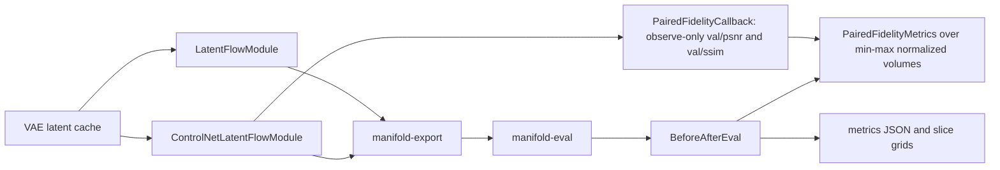

# Architecture and source map

## Component model

Manifold deliberately mirrors the diffusers vocabulary while keeping training and inference concerns separate (`CONTEXT.md`). The four components are **Model** (a network wrapper around a MONAI MAISI backbone), **Scheduler** (the rectified-flow transport and its reverse step), **Module** (the training-only `spt.Module`), and **Pipeline** (noise + conditions → a decoded volume). Each has a manifold-owned base class — nothing in the tree subclasses the `diffusers` library (ADR-0001). The domain vocabulary behind those names (JiT, transport, `scale_factor`, conditioning, ControlNet, paired fidelity, frozen arm, Experiment vs Component config) is defined once in the [domain glossary](concepts.md); this page records only where each piece lives.

| Layer | Responsibility | Primary sources |
|---|---|---|
| Models | Thin wrappers around MONAI MAISI VAE/UNet/ControlNet implementations plus PatchGAN reward scoring. The VAE owns latent scaling and sliding-window encode/decode. | `src/manifold/models/` |
| Schedulers | Rectified-flow transport, timestep/sigma grids, model-input scaling, Heun integration, and the stochastic GRPO SDE transition. They contain no training loop. | `src/manifold/schedulers/` |
| Modules | stable-pretraining training components: objectives, optimizer/schedule wiring, rollout and validation steps for JiT, the supervised ControlNet translator, reward, and GRPO. | `src/manifold/modules/` |
| Pipelines | Native inference composition of UNet, ControlNet (or frozen UNet plus ControlNet), scheduler, and VAE, with `save_pretrained`/`from_pretrained`. | `src/manifold/pipelines/` |
| Training orchestration | CLI parsing, config composition, data warming, the `CallbackRegistry` + `TrainingSpine` assembly pipeline, Lightning trainer construction, checkpointing, and export. | `src/manifold/training/`, `src/manifold/metrics/` |
| Metrics callbacks | Per-epoch FID, latent-space x0-MAE, the observe-only paired-fidelity monitor, GRPO reward, and automatic metrics line-chart rendering. | `src/manifold/metrics/`, `src/manifold/training/metrics.py` |
| In-training paired fidelity | `PairedFidelityCallback` — the observe-only `val/psnr` / `val/ssim` monitor for the supervised ControlNet stage (ADR-0037) — plus its registry spec `PairedFidelitySpec`, which the supervised shell registers by default. | `src/manifold/metrics/paired_callback.py`, `src/manifold/training/callbacks/paired_fidelity.py` |
| VRAM staging | `VaeStage` — the single VAE-only stage/restore path (the VAE lives on CPU during training, moves to the device for a decode, and is restored afterwards). `VramStage` composes it and adds only the FID-specific feature-net work. | `src/manifold/metrics/vae_stage.py`, `src/manifold/metrics/fid/vram.py` |
| Offline evaluation and reporting | `manifold-eval` policy routing, same-noise before/after generation, shared decode normalization, MONAI paired PSNR/SSIM, 2.5D slice grids, and self-contained HTML comparison. | `src/manifold/eval/`, `src/manifold/metrics/paired.py`, `src/manifold/pipelines/pipeline_utils.py` |

The shared rollout primitives are intentional: training-time sampling and native inference delegate to the same sampler behavior rather than maintaining parallel integrators (`src/manifold/modules/sampler.py`, `controlnet_sampler.py`; ADR-0005).

*Figure: Training and native artifacts converge at export. The supervised ControlNet stage additionally emits the in-training monitor, and both it and the offline eval path score through the same metric and the same normalization.*

## Runtime flows

### Noise-to-data JiT

A frozen VAE encodes volumes into an unscaled cache. The data layer estimates a single [`scale_factor`](concepts.md) and applies it on read. `LatentFlowModule` trains the conditional UNet to predict the clean latent from interpolated noise, while `FlowMatchHeunDiscreteScheduler` owns transport and integration. `LatentFlowPipeline` starts inference from Gaussian noise, applies optional interval-restricted classifier-free guidance, integrates from `t=0` to `t=1`, and decodes the result.

Start with:

- `src/manifold/data/latent_pipeline.py`, `latent_dataset.py`, `warm_datamodule.py`
- `src/manifold/modules/latent_flow.py`, `sampler.py`
- `src/manifold/schedulers/scheduling_flow_match_heun.py`
- `src/manifold/pipelines/latent_flow.py`
- `src/manifold/training/cli.py`

### Supervised paired translator (ControlNet)

The paired `x_src -> x_tgt` translator is a [ControlNet](concepts.md): a trainable adapter over a frozen JiT base UNet — see the component model above and `docs/adr/0026-controlnet-via-monai-native-residual-interface.md`, `0027-controlnet-supervised-then-grpo-two-stage.md`. The ControlNet consumes `concat([z_t, x_src, src_label, tgt_label])` and emits per-block residuals that the frozen base consumes through an out-of-place forward (in-place adds would break the grad-bearing residual path). The frozen base UNet is held **registered + dual-excluded** via [`FrozenArmMixin`](frozen-arm-and-device-policy.md#frozenarmmixin-register--dual-exclude) (ADR-0031 A1): registered so Lightning owns device placement, dual-excluded (`requires_grad=False` + `state_dict` strip + `train()` re-eval) so it is off the optimizer and off the checkpoint. The ControlNet's (src, tgt) contrast embeddings combine through `concat([embed(src), embed(tgt+offset)])` with the optional `paired_direction_offset` flipping the symmetry. The supervised loss is the `(1 - t)^-2`-weighted x0-MSE the base itself was trained with (ADR-0002 / ADR-0027).

The paired reward pipeline was deleted in ADR-0034 (paired-reward CLI, condition-aware `2·C` reward, offline pair precompute); the ControlNet path no longer needs a condition-aware reward because translation fidelity now comes from `x_src` conditioning + supervised init + the KL anchor, and the *single* realism reward ([`RewardModel`](concepts.md), `C_latent`, partial-denoise pairs) scores `z_K` unconditionally for both GRPO policies.

BraTS-specific code groups volumes by subject and contrast, creates subject-disjoint splits, and enumerates all ordered non-self pairs. The dataset contract itself remains generic: source/target latents, labels, and spacing. The shared two-way subject splitter `_train_val_manifests` lives in `src/manifold/data/paired_manifests.py` (relocated from the deleted paired-reward CLI, consumed by `controlnet_cli` and `grpo_cli`).

The active supervised checkpoint monitor remains latent-space `val/x0_mae`. The observe-only fixed-subset `val/psnr` / `val/ssim` monitor accepted by ADR-0037 **is shipped**: `manifold-train-controlnet` registers the `paired_fidelity` spec by default, so the stage logs both metrics on every gated validation epoch while checkpoint selection stays on `val/x0_mae`.

`PairedFidelityCallback` (`src/manifold/metrics/paired_callback.py`) is that monitor. On each gated epoch it selects a fixed, seeded paired subset, generates the translated target through the module's own full Heun rollout (`ControlNetLatentFlowModule.sample` → the shared `controlnet_rollout` primitive, so validation cannot drift from inference), VAE-decodes the generated and the real target through the staged VAE, normalizes both per-sample to `[0, 1]`, and scores them with the same `PairedFidelityMetrics` the offline comparison uses — the in-training curve and the offline number are directly comparable. The monitor is observe-only by construction: it runs under `inference_mode` (no gradient is ever formed), never enters the loss, and never drives checkpoint selection. Its knobs (`subset_size`, `every_n_epochs`, `num_inference_steps`, `seed`) are dataclass fields on `PairedFidelitySpec`, so the registry rejects an unknown knob at config time; the rollout step count is **recipe-primary** — `build` reads `num_inference_steps` from `CallbackContext.inference_recipe`, which the supervised shell fills from the existing `controlnet.num_inference_steps` knob (default 15), with the spec's own value as an optional per-callback override.

Two runtime properties follow from that wiring. The paired validation subset is resolved **lazily** at the first gated epoch (`getattr(datamodule, "val_latent_ds", datamodule)`), so the cold path's post-`setup()` replacement of the warmed validation dataset is honored. Under DDP every rank runs the monitor redundantly on the same fixed subset under the same seeded noise (DDP-synchronized weights ⇒ identical result), so the only cross-rank interaction is Lightning's torchmetrics sync — no FID-style sharding or error-rendezvous machinery (ADR-0037).

Start with:

- `src/manifold/data/paired_brats.py`, `paired_volume_dataset.py`, `paired_latent_dataset.py`, `paired_manifests.py`
- `src/manifold/models/controlnet_3d.py`
- `src/manifold/modules/controlnet_latent_flow.py`, `controlnet_sampler.py`
- `src/manifold/pipelines/controlnet_latent_flow.py`
- `src/manifold/metrics/paired_callback.py`, `paired.py`, `vae_stage.py`
- `src/manifold/training/callbacks/paired_fidelity.py`
- `src/manifold/training/controlnet_cli.py`
- `configs/train/config_controlnet_supervised.yaml`

### Reward and policy post-training

`RewardModel` wraps a MONAI PatchGAN discriminator and pools its output to a scalar. Reward training learns a mode-agnostic realism score from partial-denoise corruption pairs. The unified `GRPOModule` can optimize either the JiT UNet policy or a warm-started ControlNet on a frozen base UNet; both paths fork stochastic transitions and score the terminal latent `z_K` unconditionally with the *same* reward before applying the clipped group-relative objective. The policy is inferred from the native artifact passed to `--native-dir`, not a flag. For the ControlNet path, translation fidelity comes from `x_src` conditioning, supervised initialization, and the KL anchor rather than a separate condition-aware reward (ADR-0034 deleted the paired-reward pipeline). See the operational routing and recipe contract in [Reward and GRPO stages](workflows.md#reward-and-grpo-stages).

Start with `src/manifold/models/reward_model.py`, `src/manifold/modules/{reward,grpo}.py`, `src/manifold/modules/controlnet_sampler.py`, and `src/manifold/training/{reward_cli,grpo_cli,controlnet_cli}.py`.

### Before/after GRPO evaluation

The shipped `manifold-eval` command exports the post-GRPO checkpoint against the before export's component structure, reloads both artifacts, and sends them through `BeforeAfterEval`. The driver creates identical initial noise and conditioning for each seed, decodes every latent with the frozen VAE, and applies the shared `min_max_to_unit` contract. JiT emits a `before | after` provenance-only metric record; ControlNet additionally scores each generated target against its real target with MONAI 3D PSNR/SSIM. One 2.5D three-plane grid is written per sample. The offline path reuses the same metric class and the same `min_max_to_unit` normalization as the in-training monitor, so the two measurements stay comparable; the offline pass remains the apples-to-apples pairing of record (ADR-0036). See [Before/after GRPO evaluation](evaluation.md#runtime-flow) for the runtime sequence, public API, and artifact schema.

Start with `src/manifold/eval/cli.py`, `src/manifold/eval/before_after.py`, `src/manifold/eval/comparison_page.py`, `src/manifold/metrics/paired.py`, and `src/manifold/pipelines/pipeline_utils.py`.

## Configuration and persistence

Experiment YAML is composed by `src/manifold/config/loader.py` and built into components by `builder.py`. Later top-level blocks replace earlier ones unless `_base_` explicitly requests inheritance. This launch-time OmegaConf layer ([Experiment config](concepts.md)) is separate from persisted component JSON ([Component config](concepts.md)) handled by `src/manifold/configuration.py`.

Callback knobs sit between the two: the registry's `resolve` accepts a `{callback_name: {knob: value}}` map and rejects an unknown knob for a known callback with a `ValueError` before any callback is constructed (`src/manifold/training/callbacks/registry.py`).

Native inference directories contain component configuration/weights (including `model_index.json` and component subdirectories). Lightning `.ckpt` files are training state and are not loaded directly by pipelines; export is the bridge. `manifold-eval` depends on this boundary: its before directory supplies the loadable policy template and self-described `pipeline_class`, while the existing export bridge bakes the after `.ckpt` into `<output>/after_native`. The eval CLI therefore infers JiT versus ControlNet from the artifact rather than accepting a policy flag. See [Checkpoint and export contract](workflows.md#checkpoint-and-export-contract) and the eval [policy dispatch contract](evaluation.md#policy-dispatch-and-artifact-contract).

## Change guidance

- **Transport/integration:** change the scheduler and shared sampler path together; run scheduler, pipeline, and module tests to prevent train/inference drift.
- **Latent scaling:** preserve VAE ownership and the unscaled-cache contract; check VAE, data, persistence, and pipeline tests.
- **Paired conditioning/pairing:** keep BraTS discovery outside the generic dataset contract and preserve subject-level split isolation.
- **Paired fidelity/evaluation:** preserve the `min_max_to_unit` → `PairedFidelityMetrics(data_range=1.0)` ordering and the same-noise before/after contract across the pipeline, the offline eval, and the shipped in-training monitor. A normalization, artifact, or report-schema change is a cross-component change, not a local patch — the monitor and the offline pass must not diverge.
- **In-training monitor:** the paired-fidelity callback is observe-only. It may be re-tuned (subset size, cadence, rollout steps), but it must not enter the loss or become the checkpoint monitor; `val/x0_mae` stays the supervised selector. Keep the rollout step count recipe-primary (`controlnet.num_inference_steps` → `CallbackContext.inference_recipe`) rather than forking a second source of truth, and remember that `--callbacks` / the YAML `callbacks:` list *replaces* the default name set — dropping `paired_fidelity` there silently removes the monitor.
- **VRAM staging:** `VaeStage` is the single VAE stage/restore implementation and `VramStage` composes it. A new decode path must use `VaeStage` rather than re-implementing a snapshot/move/restore cycle, and must not assume the VAE stays on the device after the block.
- **Metrics:** distinguish per-rank accumulation from global reduction. Manual all-reduced metrics must not also use `sync_dist`, or they will be reduced twice.
- **Checkpoint behavior:** update training callbacks, export, downstream frozen-generator loaders, and tests as one contract.
- **Frozen arms:** new frozen-arm wiring MUST go through `FrozenArmMixin._register_frozen_arm`, not via `object.__setattr__` or any custom state-dict override — the mixin is the single owner of the register + dual-exclude contract (ADR-0031 A1). The frozen arms stay in `parameters()` (Lightning owns device placement) but carry no grad and emit no checkpoint key.
- **Per-rank device:** shells MUST resolve the per-rank CUDA device through `DevicePolicy.pin()` (pre-PG) and `DevicePolicy.warm_device(fallback)` (post-PG VAE warm); do not reintroduce the inline `set_device` twin, the bare `torch.device("cuda" if torch.cuda.is_available() else "cpu")` in the controlnet path, or `manifold.data.latent_pipeline.resolve_warm_device` (ADR-0035).
- **Callbacks:** new callbacks MUST go through the `CallbackRegistry` two-phase resolve/build; the `TrainingSpine.run` merge order is the single source of truth for which callbacks fire, which knobs apply, and which monitors are allowed (ADR-0029 / ADR-0032).

For component-level change navigation (entry points, focused tests, minimal validation), see the [Quickstart task routing](quickstart.md#task-routing) and the stage-level table in [Workflows change navigation](workflows.md#change-navigation).
