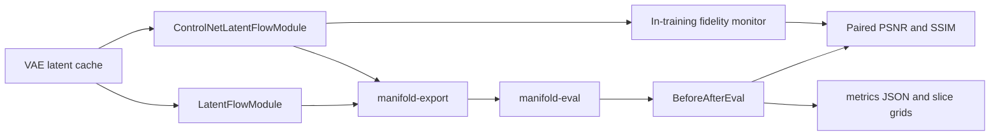

# Architecture and source map

## Component model

Manifold deliberately mirrors the diffusers vocabulary while keeping training and inference concerns separate (`CONTEXT.md`).

| Layer | Responsibility | Primary sources |
|---|---|---|
| Models | Thin wrappers around MONAI MAISI VAE/UNet/ControlNet implementations plus PatchGAN reward scoring. The VAE owns latent scaling and sliding-window encode/decode. | `src/manifold/models/` |
| Schedulers | Rectified-flow transport, timestep/sigma grids, model-input scaling, Heun integration, and stochastic GRPO/bridge transitions. They contain no training loop. | `src/manifold/schedulers/` |
| Modules | stable-pretraining training components: objectives, optimizer/schedule wiring, rollout and validation steps for JiT, the supervised ControlNet translator, reward, and GRPO — plus the shared `FrozenArmMixin` frozen-arm contract. | `src/manifold/modules/` |
| Pipelines | Native inference composition of UNet, ControlNet (or frozen UNet plus ControlNet), scheduler, and VAE, with `save_pretrained`/`from_pretrained`. | `src/manifold/pipelines/` |
| Training orchestration | CLI parsing, config composition, data warming, the `CallbackRegistry` + `TrainingSpine` assembly pipeline, Lightning trainer construction, checkpointing, and export. | `src/manifold/training/`, `src/manifold/metrics/` |
| Metrics callbacks | Per-epoch FID, latent-space x0-MAE, GRPO reward, automatic metrics line-chart rendering, and the observe-only in-training paired-fidelity monitor (`val/psnr` / `val/ssim`). | `src/manifold/metrics/`, `src/manifold/training/metrics.py` |
| Offline evaluation and reporting | `manifold-eval` policy routing, same-noise before/after generation, shared decode normalization, MONAI paired PSNR/SSIM, 2.5D slice grids, and self-contained HTML comparison. | `src/manifold/eval/`, `src/manifold/metrics/paired.py`, `src/manifold/pipelines/pipeline_utils.py` |

The shared rollout primitives are intentional: training-time sampling and native inference delegate to the same sampler behavior rather than maintaining parallel integrators (`src/manifold/modules/sampler.py`, `controlnet_sampler.py`; ADR-0005).

The in-training paired-fidelity monitor is deliberately **not** a parallel implementation either: it reuses `VaeStage`, `LatentDecoder`, `min_max_to_unit`, and `PairedFidelityMetrics` — the same helpers the offline before/after comparison uses — so an in-training curve and an offline number stay comparable (ADR-0036 / ADR-0037).

*Figure: Trained artifacts converge at export for the offline before/after evaluation, while the supervised ControlNet path also feeds the in-training paired-fidelity monitor; both score with the same paired metric.*

## Runtime flows

### Noise-to-data JiT

A frozen VAE encodes volumes into an unscaled cache. The data layer estimates a single scaling factor and applies it on read. `LatentFlowModule` trains the conditional UNet to predict the clean latent from interpolated noise, while `FlowMatchHeunDiscreteScheduler` owns transport and integration. `LatentFlowPipeline` starts inference from Gaussian noise, applies optional interval-restricted classifier-free guidance, integrates from `t=0` to `t=1`, and decodes the result.

Start with:

- `src/manifold/data/latent_pipeline.py`, `latent_dataset.py`, `warm_datamodule.py`
- `src/manifold/modules/latent_flow.py`, `sampler.py`
- `src/manifold/schedulers/scheduling_flow_match_heun.py`
- `src/manifold/pipelines/latent_flow.py`
- `src/manifold/training/cli.py`

### Supervised paired translator (ControlNet)

The paired `x_src -> x_tgt` translator is a **trainable ControlNet on a frozen JiT base UNet** — see the component model above and `docs/adr/0026-controlnet-via-monai-native-residual-interface.md`, `0027-controlnet-supervised-then-grpo-two-stage.md`. The ControlNet consumes the noised target latent `z_t` plus the source latent `x_src` (embedded and added to the input embedding) and the (src, tgt) contrast pair, whose label embeddings combine through `concat([embed(src), embed(tgt+offset)])` with the optional `paired_direction_offset` shifting the target label. It emits per-block residuals that the frozen base consumes through an out-of-place forward (in-place adds would break the grad-bearing residual path); the base itself is conditioned only on the target label. The frozen base UNet is held **registered + dual-excluded** via [`FrozenArmMixin`](frozen-arm-and-device-policy.md#frozenarmmixin-register--dual-exclude) (ADR-0031 A1): registered so Lightning owns device placement, dual-excluded (`requires_grad=False` + `state_dict` strip + `train()` re-eval) so it is off the optimizer and off the checkpoint. The supervised loss is the `(1 - t)^-2`-weighted x0-MSE the base itself was trained with (ADR-0002 / ADR-0027).

The paired reward pipeline was deleted in ADR-0034 (paired-reward CLI, condition-aware `2·C` reward, offline pair precompute); the ControlNet path no longer needs a condition-aware reward because translation fidelity now comes from `x_src` conditioning + supervised init + the KL anchor, and the *single* realism reward (`RewardModel`, `C_latent`, partial-denoise pairs) scores `z_K` unconditionally for both GRPO policies.

BraTS-specific code groups volumes by subject and contrast, creates subject-disjoint splits, and enumerates all ordered non-self pairs. The dataset contract itself remains generic: source/target latents, labels, and spacing. The shared two-way subject splitter `_train_val_manifests` lives in `src/manifold/data/paired_manifests.py` (relocated from the deleted paired-reward CLI, consumed by `controlnet_cli` and `grpo_cli`).

The supervised checkpoint monitor remains latent-space `val/x0_mae`. ADR-0037's paired-fidelity monitor **is implemented and on by default** in this stage: `PairedFidelityCallback` (`src/manifold/metrics/paired_callback.py`) is registered by `manifold-train-controlnet` as the `paired_fidelity` callback via `PairedFidelitySpec` (`src/manifold/training/callbacks/paired_fidelity.py`), and it logs `val/psnr` / `val/ssim` while checkpoint selection stays on `val/x0_mae`. It is observe-only: it never enters the loss, never touches the optimizer or EMA, and never claims the checkpoint.

#### In-training paired-fidelity monitor

On every gated validation epoch the monitor:

1. resolves the paired validation dataset **lazily** — `getattr(datamodule, "val_latent_ds", datamodule)` — so the cold path's post-`setup()` replacement of `val_latent_ds` is honored (F5);
2. selects a **fixed** seeded subset (`subset_size`, default 8) once and caches it, so an epoch-over-epoch change reflects the model, not a moving data sample;
3. draws freshly seeded noise and runs the module's **own full Heun rollout** (`ControlNetLatentFlowModule.sample` → `controlnet_rollout`) under `torch.inference_mode`, so no gradient is ever formed;
4. decodes the generated and the real target latent through `LatentDecoder` while `VaeStage` stages the VAE onto the device (VAE-only staging: CPU → device → CPU);
5. normalizes both volumes per sample with `min_max_to_unit` and scores them with `PairedFidelityMetrics` (MONAI 3D PSNR/SSIM, `data_range=1.0`);
6. logs `val/psnr` / `val/ssim` through two module-attached `torchmetrics.MeanMetric`s that are reset each epoch, so the logged value is the current epoch's rather than an accumulation.

No parallel machinery is introduced: `VaeStage`, `LatentDecoder`, `min_max_to_unit`, and `PairedFidelityMetrics` are the same helpers the offline before/after comparison uses, so the in-training curve and the offline number are directly comparable (ADR-0036 / ADR-0037).

The rollout step count is **recipe-primary**: `controlnet.num_inference_steps` (default 15) is read by the CLI, passed through `CallbackContext.inference_recipe`, and taken by `PairedFidelitySpec.build`; an explicit per-callback `num_inference_steps` knob overrides it. Under DDP every rank evaluates the same fixed subset redundantly (identical weights, identical seeded noise, identical input), so the cross-rank reduction is just Lightning's torchmetrics sync — no sharding and no error-rendezvous machinery.

The offline comparison this monitor mirrors is documented in [Before/after GRPO evaluation](evaluation.md#runtime-flow); the registry surface a callback change must respect is in [Callback registry and training spine](callback-registry.md#change-guidance).

Start with:

- `src/manifold/data/paired_brats.py`, `paired_volume_dataset.py`, `paired_latent_dataset.py`, `paired_manifests.py`
- `src/manifold/models/controlnet_3d.py`
- `src/manifold/modules/controlnet_latent_flow.py`, `controlnet_sampler.py`
- `src/manifold/pipelines/controlnet_latent_flow.py`
- `src/manifold/training/controlnet_cli.py`, `src/manifold/training/callbacks/paired_fidelity.py`
- `src/manifold/metrics/paired_callback.py`, `src/manifold/metrics/paired.py`, `src/manifold/metrics/vae_stage.py`
- `configs/train/config_controlnet_supervised.yaml`

### Reward and policy post-training

`RewardModel` wraps a MONAI PatchGAN discriminator and pools its output to a scalar. Reward training learns a mode-agnostic realism score from partial-denoise corruption pairs. The unified `GRPOModule` can optimize either the JiT UNet policy or a warm-started ControlNet on a frozen base UNet; both paths fork stochastic transitions and score the terminal latent `z_K` unconditionally with the *same* reward before applying the clipped group-relative objective. The policy is inferred from the native artifact passed to `--native-dir`, not a flag. For the ControlNet path, translation fidelity comes from `x_src` conditioning, supervised initialization, and the KL anchor rather than a separate condition-aware reward (ADR-0034 deleted the paired-reward pipeline). See the operational routing and recipe contract in [Reward and GRPO stages](workflows.md#reward-and-grpo-stages).

The paired-fidelity monitor is **not** registered on the GRPO stage: extending it there is a deliberate follow-up (ADR-0037). On that stage the unconditional FID callback is instead skipped for a ControlNet policy and force-removed post-merge through `TrainingSpine`'s `forbidden_callbacks` / `forbidden_monitors`, and checkpoint selection uses the conditional `val/mean_reward`.

Start with `src/manifold/models/reward_model.py`, `src/manifold/modules/{reward,grpo}.py`, `src/manifold/modules/controlnet_sampler.py`, and `src/manifold/training/{reward_cli,grpo_cli,controlnet_cli}.py`.

### Before/after GRPO evaluation

The shipped `manifold-eval` command exports the post-GRPO checkpoint against the before export's component structure, reloads both artifacts, and sends them through `BeforeAfterEval`. The driver creates identical initial noise and conditioning for each seed, decodes every latent with the frozen VAE, and applies the shared `min_max_to_unit` contract. JiT emits a `before | after` provenance-only metric record; ControlNet additionally scores each generated target against its real target with MONAI 3D PSNR/SSIM. One 2.5D three-plane grid is written per sample. See [Before/after GRPO evaluation](evaluation.md#runtime-flow) for the runtime sequence, public API, and artifact schema; the observe-only in-training counterpart of that comparison is described in the supervised section above.

Start with `src/manifold/eval/cli.py`, `src/manifold/eval/before_after.py`, `src/manifold/eval/comparison_page.py`, `src/manifold/metrics/paired.py`, and `src/manifold/pipelines/pipeline_utils.py`.

## Configuration and persistence

Experiment YAML is composed by `src/manifold/config/loader.py` and built into components by `builder.py`. Later files replace earlier **top-level** blocks wholesale (so a later recipe's `diffusion_unet` block never keeps stale sub-keys), while `_base_` is the explicit per-file inheritance layer that deep-merges inside a single file. CLI `--<key>` flags and Hydra-style dotlist overrides layer on top, dotlist last. This launch-time OmegaConf layer is separate from persisted component JSON handled by `src/manifold/configuration.py` — the composed config builds components at launch and never persists.

Native inference directories contain component configuration/weights (including `model_index.json`, which names the `pipeline_class` and its components, and one subdirectory per component). Lightning `.ckpt` files are training state and are not loaded directly by pipelines; export is the bridge. `manifold-eval` depends on this boundary: its before directory supplies the loadable policy template and self-described `pipeline_class`, while the existing export bridge bakes the after `.ckpt` into `<output>/after_native`. The eval CLI therefore infers JiT versus ControlNet from the artifact rather than accepting a policy flag. See [Checkpoint and export contract](workflows.md#checkpoint-and-export-contract) and the eval [policy dispatch contract](evaluation.md#policy-dispatch-and-artifact-contract).

## Change guidance

- **Transport/integration:** change the scheduler and shared sampler path together; run scheduler, pipeline, and module tests to prevent train/inference drift.
- **Latent scaling:** preserve VAE ownership and the unscaled-cache contract; check VAE, data, persistence, and pipeline tests.
- **Paired conditioning/pairing:** keep BraTS discovery outside the generic dataset contract and preserve subject-level split isolation. The ControlNet embeds `x_src` and adds it to the input embedding — do not reintroduce a channel concat of `z_t` and `x_src` without changing the model contract.
- **Paired fidelity/evaluation:** preserve the `min_max_to_unit` → `PairedFidelityMetrics(data_range=1.0)` ordering and same-noise before/after contract across the pipeline, the offline eval driver, and the shipped in-training monitor (`PairedFidelityCallback`). A normalization, artifact, or report-schema change is a cross-component change, not a local patch.
- **In-training monitor scope:** the monitor is observe-only. Do not move checkpoint selection onto `val/psnr` / `val/ssim`, add either scalar to the loss, or register `paired_fidelity` on the ControlNet-GRPO stage without a separate decision (ADR-0037). Its rollout step count stays recipe-primary (`controlnet.num_inference_steps`); the spec's own `num_inference_steps` is an override, not a second source of truth.
- **Metrics:** distinguish per-rank accumulation from global reduction. Manual all-reduced metrics must not also use `sync_dist`, or they will be reduced twice.
- **Checkpoint behavior:** update training callbacks, export, downstream frozen-generator loaders, and tests as one contract.
- **Frozen arms:** new frozen-arm wiring MUST go through `FrozenArmMixin._register_frozen_arm`, not via `object.__setattr__` or any custom state-dict override — the mixin is the single owner of the register + dual-exclude contract (ADR-0031 A1). The frozen arms stay in `parameters()` (Lightning owns device placement) but carry no grad and emit no checkpoint key.
- **Per-rank device:** shells MUST resolve the per-rank CUDA device through `DevicePolicy.pin()` (pre-PG) and `DevicePolicy.warm_device(fallback)` (post-PG VAE warm); do not reintroduce the inline `set_device` twin, the bare `torch.device("cuda" if torch.cuda.is_available() else "cpu")` in the controlnet path, or `manifold.data.latent_pipeline.resolve_warm_device` (ADR-0035).
- **Callbacks:** new callbacks MUST go through the `CallbackRegistry` two-phase resolve/build; the `TrainingSpine.run` merge order is the single source of truth for which callbacks fire, which knobs apply, and which monitors are allowed (ADR-0029 / ADR-0032).

For component-level change navigation (entry points, focused tests, minimal validation), see the [Quickstart task routing](quickstart.md#task-routing) and the stage-level table in [Workflows change navigation](workflows.md#change-navigation).
