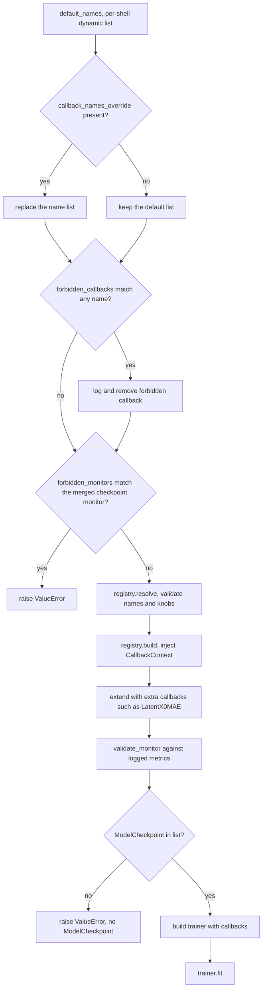

# Callback registry and training spine

`CallbackRegistry` (ADR-0029) is the typed name → spec dispatcher that replaced
the ad-hoc `_build_callbacks` / `_build_checkpoint` clones that used to live in
every training CLI. `TrainingSpine` (ADR-0032) is the **single caller** of that
registry: it owns the `assemble → resolve → build → validate → trainer → fit`
sequence, plus the post-merge `forbidden_callbacks` / `forbidden_monitors` guards
that let a shell drop a callback no YAML or `--callbacks` override can re-enable.
Every training CLI now ends with `spine.run(...)`; the CLI's only responsibility
left is seeding, building the module + datamodule, and computing its dynamic
default callback-name set.

This page documents the spec contract, the two-phase construction, the
post-resolve monitor validation, and the spine's merge order — the load-bearing
pieces of any callback addition, knob rename, or "drop FID on the GRPO ControlNet
path" change. The **second generative spec** — `PairedFidelitySpec` (ADR-0037) —
is part of that surface: it is registered by the supervised ControlNet shell and
logs `val/psnr` / `val/ssim` observe-only, next to `FIDSpec`.

For the surrounding component map see [Architecture and source map](architecture.md);
for how these tests are run see [Operations and testing](operations-and-testing.md).

## Spec contract

Every callback registered with the registry is a `@dataclass` class with two
things (`src/manifold/training/callbacks/registry.py`):

1. **Knobs as dataclass fields** (with defaults). The field set is the
   allow-list used by `CallbackRegistry.resolve` to reject unknown knobs with a
   loud `ValueError` before any `pl.Callback` is built.
2. **A `build(self, ctx: CallbackContext) -> pl.Callback` method** that takes
   the runtime-objects bag and returns a constructed Lightning callback.

`CallbackRegistry.register(name, spec_cls)` refuses anything that is not a
`@dataclass` class (`TypeError`) — the knobs-as-fields rule is what makes the
unknown-knob allow-list well-defined.

Specs match the `CallbackSpec` Protocol structurally — no inheritance
(`manifold.training.callbacks.registry.CallbackSpec`). A spec may optionally
expose:

- `logged_metrics: frozenset[str]` — the metrics the built callback logs. Used
  by `validate_monitor` so a `CheckpointSpec.monitor_metric` resolves against the
  full set of metric emitters, not just the registry ones. It is declared as a
  **`ClassVar`** in every built-in spec, so it never enters the knob set that
  `resolve` validates against.
- `monitor_metric: str | None` — the special-case field `validate_monitor`
  scans for. Only `CheckpointSpec` declares it.

## Two-phase construction

ADR-0029 splits spec instantiation from callback construction because
generative callbacks such as FID need runtime objects (the VAE, inference
recipe, and feature network) that do not exist at config resolution. ADR-0037
accepts the same construction shape for the in-training paired PSNR/SSIM
callback, and **that spec now exists and is registered**: the supervised
ControlNet shell registers `paired_fidelity` → `PairedFidelitySpec`
(`src/manifold/training/controlnet_cli.py`). The GRPO shell still registers only
`train_loss`, `fid` and `checkpoint` — the paired monitor is deliberately *not*
registered there (ADR-0037 treats the ControlNet-GRPO extension as a separate
follow-up).

- **`CallbackRegistry.resolve(names, cfg)` (config-time)** — validates the
  requested name list and the per-name knob dict, then returns constructed spec
  instances in `names` order. Unknown name → `KeyError` with the registered
  set; unknown knob for a known name → `ValueError` with the allowed set.
  The list is **rank-symmetric** by contract (every DDP rank gets the same CLI
  args from `torchrun`).
- **`CallbackRegistry.build(specs, ctx)` (fit-prep)** — injects the runtime
  `CallbackContext` (the module, VAE, datamodule, inference recipe, model dir,
  seed, optional lazy `feature_net_factory`, optional `real_latents`) and
  returns the constructed `pl.Callback` list.

A callback that needs neither a knob nor a runtime object (e.g. `TrainLossSpec`)
is fine with empty fields and an empty `ctx`; the registry does not enforce a
minimum surface.

`CallbackContext.inference_recipe` is the recipe slot the generative specs read.
On the supervised ControlNet path it is **no longer `None`**: the shell fills it
with `{"num_inference_steps": int(num_inference_steps)}` — the existing
`controlnet.num_inference_steps` knob (default 15) — so the paired-fidelity spec
can take its rollout step count from the recipe. The JiT shell fills it only
when the FID callback is attached; the reward shell leaves it `None`; the GRPO
shell fills it with the full FID sampling recipe only when the FID triple is
active.

## Post-resolve monitor validation

`CallbackRegistry.validate_monitor(specs, module, extra_callbacks=None)` runs
**after** resolve/build, **before** the trainer is built. The contract:

- If no checkpoint spec is present, or its `monitor_metric` is `None`
  (the unmonitored periodic / last path), validation is a no-op — absence is the
  intended fallback when no held-out validation is wired.
- Otherwise the `monitor_metric` must be present in the union of:
  - every spec's `logged_metrics` (the registry path),
  - the `module.logged_metrics` attribute (the Module-declared path: GRPO's
    `val/mean_reward`, the reward module's `val/gen_pair_acc`),
  - every `extra_callbacks` member's `logged_metrics` (the hand-appended path:
    `LatentX0MAE`'s `val/x0_mae`, see `src/manifold/training/metrics.py`).

A `monitor_metric` that is logged by nobody raises `ValueError` with the
available set — so Lightning does not error mid-fit on a never-logged monitor.

This validation is the safety net behind the GRPO ControlNet fid guard (see
below) and behind the `tests/test_callback_registry.py` monitor tests.

Because `PairedFidelitySpec` declares `logged_metrics = {"val/psnr",
"val/ssim"}`, those two metrics are *validatable* monitors: a checkpoint may name
them and validation will pass. The declaration is **not** a switch — the
supervised shell's default `checkpoint.monitor_metric` stays `val/x0_mae`, so
selecting on PSNR/SSIM remains an explicit, separate decision (ADR-0037:
observe-only first).

## Built-in specs

| Spec | Knobs (defaults) | Built callback | `logged_metrics` |
|---|---|---|---|
| `TrainLossSpec` | (none) | `TrainLossLogger` logging `train/loss_epoch` | `frozenset({"train/loss_epoch"})` |
| `FIDSpec` | `num_synth` (16), `every_n_epochs` (1), `center_slices_ratio` (0.5), `cov_ridge` (1e-6) | `FIDCallback` (rank-strided, lazy feature-net) | `frozenset({"val/fid"})` |
| `PairedFidelitySpec` | `subset_size` (8), `every_n_epochs` (1), `num_inference_steps` (`None` ⇒ recipe-primary), `seed` (0) | `PairedFidelityCallback` (observe-only fixed-subset rollout) | `frozenset({"val/psnr", "val/ssim"})` |
| `CheckpointSpec` | `monitor_metric` (`None`), `save_top_k` (3), `save_last` (`True`), `every_n_epochs` (1), `mode` (`"min"`), `filename` (`None`) | `pl.callbacks.ModelCheckpoint` (monitored vs unmonitored two branches) | n/a (`validate_monitor` reads `monitor_metric` defensively) |

`CheckpointSpec.build` reproduces the prior `_build_checkpoint` two-branch
construction: `monitor_metric=None` keeps `save_top_k=1` plus `last.ckpt` at
the `every_n_epochs` cadence (the JiT production fallback); the monitored branch
tracks `monitor_metric` top-`k` plus last. The `filename` default picks
`unet3d-{epoch:03d}-{step}-{monitor:.3f}` for the monitored path and
`unet3d-{epoch:03d}-{step}` for the unmonitored path
(`src/manifold/training/callbacks/checkpoint.py`).

`FIDSpec` and `PairedFidelitySpec` are the two **generative** specs, and they
share the same runtime surface: both read `ctx.module` / `ctx.vae` /
`ctx.datamodule` and the generation recipe from `CallbackContext`. They differ
in what they need beyond that: `FIDSpec` also takes `ctx.feature_net` /
`ctx.feature_net_factory` / `ctx.real_latents` and the FID sampling recipe
(`latent_shape`, `spacing`, `modality`, `num_inference_steps`,
`guidance_scale`, `cfg_interval`), while `PairedFidelitySpec` only needs the
rollout step count — and reads it from `ctx.inference_recipe`
(`src/manifold/training/callbacks/paired_fidelity.py`).

### The paired-fidelity spec in detail

`PairedFidelitySpec` is the registry face of the observe-only in-training
monitor `PairedFidelityCallback`
(`src/manifold/metrics/paired_callback.py`, ADR-0037):

- **Knobs** — `subset_size` (fixed paired subjects scored per monitored epoch),
  `every_n_epochs` (the FID-style cadence gate), `num_inference_steps` (the
  rollout step count), `seed` (the generation-noise + subset-selection seed).
- **Runtime objects** — `ctx.module` (its `sample()` runs the full Heun
  ControlNet rollout), `ctx.vae` (decodes generated + real target), and
  `ctx.datamodule` forwarded as `paired_data`. The paired dataset is resolved
  **lazily** at the first gated epoch (`getattr(datamodule, "val_latent_ds",
  datamodule)`), so the cold path's post-`setup()` replacement of
  `val_latent_ds` is honored — `build` never resolves it.
- **Recipe-primary step count** — when its own `num_inference_steps` knob is
  `None`, `build` reads `ctx.inference_recipe["num_inference_steps"]`; an
  explicit per-callback value overrides the recipe; with neither, the callback's
  own default (15) applies. So the recipe knob is the single source of truth and
  the spec knob is an override, not a second one.
- **Observe-only** — it logs `val/psnr` / `val/ssim` through module-attached
  `torchmetrics.MeanMetric`s and never touches the loss, the optimizer, EMA, or
  checkpoint selection. It reuses the same rollout → decode → `min_max_to_unit`
  → MONAI 3D PSNR/SSIM path as the offline before/after comparison, so the
  in-training curve and the offline number stay comparable
  ([Before/after GRPO evaluation](evaluation.md#runtime-flow)).
- **DDP** — the monitor is *redundant*, not sharded: every rank runs the same
  fixed subset under the same seeded noise on DDP-synchronized weights, so the
  only cross-rank interaction is Lightning's torchmetrics sync (no FID-style
  sharding or error-rendezvous machinery). A 2-rank gate asserts identical
  per-rank scores and no deadlock; revisit this design if the subset grows.

## TrainingSpine.run — the merge order

`TrainingSpine.run` is a single method, parameterized by named arguments rather
than a per-shell subclass (composition, not inheritance — the project's OOP
rule). The merge order is:

1. Start from `default_names` (the per-shell dynamic default callback list) —
   **unless** `callback_names_override` is given, which **replaces** the name
   list entirely (the CLI `--callbacks` flag; `resolve_callback_names` in
   `src/manifold/config/loader.py` gives the CLI string precedence over the
   YAML `callbacks:` list and returns `None` when neither is present, so the
   shell's derived list is used).
2. **`forbidden_callbacks` is applied AFTER the merge.** Each name in the map
   is force-removed from the merged list with a `rank_zero_info` log line. This
   is the load-bearing guard: a YAML knob or `--callbacks` override cannot
   re-enable a forbidden callback. The GRPO ControlNet path passes
   `forbidden_callbacks={"fid": "constant frozen-base metric"}` so the FID
   callback is dropped for that policy even if a stale recipe or an override
   lists it — a merged list of `["checkpoint", "fid"]` is trimmed back to
   `["checkpoint"]`.
3. **`forbidden_monitors` rejects a checkpoint `monitor_metric` BEFORE
   resolution.** The guard reads the merged `callback_cfg["checkpoint"]
   ["monitor_metric"]`; if it matches, a loud log precedes a `ValueError`
   instead of silently resuming on a constant metric. The same GRPO ControlNet
   path passes `forbidden_monitors={"val/fid": ...}`.
4. `registry.resolve(names, callback_cfg)` — validates names and per-name knobs
   and constructs the spec instances **in `names` order**. This is where the
   knob map (`callback_cfg`) is applied to the specs.
5. `registry.build(specs, ctx)` → inject the `CallbackContext`.
6. `extra_callbacks` (e.g. the hand-appended `LatentX0MAE`) are appended.
7. `validate_monitor(specs, module, extra_callbacks)` — the post-resolve check.
8. A `ModelCheckpoint` must survive; otherwise `ValueError`.
9. Assemble `pl.Trainer` → `trainer.fit`.

The per-shell default name lists (the `default_names` argument):

| Shell | Default names | Notes |
|---|---|---|
| JiT (`src/manifold/training/cli.py`) | `["train_loss", "fid", "checkpoint"]` | `fid` only when FID is attached (enabled **and** a held-out val split exists); otherwise the checkpoint is unmonitored |
| Reward (`src/manifold/training/reward_cli.py`) | `["checkpoint"]` | `train_loss` is registered but not in the default list |
| GRPO (`src/manifold/training/grpo_cli.py`) | `["checkpoint"]` (+ `"fid"` when the FID triple is active) | the ControlNet policy path force-drops `fid` via `forbidden_callbacks` |
| Supervised ControlNet (`src/manifold/training/controlnet_cli.py`) | `["train_loss", "checkpoint", "paired_fidelity"]` | the paired monitor is on by default; the shell's default checkpoint monitor is `val/x0_mae` |


*Figure: `TrainingSpine.run` merge order — default names → `--callbacks` override → `forbidden_callbacks` / `forbidden_monitors` → resolve (the knob map is applied here) → build → `validate_monitor` → fit.*

If no `ModelCheckpoint` survives the merge (an override dropped it),
`TrainingSpine.run` raises `ValueError("no ModelCheckpoint in resolved list")`
rather than letting `next(...)` raise `StopIteration` deeper in the call
(`tests/test_callback_registry.py::test_training_spine_fails_fast_without_checkpoint`,
codex #170 P2).

The forbidden-callbacks guard is the documented externalization of the
former "GRPO ControlNet fid" special case: it lives generically in the spine,
not in any GRPO vocabulary
(`tests/test_callback_registry.py::test_training_spine_forbidden_callbacks_force_removed_post_merge`,
ADR-0032).

## Change guidance

- **Adding a callback:** add a `@dataclass` spec under
  `src/manifold/training/callbacks/`, expose it from
  `src/manifold/training/callbacks/__init__.py`, register it in each CLI's
  `spine.registry.register(...)` block, and add a `train_loss`-style logger
  callback if it logs a monitored metric. Compose `CallbackContext` if the
  spec needs a runtime object not already in the bag.
- **Tuning the paired-fidelity spec:** the knobs are dataclass fields, so a
  **rename fails loudly** through `resolve` (`ValueError: Unknown knob(s) for
  callback 'paired_fidelity'`) — every recipe or CLI site using the old name
  must be updated in the same change. The `num_inference_steps` precedence is
  *per-callback knob → `ctx.inference_recipe["num_inference_steps"]` → the
  callback's own default (15)*: the recipe (`controlnet.num_inference_steps`)
  stays the source of truth and the spec knob is an override. Keep the callback
  **observe-only**: do not move `checkpoint.monitor_metric` onto `val/psnr` /
  `val/ssim`, do not add either scalar to the loss, and do not register
  `paired_fidelity` on the ControlNet-GRPO stage without a separate decision
  (ADR-0037). Declaring `logged_metrics` only makes the metrics *validatable*;
  it is not the switch that turns them on as a monitor.
- **Renaming a knob:** rename the dataclass field. `resolve` will start
  rejecting the old name in any recipe that still uses it — that loud
  `ValueError` is the contract's signal that all recipe sites need an update.
- **Adding a knob with a non-default:** same as above; recipes that omit it
  inherit the new default.
- **Dropping a callback for one policy:** prefer `forbidden_callbacks` over
  hard-coding the absent name into `default_names`. The forbidden map is the
  loud, post-merge, override-resistant guard.
- **Adding a new monitored metric:** make sure the emitting side declares it
  either as a spec's `logged_metrics` (as a `ClassVar`, so it is not a knob),
  the module's `logged_metrics`, or an `extra_callbacks` member's
  `logged_metrics`. Otherwise `validate_monitor` rejects any checkpoint that
  monitors it.

## Source map

- Spec contract + registry: `src/manifold/training/callbacks/registry.py`
- Runtime objects bag: `src/manifold/training/callbacks/context.py`
- Built-in specs: `src/manifold/training/callbacks/{train_loss,fid,checkpoint,paired_fidelity}.py`
- Spec barrel: `src/manifold/training/callbacks/__init__.py`
- Spine implementation: `src/manifold/training/core.py`
- CLI callers:
  - `src/manifold/training/cli.py` (JiT)
  - `src/manifold/training/reward_cli.py`
  - `src/manifold/training/grpo_cli.py` (uses `forbidden_callbacks` /
    `forbidden_monitors` on the ControlNet policy path)
  - `src/manifold/training/controlnet_cli.py` (registers `paired_fidelity`)
- Callback-name resolution (CLI over YAML): `src/manifold/config/loader.py`
- Paired-fidelity callback implementation: `src/manifold/metrics/paired_callback.py`
- Hand-appended non-registry callbacks: `src/manifold/training/metrics.py`
- Trainer builder (called by the spine): `src/manifold/training/trainer.py`
- Decision records: `docs/adr/0029-callback-registry.md`,
  `docs/adr/0032-cli-spine-collapse.md`,
  `docs/adr/0037-controlnet-fidelity-in-training-monitor.md`

## Focused tests

- `tests/test_callback_registry.py::test_resolve_fails_fast_on_unknown_name`,
  `test_resolve_fails_fast_on_unknown_knob_for_known_name`,
  `test_unknown_knob_against_fielded_spec` — config-time validation
- `tests/test_callback_registry.py::test_validate_monitor_fails_on_unlogged_metric`,
  `test_validate_monitor_passes_on_module_declared_metric`,
  `test_validate_monitor_accepts_extra_callback_logged_metric`,
  `test_validate_monitor_fails_when_extra_callback_omits_metric`,
  `test_validate_monitor_none_bypasses_validation` — post-resolve monitor
  validation paths
- `tests/test_callback_registry.py::test_paired_fidelity_spec_builds_callback_with_knobs`,
  `test_paired_fidelity_spec_resolve_fails_fast_on_unknown_knob`,
  `test_paired_fidelity_spec_declares_logged_metrics`,
  `test_paired_fidelity_spec_reads_num_inference_steps_from_recipe`,
  `test_paired_fidelity_spec_keeps_checkpoint_monitor_on_x0_mae`,
  `test_validate_monitor_accepts_psnr_and_ssim` — the registry-side monitor
  surface of the paired-fidelity spec (knob build, loud unknown-knob failure,
  the `logged_metrics` declaration, recipe-primary step count, and the
  checkpoint monitor staying on `val/x0_mae`)
- `tests/test_callback_registry.py::test_training_spine_fails_fast_without_checkpoint`
  — codex #170 P2
- `tests/test_callback_registry.py::test_training_spine_forbidden_callbacks_force_removed_post_merge`,
  `test_training_spine_forbidden_monitor_raises` — ADR-0032 forbidden guards
- `tests/test_controlnet_cli.py::test_run_controlnet_training_delegates_to_training_spine`
  — the supervised shell's registrations (`train_loss`, `checkpoint`,
  `paired_fidelity`), its default names, and the filled `inference_recipe`
- `tests/test_controlnet_cli.py::test_run_controlnet_training_logs_paired_fidelity`
  — the monitor actually running end-to-end: finite `val/psnr` / `val/ssim`,
  the checkpoint monitor still `val/x0_mae`, checkpoint still written
- `tests/test_controlnet_cli.py::test_main_threads_controlnet_num_inference_steps_into_recipe`
  — the CLI knob reaches the recipe
- `tests/test_paired_fidelity_ddp.py::test_ddp_paired_fidelity_monitor_no_deadlock_and_consistent`
  — 2-rank DDP: no deadlock and identical per-rank scores (redundant
  evaluation, not sharded)
- `tests/test_training_cli.py::test_*` covering CLI × spine integration

## Minimal validation

```bash
pytest tests/test_callback_registry.py -q
```

For a knob rename that touches one spec, also run that CLI's focused tests
(reward → `tests/test_reward.py`, JiT → `tests/test_training_cli.py`, GRPO →
`tests/test_grpo.py`, ControlNet → `tests/test_controlnet_cli.py`).

For a paired-fidelity change, also run the monitor's own tests:
`pytest tests/test_paired_fidelity_callback.py tests/test_paired_fidelity_ddp.py -q`.
