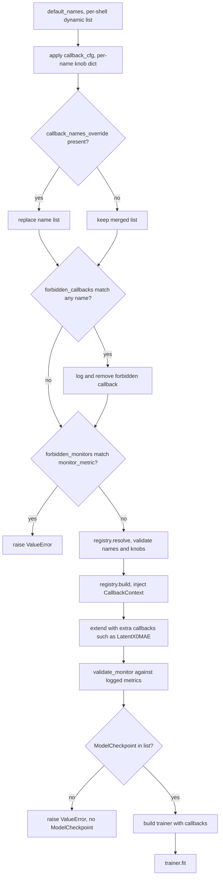

# Callback registry and training spine

`CallbackRegistry` (ADR-0029) is the typed name → spec dispatcher that replaced
the ad-hoc `_build_callbacks` / `_build_checkpoint` clones that used to live in
every training CLI. `TrainingSpine` (ADR-0032) is the **single caller** of that
registry: it owns the
`assemble → resolve → build → validate → trainer → fit`
sequence, plus the post-merge `forbidden_callbacks` / `forbidden_monitors` guards
that let a shell drop a callback no YAML or `--callbacks` override can re-enable.
Every training CLI now ends with `spine.run(...)`; the CLI's remaining job is to
seed, build its module + datamodule, register the specs it supports, and derive
its dynamic default callback-name set and knob map.

This page documents the spec contract, the two-phase construction, the
post-resolve monitor validation, the built-in spec catalog (including the
observe-only paired-fidelity monitor), and the spine's merge order — the
load-bearing pieces of any callback addition, knob rename, or "drop FID on the
GRPO ControlNet path" change. For the monitor's own rollout / decode / metric
semantics see [Paired-fidelity monitor](paired-fidelity-monitor.md); for the
component map see [Architecture and source map](architecture.md).

## Spec contract

Every callback registered with the registry is a `@dataclass` class with two
things (`src/manifold/training/callbacks/registry.py`):

1. **Knobs as dataclass fields** (with defaults). The field set is the
   allow-list used by `CallbackRegistry.resolve` to reject unknown knobs with a
   loud `ValueError` before any `pl.Callback` is built. `register` itself
   refuses a non-dataclass with `TypeError` — the knob allow-list only exists
   if the spec is a dataclass.
2. **A `build(self, ctx: CallbackContext) -> pl.Callback` method** that takes
   the runtime-objects bag and returns a constructed Lightning callback.

Specs match the `CallbackSpec` Protocol structurally — no inheritance
(`manifold.training.callbacks.registry.CallbackSpec`). A spec may optionally
expose:

- `logged_metrics: frozenset[str]` — the metrics the built callback logs. Used
  by `validate_monitor` so a `CheckpointSpec.monitor_metric` resolves against the
  full set of metric emitters, not just the registry ones. Every built-in spec
  declares it as a `ClassVar`, so it stays **out** of the knob allow-list
  (`dataclasses.fields` ignores class variables).
- `monitor_metric: str | None` — the special-case field `validate_monitor`
  scans for. Only `CheckpointSpec` declares it.

Neither is part of the required Protocol: `validate_monitor` reads both
defensively via `getattr`, so a spec that declares neither is legal.

## Two-phase construction

ADR-0029 splits spec instantiation from callback construction because
generative callbacks such as FID need runtime objects (the VAE, inference
recipe, and feature network) that do not exist at config resolution. ADR-0037
planned the second generative callback in that same shape; `PairedFidelitySpec`
is now registered and exported from
`src/manifold/training/callbacks/__init__.py`, so the paired PSNR/SSIM monitor
is a first-class registry entry (issue #238).

- **`CallbackRegistry.resolve(names, cfg)` (config-time)** — validates the
  requested name list and the per-name knob dict, then returns constructed spec
  instances in `names` order. Unknown name → `KeyError` with the registered
  set; unknown knob for a known name → `ValueError` with the allowed set. Only
  the knobs actually supplied are passed to the constructor; the remaining
  fields take their dataclass defaults. The list is **rank-symmetric** by
  contract (every DDP rank gets the same CLI args from `torchrun`).
- **`CallbackRegistry.build(specs, ctx)` (fit-prep)** — injects the runtime
  `CallbackContext` (the module, VAE, datamodule, inference recipe, model dir,
  seed, optional directly-injected `feature_net`, optional lazy
  `feature_net_factory`, optional `real_latents`) and returns the constructed
  `pl.Callback` list.

`CallbackContext` is a frozen dataclass whose fields are all `Any`-typed so the
callbacks package stays free of import cycles back into the module / data /
metrics layers; a spec's `build` casts as needed. A callback that needs neither
a knob nor a runtime object (e.g. `TrainLossSpec`) is fine with empty fields
and an empty `ctx`; the registry does not enforce a minimum surface.

## Post-resolve monitor validation

`CallbackRegistry.validate_monitor(specs, module, extra_callbacks=None)` runs
**after** resolve/build, **before** the trainer is built. The contract:

- The checkpoint spec is the **first** resolved spec that carries a
  `monitor_metric` attribute — in practice `CheckpointSpec`.
- If no checkpoint spec is present, or its `monitor_metric` is `None`
  (the unmonitored periodic / last path), validation is a no-op — absence is the
  intended fallback when no held-out validation is wired.
- Otherwise the `monitor_metric` must be present in the union of:
  - every spec's `logged_metrics` (the registry path),
  - the `module.logged_metrics` attribute (the Module-declared path: GRPO's
    `val/mean_reward`, the reward module's `val/gen_pair_acc`),
  - every `extra_callbacks` member's `logged_metrics` (the hand-appended path:
    `LatentX0MAE`'s `val/x0_mae`, see `src/manifold/training/metrics.py`).

A `monitor_metric` that is logged by nobody raises `ValueError` with the
available set — so Lightning does not error mid-fit on a never-logged monitor.

This validation is the second line of defense behind the GRPO ControlNet fid
guard (see below): once the FID callback is force-removed, no resolved spec and
no module declares `val/fid`, so a checkpoint still monitoring it is rejected
here even if the pre-resolution guard were bypassed.

## Built-in specs

The registry starts empty at construction; **each shell registers the names it
supports** on its own `TrainingSpine.registry`
(`src/manifold/training/cli.py`, `reward_cli.py`, `grpo_cli.py`,
`controlnet_cli.py`). A name a given CLI did not register is an unknown name
for that CLI: `--callbacks paired_fidelity` on the GRPO shell fails fast at
`resolve` with a `KeyError`.

| Name | Spec | Knobs (defaults) | Built callback | `logged_metrics` |
|---|---|---|---|---|
| `train_loss` | `TrainLossSpec` | (none) | `TrainLossLogger` logging `train/loss_epoch` | `frozenset({"train/loss_epoch"})` |
| `fid` | `FIDSpec` | `num_synth=16`, `every_n_epochs=1`, `center_slices_ratio=0.5`, `cov_ridge=1e-6` | `FIDCallback` (per-rank shards, all-reduced FID, lazy feature net) | `frozenset({"val/fid"})` |
| `checkpoint` | `CheckpointSpec` | `monitor_metric=None`, `save_top_k=3`, `save_last=True`, `every_n_epochs=1`, `mode="min"`, `filename=None` | `pl.callbacks.ModelCheckpoint` (monitored vs unmonitored two branches) | n/a (`validate_monitor` reads `monitor_metric` defensively) |
| `paired_fidelity` | `PairedFidelitySpec` | `subset_size=8`, `every_n_epochs=1`, `num_inference_steps=None`, `seed=0` | `PairedFidelityCallback` | `frozenset({"val/psnr", "val/ssim"})` |

`FIDSpec.build` threads the generation recipe (`latent_shape`, `spacing`,
`modality`, `num_inference_steps`, `guidance_scale`, `cfg_interval`) out of
`ctx.inference_recipe`, and passes `ctx.real_latents` (GRPO-supplied) together
with the JiT lazy fallback `real_latents_source=ctx.datamodule` (ADR-0017 / F5).

`CheckpointSpec.build` reproduces the prior `_build_checkpoint` two-branch
construction: `monitor_metric=None` keeps `save_top_k=1` plus `last.ckpt` at
the `every_n_epochs` cadence (the JiT production fallback); the monitored branch
tracks `monitor_metric` top-`k` plus last. The `filename` default picks
`unet3d-{epoch:03d}-{step}-{monitor:.3f}` for the monitored path and
`unet3d-{epoch:03d}-{step}` for the unmonitored path
(`src/manifold/training/callbacks/checkpoint.py`). The branches are asymmetric:
`every_n_epochs` applies only to the unmonitored branch, and `save_top_k` only
to the monitored one (the unmonitored branch hard-codes `save_top_k=1`). The
reward / GRPO / ControlNet shells override `filename` with their own prefix
(`reward-`, `grpo-`, `controlnet-`); the JiT shell keeps the spec default.

## The paired-fidelity spec (ADR-0037)

`PairedFidelitySpec` is the observe-only in-training paired monitor
(`val/psnr` / `val/ssim`) for the supervised ControlNet stage. It is mounted
exactly like `FIDSpec`: a registered spec whose `build(ctx)` injects the
runtime objects from `CallbackContext`.

- **Recipe-primary rollout step count.** The spec's own `num_inference_steps`
  knob defaults to `None`; `build` then reads
  `ctx.inference_recipe["num_inference_steps"]` and falls back to the literal
  `15` when the context carries no recipe (the same default the callback
  itself uses). An explicit per-callback value overrides the recipe.
- **The supervised shell now fills the recipe.** `controlnet_cli.py` used to
  pass `inference_recipe=None` on this path; it now passes
  `{"num_inference_steps": int(num_inference_steps)}`, sourced from the
  existing `controlnet.num_inference_steps` recipe knob (default 15 ⇒ 29 UNet
  evals for the two-eval Heun rollout). The recipe value therefore reaches the
  callback without the knob being duplicated in two places.
- **Lazy paired subset.** `build` forwards `ctx.datamodule` as the
  paired-subset source; the callback resolves the actual paired dataset lazily
  at the first gated epoch (`getattr(datamodule, "val_latent_ds", datamodule)`,
  F5), so the cold path's post-`setup()` replacement of `val_latent_ds` is
  honored.
- **Observe-only.** `logged_metrics` declares `val/psnr` / `val/ssim` so
  `validate_monitor` accepts them as *validatable* monitors, but the monitor is
  never a checkpoint monitor (the supervised shell keeps
  `monitor_metric: val/x0_mae`), never a loss term, and never touches the
  optimizer / EMA.

## TrainingSpine.run — the merge order

`TrainingSpine.run` is a single method, parameterized by named arguments rather
than a per-shell subclass (composition, not inheritance — the project's OOP
rule). The merge order is:

1. Start from `default_names` (the per-shell dynamic default callback list,
   derived by the CLI from the resolved mode — see the table below).
2. `callback_cfg` knob dicts are applied to whatever specs resolve from those
   names (the knob values are materialized when `registry.resolve` constructs
   the spec instances).
3. `callback_names_override` **replaces** the name list entirely (the CLI
   `--callbacks` flag). A user can drop or add names here.
4. **`forbidden_callbacks` is applied AFTER the merge.** Each name in the map
   is force-removed from the merged list with a `rank_zero_info` log line. This
   is the load-bearing guard: a YAML knob or `--callbacks` override cannot
   re-enable a forbidden callback. The GRPO ControlNet path passes
   `forbidden_callbacks={"fid": "constant frozen-base metric"}` so the FID
   callback is dropped for that policy even if a stale recipe lists it.
5. **`forbidden_monitors` rejects a checkpoint `monitor_metric` BEFORE
   resolution.** It inspects the merged knob map's
   `callback_cfg["checkpoint"]["monitor_metric"]` entry and raises `ValueError`
   (after a loud log) if that metric is forbidden — so any checkpoint
   `monitor_metric: val/fid` is refused instead of silently resuming on a
   constant metric.
6. Resolve → build → extend with `extra_callbacks` → `validate_monitor` →
   assemble `pl.Trainer` → `trainer.fit`.


*Figure: `TrainingSpine.run` merge order — defaults → knobs → `--callbacks` override → `forbidden_callbacks` / `forbidden_monitors` → resolve → build → validate_monitor → fit.*

The per-shell default name sets (the dynamic list the shell derives from the
resolved mode):

| Shell | `default_names` |
|---|---|
| JiT (`cli.py`) | `["train_loss"]` + `"fid"` when FID is attached + `"checkpoint"` |
| supervised ControlNet (`controlnet_cli.py`) | `["train_loss", "checkpoint", "paired_fidelity"]` |
| GRPO (`grpo_cli.py`) | `["checkpoint"]` (+ `"fid"` when the FID triple is active and no ControlNet is present) |
| reward (`reward_cli.py`) | `["checkpoint"]` |

If no `ModelCheckpoint` survives the merge (an override dropped it),
`TrainingSpine.run` raises a `ValueError` whose message starts
`"TrainingSpine.run: the resolved callback list has no ModelCheckpoint
(names=...)"` — rather than letting `next(...)` raise `StopIteration` deeper in
the call
(`tests/test_callback_registry.py::test_training_spine_fails_fast_without_checkpoint`,
codex #170 P2).

The forbidden-callbacks guard is the documented externalization of the
former "GRPO ControlNet fid" special case: it lives generically in the spine,
not in any GRPO vocabulary
(`tests/test_callback_registry.py::test_training_spine_forbidden_callbacks_force_removed_post_merge`,
ADR-0032). The GRPO shell raises the ban for the whole policy path when a
ControlNet is present, because the unconditional FID rollout ignores the
ControlNet and would be a constant frozen-base metric.

`build_trainer` (called by the spine) appends the framework callbacks that are
**not** registry entries — the spt `ModuleRegistryCallback` and the
`MetricsPlotCallback`. The latter renders every finite metric found in the CSV
logger's `metrics.csv` as its own subplot, so a newly logged metric such as
`val/psnr` / `val/ssim` shows up in the metrics PNG with no special-casing.

## Change guidance

- **Adding a callback:** add a `@dataclass` spec under
  `src/manifold/training/callbacks/`, expose it from
  `src/manifold/training/callbacks/__init__.py`, register it in each CLI's
  `spine.registry.register(...)` block, and add a `train_loss`-style logger
  callback if it logs a monitored metric. Compose `CallbackContext` if the
  spec needs a runtime object not already in the bag.
- **Extending the paired-fidelity monitor to ControlNet-GRPO (still open):**
  the GRPO shell's `forbidden_callbacks={"fid": ...}` exists because FID's
  *unconditional* rollout ignores the ControlNet. The paired-fidelity monitor
  rolls `controlnet_rollout`, which *does* use the ControlNet, so that
  rationale does not cover it — but releasing the blanket ban for this callback
  specifically (and keeping the VAE on GPU for the decode) is a deliberate
  separate follow-up per ADR-0037, not part of the supervised-stage change.
  Nothing in the registry needs to change for it; the guard map does.
- **Renaming a knob:** rename the dataclass field. `resolve` will start
  rejecting the old name in any recipe that still uses it — that loud
  `ValueError` is the contract's signal that all recipe sites need an update.
- **Adding a knob with a non-default:** same as above; recipes that omit it
  inherit the new default.
- **Dropping a callback for one policy:** prefer `forbidden_callbacks` over
  hard-coding the absent name into `default_names`. The forbidden map is the
  loud, post-merge, override-resistant guard.
- **Adding a new monitored metric:** make sure the emitting side declares it
  either as a spec's `logged_metrics`, the module's `logged_metrics`, or an
  `extra_callbacks` member's `logged_metrics`. Otherwise
  `validate_monitor` rejects any checkpoint that monitors it.

## Source map

- Spec contract + registry: `src/manifold/training/callbacks/registry.py`
- Runtime objects bag: `src/manifold/training/callbacks/context.py`
- Built-in specs: `src/manifold/training/callbacks/{train_loss,fid,checkpoint,paired_fidelity}.py`
- Spec barrel: `src/manifold/training/callbacks/__init__.py`
- Built callbacks: `src/manifold/metrics/fid/callback.py` (FID),
  `src/manifold/metrics/paired_callback.py` (paired fidelity),
  `src/manifold/training/metrics.py` (`TrainLossLogger`, `LatentX0MAE`)
- Spine implementation: `src/manifold/training/core.py`
- CLI callers:
  - `src/manifold/training/cli.py` (JiT)
  - `src/manifold/training/reward_cli.py`
  - `src/manifold/training/grpo_cli.py` (uses `forbidden_callbacks` /
    `forbidden_monitors` on the ControlNet policy path)
  - `src/manifold/training/controlnet_cli.py` (registers `paired_fidelity`,
    fills `CallbackContext.inference_recipe`)
- Trainer builder (called by the spine): `src/manifold/training/trainer.py`
- Callback-name list resolution (CLI replaces the YAML `callbacks:` list):
  `src/manifold/config/loader.py::resolve_callback_names`
- ADRs: `docs/adr/0029-callback-registry.md`,
  `docs/adr/0032-cli-spine-collapse.md`, `docs/adr/0037-controlnet-fidelity-in-training-monitor.md`

## Focused tests

- `tests/test_callback_registry.py::test_resolve_fails_fast_on_unknown_name`,
  `test_resolve_fails_fast_on_unknown_knob_for_known_name`,
  `test_unknown_knob_against_fielded_spec` — config-time validation
- `tests/test_callback_registry.py::test_build_returns_train_loss_logger`,
  `test_fid_spec_builds_fid_callback_with_knobs_and_lazy_pull`,
  `test_fid_spec_grpo_supplied_real_latents_wins`,
  `test_checkpoint_spec_declares_full_knob_surface` — the build phase
- `tests/test_callback_registry.py::test_validate_monitor_passes_when_metric_is_callback_logged`,
  `test_validate_monitor_fails_on_unlogged_metric`,
  `test_validate_monitor_passes_on_module_declared_metric`,
  `test_validate_monitor_none_bypasses_validation`,
  `test_validate_monitor_accepts_extra_callback_logged_metric`,
  `test_validate_monitor_fails_when_extra_callback_omits_metric` — post-resolve
  monitor validation paths
- `tests/test_callback_registry.py::test_paired_fidelity_spec_builds_callback_with_knobs`,
  `test_paired_fidelity_spec_resolve_fails_fast_on_unknown_knob`,
  `test_paired_fidelity_spec_declares_logged_metrics`,
  `test_validate_monitor_accepts_psnr_and_ssim`,
  `test_paired_fidelity_spec_keeps_checkpoint_monitor_on_x0_mae`,
  `test_paired_fidelity_spec_reads_num_inference_steps_from_recipe` — the
  paired-fidelity spec (recipe-primary step count included)
- `tests/test_callback_registry.py::test_training_spine_fails_fast_without_checkpoint`
  — codex #170 P2
- `tests/test_callback_registry.py::test_training_spine_forbidden_callbacks_force_removed_post_merge`,
  `test_training_spine_forbidden_monitor_raises` — ADR-0032 forbidden guards
- `tests/test_controlnet_cli.py::test_run_controlnet_training_delegates_to_training_spine`,
  `test_run_controlnet_training_merges_callback_config` — the ControlNet
  shell's registrations, default names, and filled `inference_recipe`
- `tests/test_grpo.py::test_run_grpo_training_yaml_monitor_override_derives_mode_post_merge`
  — the GRPO shell's post-merge monitor / mode derivation

## Minimal validation

```bash
pytest tests/test_callback_registry.py -q
```

For a knob rename that touches one spec, also run that CLI's focused tests
(reward → `test_reward.py`, JiT → `test_training_cli.py`, GRPO → `test_grpo.py`,
ControlNet → `test_controlnet_cli.py`); for a paired-fidelity change also run
`tests/test_paired_fidelity_callback.py`.
