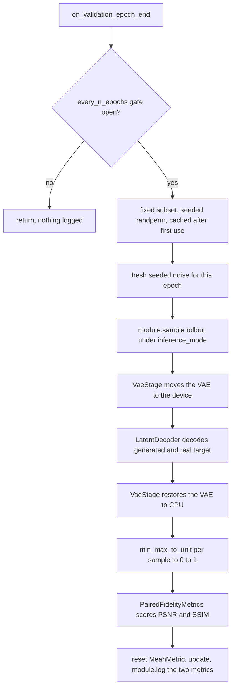
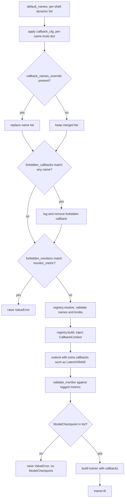

# Callback registry and training spine

`CallbackRegistry` (ADR-0029) is the typed name → spec dispatcher that replaced
the ad-hoc `_build_callbacks` / `_build_checkpoint` clones that used to live in
every training CLI. `TrainingSpine` (ADR-0032) is the **single caller** of that
registry: it owns the `assemble → resolve → build → validate → trainer → fit`
sequence, plus the post-merge `forbidden_callbacks` / `forbidden_monitors` guards
that let a shell drop a callback no YAML or `--callbacks` override can re-enable.
Every training shell ends with `spine.run(...)` — four `run_*` shells call it in
the current tree (`cli.py` for JiT, `reward_cli.py`, `grpo_cli.py`,
`controlnet_cli.py`); the CLI's only responsibility left is seeding, building the
module + datamodule, and computing its dynamic default callback-name set.

This page documents the spec contract, the two-phase construction, the
post-resolve monitor validation, the spine's merge order, and the built-in spec
table (which now includes the observe-only paired-fidelity monitor of ADR-0037) —
the load-bearing pieces of any callback addition, knob rename, or "drop FID on
the GRPO ControlNet path" change.

## Spec contract

Every callback registered with the registry is a `@dataclass` class with two
things (`src/manifold/training/callbacks/registry.py`):

1. **Knobs as dataclass fields** (with defaults). The field set is the
   allow-list used by `CallbackRegistry.resolve` to reject unknown knobs with a
   loud `ValueError` before any `pl.Callback` is built.
2. **A `build(self, ctx: CallbackContext) -> pl.Callback` method** that takes
   the runtime-objects bag and returns a constructed Lightning callback.

`CallbackRegistry.register` enforces the dataclass half of the contract: a
non-dataclass spec class is rejected with a `TypeError` (the unknown-knob check
needs a field set to compare against).

Specs match the `CallbackSpec` Protocol structurally — no inheritance
(`manifold.training.callbacks.registry.CallbackSpec`). A spec may optionally
expose:

- `logged_metrics: frozenset[str]` — the metrics the built callback logs. Used
  by `validate_monitor` so a `CheckpointSpec.monitor_metric` resolves against the
  full set of metric emitters, not just the registry ones. It is declared as a
  `ClassVar` in every built-in spec, so it stays **out** of the dataclass field
  set and therefore out of `resolve`'s knob allow-list.
- `monitor_metric: str | None` — the special-case field `validate_monitor`
  scans for. Only `CheckpointSpec` declares it.

## Two-phase construction

ADR-0029 splits spec instantiation from callback construction because
generative callbacks such as FID need runtime objects (the VAE, inference
recipe, and feature network) that do not exist at config resolution.

- **`CallbackRegistry.resolve(names, cfg)` (config-time)** — validates the
  requested name list and the per-name knob dict, then returns constructed spec
  instances in `names` order. Unknown name → `KeyError` with the registered
  set; unknown knob for a known name → `ValueError` with the allowed set.
  The list is **rank-symmetric** by contract (every DDP rank gets the same CLI
  args from `torchrun`).
- **`CallbackRegistry.build(specs, ctx)` (fit-prep)** — injects the runtime
  `CallbackContext` (the module, VAE, datamodule, inference recipe, model dir,
  seed, optional lazy `feature_net_factory`, optional `real_latents`) and
  returns the constructed `pl.Callback` list.

A callback that needs neither a knob nor a runtime object (e.g. `TrainLossSpec`)
is fine with empty fields and an empty `ctx`; the registry does not enforce a
minimum surface.

ADR-0037's in-training paired PSNR/SSIM monitor is the second generative
callback of this family, and it is **shipped**: `PairedFidelitySpec` is
exported from `manifold.training.callbacks` and registered under the name
`"paired_fidelity"` by the supervised ControlNet shell
(`src/manifold/training/controlnet_cli.py`). It is mounted exactly like
`FIDSpec` — a registered spec declaring `logged_metrics`, built through
`CallbackContext`.

## Post-resolve monitor validation

`CallbackRegistry.validate_monitor(specs, module, extra_callbacks=None)` runs
**after** resolve/build, **before** the trainer is built. The contract:

- If no checkpoint spec is present, or its `monitor_metric` is `None`
  (the unmonitored periodic / last path), validation is a no-op — absence is the
  intended fallback when no held-out validation is wired.
- Otherwise the `monitor_metric` must be present in the union of:
  - every spec's `logged_metrics` (the registry path),
  - the `module.logged_metrics` attribute (the Module-declared path: GRPO's
    `val/mean_reward`, the reward module's `val/gen_pair_acc`),
  - every `extra_callbacks` member's `logged_metrics` (the hand-appended path:
    `LatentX0MAE`'s `val/x0_mae`, see `src/manifold/training/metrics.py`).

A `monitor_metric` that is logged by nobody raises `ValueError` with the
available set — so Lightning does not error mid-fit on a never-logged monitor.

This validation is the safety net behind the GRPO ControlNet fid guard (see
below) and behind the `tests/test_callback_registry.py` monitor tests.

## Built-in specs

| Spec | Knobs (defaults) | Built callback | `logged_metrics` |
|---|---|---|---|
| `TrainLossSpec` | (none) | `TrainLossLogger` logging `train/loss_epoch` | `frozenset({"train/loss_epoch"})` |
| `FIDSpec` | `num_synth` (16), `every_n_epochs` (1), `center_slices_ratio` (0.5), `cov_ridge` (1e-6) | `FIDCallback` (rank-strided, lazy feature-net) | `frozenset({"val/fid"})` |
| `CheckpointSpec` | `monitor_metric`, `save_top_k`, `save_last`, `every_n_epochs`, `mode`, `filename` | `pl.callbacks.ModelCheckpoint` (monitored vs unmonitored two branches) | n/a (`validate_monitor` reads `monitor_metric` defensively) |
| `PairedFidelitySpec` | `subset_size` (8), `every_n_epochs` (1), `num_inference_steps` (`None` ⇒ recipe), `seed` (0) | `PairedFidelityCallback` (observe-only, fixed paired subset) | `frozenset({"val/psnr", "val/ssim"})` |

`CheckpointSpec.build` reproduces the prior `_build_checkpoint` two-branch
construction: `monitor_metric=None` keeps `save_top_k=1` plus `last.ckpt` at
the `every_n_epochs` cadence (the JiT production fallback); the monitored branch
tracks `monitor_metric` top-`k` plus last. The `filename` default picks
`unet3d-{epoch:03d}-{step}-{monitor:.3f}` for the monitored path and
`unet3d-{epoch:03d}-{step}` for the unmonitored path
(`src/manifold/training/callbacks/checkpoint.py`).

### The paired-fidelity spec and callback (ADR-0037)

`PairedFidelitySpec` (`src/manifold/training/callbacks/paired_fidelity.py`) is
the observe-only 3D PSNR/SSIM monitor for the supervised ControlNet stage. Its
four knobs are the `paired_fidelity` config block; the runtime objects
(`module` / `vae` / paired-subset source) come from `CallbackContext` at
`build` time. It deliberately reuses the *same* metric, the *same* min-max
normalization, and the *same* full-rollout generation as the offline
before/after comparison, so the in-training curve and the offline number are
directly comparable (see
[Before/after GRPO evaluation](evaluation.md#paired-fidelity-metric)).

- **Recipe-primary step count.** `num_inference_steps` defaults to `None`,
  which means "read it from the recipe": `build` takes
  `ctx.inference_recipe["num_inference_steps"]` (falling back to the callback's
  own 15 when the context carries no recipe). The supervised shell fills that
  context field from the existing `controlnet.num_inference_steps` knob
  (`inference_recipe={"num_inference_steps": int(num_inference_steps)}`), so the
  rollout depth is one shared knob; an explicit per-callback
  `num_inference_steps` overrides the recipe.
- **Lazy paired-dataset resolution.** `build` forwards `ctx.datamodule` as the
  paired-subset source and never resolves it. The callback resolves the actual
  dataset lazily at the first gated epoch with
  `getattr(datamodule, "val_latent_ds", datamodule)`, so the cold path's
  post-`setup()` replacement of the warmed `val_latent_ds` is honored (F5 /
  ADR-0017).
- **Observe-only.** The callback logs `val/psnr` / `val/ssim` and nothing else;
  it never enters the loss, the optimizer, or the EMA, and it does not select
  checkpoints. Declaring the two metrics in `logged_metrics` only makes them
  *validatable* monitor candidates for `validate_monitor` — the supervised
  checkpoint monitor stays `val/x0_mae` (logged by the hand-appended
  `LatentX0MAE`).

The callback itself (`src/manifold/metrics/paired_callback.py`) runs on
`on_validation_epoch_end`:


*Figure: the paired-fidelity monitor's gated validation-epoch flow — fixed subset, full Heun rollout, VAE decode, normalization, MONAI scoring, then the two logged metrics.*

The mechanism in words: a seeded `randperm` prefix of `subset_size` paired
subjects is selected and collated once and cached, so epoch-over-epoch change
reflects the model and not a moving data sample; the generation noise is
re-seeded fresh on every gated epoch, which is what makes the logged value
reproducible; the rollout runs inside `torch.inference_mode()` (so no gradient is
ever formed), the VAE is staged onto the device only for the decode and
restored to CPU afterwards (`VaeStage`), and both volumes are min-max normalized
to `[0, 1]` before the shared `PairedFidelityMetrics` (MONAI
`PSNRMetric` / `SSIMMetric`) scores them. The two `torchmetrics.MeanMetric`
instances are attached to the **module** (Lightning only registers metrics it
finds on the module) and reset each epoch, so the logged number is the current
epoch's value, not a running mean.

**DDP.** Every rank runs the monitor redundantly on the same fixed subset
under the same seeded noise on DDP-synchronized weights, so the per-rank result
is identical and the only cross-rank interaction is Lightning's torchmetrics
sync — there is no FID-style sharding and no error-rendezvous machinery, so
collective-count invariance (ADR-0030) holds trivially.

**ADR-0037 note.** Extending this monitor to the ControlNet-GRPO stage (which
would mean releasing the blanket `forbidden_callbacks={"fid"}` for *this*
callback specifically, since paired fidelity rolls the trainable ControlNet and
so is not a constant frozen-base metric) is a **deliberate follow-up**, not
part of this change.

## TrainingSpine.run — the merge order

`TrainingSpine.run` is a single method, parameterized by named arguments rather
than a per-shell subclass (composition, not inheritance — the project's OOP
rule). The merge order is:

1. Start from `default_names` (the per-shell dynamic default callback list,
   derived by the CLI from the resolved mode — e.g. the JiT path starts with
   `["train_loss", "fid", "checkpoint"]` when FID is attached and
   `["train_loss", "checkpoint"]` when it is not; the GRPO path starts with
   `["checkpoint"]` plus `"fid"` only when the FID triple is active; the
   reward path with `["checkpoint"]`; the supervised ControlNet path with
   `["train_loss", "checkpoint", "paired_fidelity"]`).
2. `callback_cfg` knob dicts are applied to whatever specs resolve from those
   names.
3. `callback_names_override` **replaces** the name list entirely (the CLI
   `--callbacks` flag). A user can drop or add names here.
4. **`forbidden_callbacks` is applied AFTER the merge.** Each name in the map
   is force-removed from the merged list with a `rank_zero_info` log line. This
   is the load-bearing guard: a YAML knob or `--callbacks` override cannot
   re-enable a forbidden callback. The GRPO ControlNet path passes
   `forbidden_callbacks={"fid": <reason>}` — the reason being that unconditional
   FID ignores the ControlNet and is therefore a constant frozen-base metric —
   so the FID callback is dropped for that policy even if a stale recipe lists
   it.
5. **`forbidden_monitors` rejects a checkpoint `monitor_metric` BEFORE
   resolution.** The guard reads the `checkpoint` knob block of `callback_cfg`,
   so any checkpoint `monitor_metric: val/fid` raises `ValueError` instead of
   silently resuming on a constant metric. The GRPO ControlNet path passes
   `forbidden_monitors={"val/fid": <reason>}` with the same rationale.
6. Resolve → build → validate_monitor → assemble `pl.Trainer` → `trainer.fit`.


*Figure: `TrainingSpine.run` merge order — defaults → knobs → `--callbacks` override → `forbidden_callbacks` / `forbidden_monitors` → resolve → build → validate_monitor → fit.*

If no `ModelCheckpoint` survives the merge (an override dropped it),
`TrainingSpine.run` raises `ValueError("no ModelCheckpoint in resolved list")`
rather than letting `next(...)` raise `StopIteration` deeper in the call
(`tests/test_callback_registry.py::test_training_spine_fails_fast_without_checkpoint`,
codex #170 P2).

The forbidden-callbacks guard is the documented externalization of the
former "GRPO ControlNet fid" special case: it lives generically in the spine,
not in any GRPO vocabulary
(`tests/test_callback_registry.py::test_training_spine_forbidden_callbacks_force_removed_post_merge`,
ADR-0032).

## Change guidance

- **Adding a callback:** add a `@dataclass` spec under
  `src/manifold/training/callbacks/`, expose it from
  `src/manifold/training/callbacks/__init__.py`, register it in each CLI's
  `spine.registry.register(...)` block, and add a `train_loss`-style logger
  callback if it logs a monitored metric. Compose `CallbackContext` if the
  spec needs a runtime object not already in the bag.
- **Extending the paired-fidelity spec / callback:** the monitor ships, so the
  work is now *extension*, not first implementation. Three seams carry the
  contract:
  - **Recipe-primary step count** — the rollout depth is
    `ctx.inference_recipe["num_inference_steps"]` (filled from the supervised
    shell's `controlnet.num_inference_steps` knob); the spec's own
    `num_inference_steps` knob is an optional per-callback override on top of
    it. Changing the rollout depth means changing that shared knob, not
    hard-coding a step count in the callback.
  - **Lazy paired-dataset resolution** — the paired source is resolved at the
    first gated epoch via `getattr(datamodule, "val_latent_ds", datamodule)`,
    never at build time. Anything that replaces `val_latent_ds` after
    `setup()` stays honored; anything that assumes the dataset is bound at
    build time breaks the cold path.
  - **DDP redundancy** — every rank evaluates the same fixed subset under the
    same seeded noise, so the only cross-rank interaction is Lightning's metric
    sync. Do not add FID-style sharding or a custom `all_reduce` without
    revisiting collective-count invariance (ADR-0030) and the redundancy
    invariant the DDP gate locks down.
  Keep `val/psnr` / `val/ssim` observe-only: do not make either scalar a
  checkpoint monitor, a loss term, or a path for the ControlNet-GRPO stage
  until that separate follow-up is accepted.
- **Renaming a knob:** rename the dataclass field. `resolve` will start
  rejecting the old name in any recipe that still uses it — that loud
  `ValueError` is the contract's signal that all recipe sites need an update.
- **Adding a knob with a non-default:** same as above; recipes that omit it
  inherit the new default.
- **Dropping a callback for one policy:** prefer `forbidden_callbacks` over
  hard-coding the absent name into `default_names`. The forbidden map is the
  loud, post-merge, override-resistant guard.
- **Adding a new monitored metric:** make sure the emitting side declares it
  either as a spec's `logged_metrics`, the module's `logged_metrics`, or an
  `extra_callbacks` member's `logged_metrics`. Otherwise
  `validate_monitor` rejects any checkpoint that monitors it.

## Source map

- Spec contract + registry: `src/manifold/training/callbacks/registry.py`
- Runtime objects bag: `src/manifold/training/callbacks/context.py`
- Built-in specs: `src/manifold/training/callbacks/{train_loss,fid,checkpoint,paired_fidelity}.py`
- Spec barrel: `src/manifold/training/callbacks/__init__.py`
- Paired-fidelity callback: `src/manifold/metrics/paired_callback.py`
- Spine implementation: `src/manifold/training/core.py`
- CLI callers:
  - `src/manifold/training/cli.py` (JiT)
  - `src/manifold/training/reward_cli.py`
  - `src/manifold/training/grpo_cli.py` (uses `forbidden_callbacks` /
    `forbidden_monitors` on the ControlNet policy path)
  - `src/manifold/training/controlnet_cli.py` (registers `paired_fidelity`)
- Trainer builder (called by the spine): `src/manifold/training/trainer.py`

## Focused tests

- `tests/test_callback_registry.py::test_resolve_fails_fast_on_unknown_name`,
  `test_resolve_fails_fast_on_unknown_knob_for_known_name` — config-time
  validation
- `tests/test_callback_registry.py::test_validate_monitor_fails_on_unlogged_metric`,
  `test_validate_monitor_passes_on_module_declared_metric`,
  `test_validate_monitor_accepts_extra_callback_logged_metric` — post-resolve
  monitor validation paths
- `tests/test_callback_registry.py::test_training_spine_fails_fast_without_checkpoint`
  — codex #170 P2
- `tests/test_callback_registry.py::test_training_spine_forbidden_callbacks_force_removed_post_merge`,
  `test_training_spine_forbidden_monitor_raises` — ADR-0032 forbidden guards
- `tests/test_callback_registry.py::test_paired_fidelity_spec_builds_callback_with_knobs`,
  `test_paired_fidelity_spec_resolve_fails_fast_on_unknown_knob`,
  `test_paired_fidelity_spec_declares_logged_metrics`,
  `test_paired_fidelity_spec_reads_num_inference_steps_from_recipe` — the
  paired-fidelity spec's knobs, recipe-primary step count, and fail-fast
  knob validation
- `tests/test_callback_registry.py::test_validate_monitor_accepts_psnr_and_ssim`,
  `test_paired_fidelity_spec_keeps_checkpoint_monitor_on_x0_mae` — the two
  PSNR/SSIM metrics are *validatable* monitors, while checkpoint selection
  stays on `val/x0_mae`
- `tests/test_paired_fidelity_callback.py::test_*` — the callback at the hook:
  logged metrics, cadence gating, fixed-subset stability, per-epoch metric
  reset, the `[0,1]` normalization contract, and the observe-only
  (inference-mode, no-grad) guarantee
- `tests/test_paired_fidelity_ddp.py::test_ddp_paired_fidelity_monitor_no_deadlock_and_consistent`
  — 2-rank redundancy gate: no hang, identical per-rank values (logged and
  rank-local), checkpoint monitor still `val/x0_mae`
- `tests/test_training_cli.py::test_*` covering CLI × spine integration

## Minimal validation

```bash
pytest tests/test_callback_registry.py -q
```

For the paired-fidelity monitor, also run its hook and DDP gates:

```bash
pytest tests/test_paired_fidelity_callback.py tests/test_paired_fidelity_ddp.py -q
```

For a knob rename that touches one spec, also run that CLI's focused tests
(reward → `test_reward.py`, JiT → `test_training_cli.py`, GRPO → `test_grpo.py`,
ControlNet → `test_controlnet_cli.py`).
