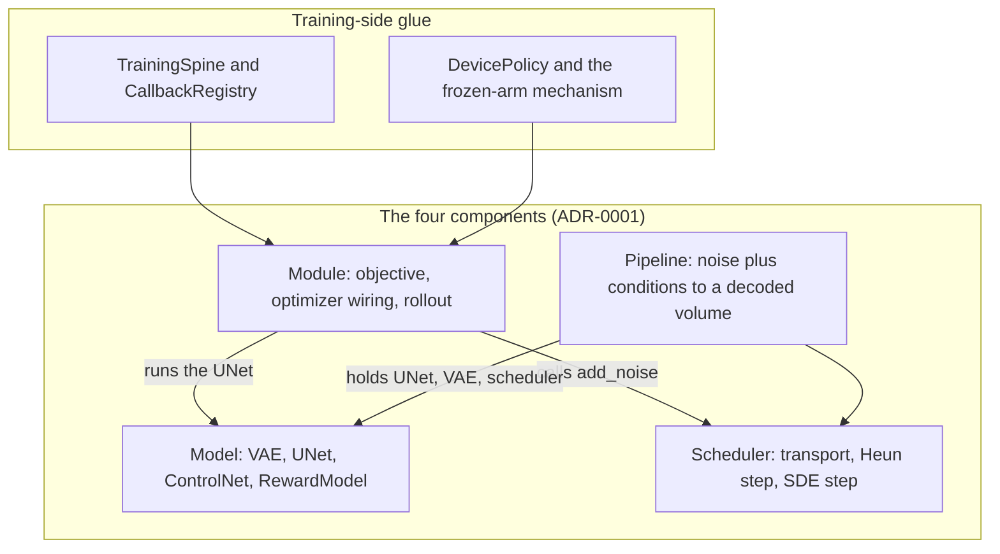

# Domain concepts and decision index

This is the wiki's glossary. The canonical vocabulary lives in
[`CONTEXT.md`](../CONTEXT.md); this page adds the three things a reader needs to
*use* that vocabulary: which component owns each term, the source symbol that
implements it, and the anti-terms the project rejects. It also indexes every
decision record under [`docs/adr/`](../docs/adr/) so a change can find the ADR
that governs it before it touches code.

The rules for using this vocabulary come from
[`docs/agents/domain.md`](../docs/agents/domain.md):

- Use the term as defined here (and in `CONTEXT.md`) — in issue titles, PR
  descriptions, test names, and code comments. Do not drift to a synonym that
  the glossary explicitly rejects.
- If a concept you need is missing, that is a signal: either you are inventing
  language the project does not use, or there is a real gap to raise with
  `/domain-modeling`. Do not fill the gap with a near-synonym.
- If your change contradicts an existing ADR, surface it explicitly (issue
  title, PR description) rather than silently overriding it.

The **Avoid** column in every table below is normative: it lists the words
`CONTEXT.md` rejects for that term, and the consolidated
[anti-term index](#anti-term-index-the-words-the-glossary-rejects) maps each
rejected word to the term to use instead.

## Ownership map

*Figure: where the vocabulary attaches. The Scheduler owns the transport every
other component agrees on; the Module owns the training-only concerns; the
Pipeline is the inference-only packaging. The training-side glue (spine,
registry, device policy, frozen arms) is a separate layer around the Module.*

## The four components

| Term | Owning component | Source symbol / path | Avoid |
|---|---|---|---|
| **Model** | `src/manifold/models/` | A diffusers-style network wrapper over a MONAI MAISI / PatchGAN class: `AutoencoderKL`, `UNet3DConditionModel`, `ControlNet3DConditionModel`, `RewardModel`; base class `ModelMixin` in `models/modeling_utils.py` | network, backbone |
| **Scheduler** | `src/manifold/schedulers/` | `FlowMatchHeunDiscreteScheduler` (transport + two-evaluation Heun), `PartialFlowMatchHeunScheduler`, `FlowMatchGRPOScheduler`; base `SchedulerMixin` | noise scheduler, sampler |
| **Module** (training Module) | `src/manifold/modules/` | `spt.Module` subclasses that own training-only concerns: `LatentFlowModule`, `ControlNetLatentFlowModule`, `RewardModule`, `GRPOModule` | trainer, Lightning module |
| **Pipeline** | `src/manifold/pipelines/` | `DiffusionPipeline` base in `pipelines/pipeline_utils.py`; `LatentFlowPipeline`, `ControlNetLatentFlowPipeline` | inferer, generator |

Nothing in the tree subclasses the `diffusers` library: the layout and naming are
mimicked with manifold-owned base classes (`src/manifold/__init__.py`,
ADR-0001). A "sampler" is not a component — the shared rollout primitive is
`sample_latent_flow` in `modules/sampler.py`, owned by the Module and delegated
to by the Pipeline (ADR-0005).

## The JiT latent flow

| Term | Owning component | Source symbol / path | Avoid |
|---|---|---|---|
| **JiT** (x0-denoiser) | Scheduler + Module | `prediction_type = "sample"` in `schedulers/scheduling_flow_match_heun.py`; the clean-latent prediction and its loss in `modules/latent_flow.py::LatentFlowModule.forward` | recipe, denoiser mode, x0 mode |
| **transport** | Scheduler | `FlowMatchHeunDiscreteScheduler.add_noise` — `z = t·x + (1−t)·e`, `t∈[0,1]`, `t→1` is clean data; plus `set_timesteps`, `scale_model_input`, `euler_step` / `heun_correct` | forward process, noise schedule, corruption |
| **scale_factor** | Model (the VAE wrapper) | `AutoencoderKL.scaling_factor` buffer: `encode` returns scaled latents, `decode` undoes the scaling, `encode_raw` returns the unscaled latent. Estimated as `1/std(z)` over an unscaled cache by `data/latent_dataset.py::estimate_scale_factor`; at inference it comes from the exported native checkpoint | latent scale, norm factor |
| **conditioning** | Model (the UNet wrapper) | `UNet3DConditionModel.forward(sample, timestep, spacing, class_labels)` — the spacing tensor (scaled ×`1e2`) and the class-label vector, i.e. medical geometry and modality | context, encoder hidden states |

The Module and the Pipeline never reference `scale_factor`: it is the VAE's
property, so the same number applies on the training and the inference side.

## Paired translation (ControlNet)

| Term | Owning component | Source symbol / path | Avoid |
|---|---|---|---|
| **ControlNet** | Model | `ControlNet3DConditionModel` in `models/controlnet_3d.py` — a trainable clone of the base UNet encoder plus zero-conv layers, whose residuals enter the frozen base through MONAI's native `down_block_additional_residuals` / `mid_block_additional_residual` args | control branch, condition net, control adapter |
| **direction head** | Model (on the ControlNet) | The direction MLP over `concat(embed(src), embed(tgt+offset))` on the ControlNet's class-embedding path (`models/controlnet_3d.py`), with the `paired_direction_offset` knob breaking A↔B symmetry | summed-label conditioning |
| **paired dataset contract** | Data layer | `data/paired_volume_dataset.py` (emits `src_image`, `tgt_image`, `spacing`, `src_label`, `tgt_label`) and `data/paired_latent_dataset.py` (emits the scaled `src_latent`, `tgt_latent`, `src_label`, `tgt_label`, `spacing`) — the dataset-agnostic seam, unaware of BraTS | pair loader, translation dataset |
| **any-to-any pairing** | BraTS builder (not the dataset) | `data/paired_brats.py::build_brats_pair_manifest` — all ordered within-subject non-self contrast pairs (12 per 4-contrast subject), emitting the manifest the generic dataset consumes | cross-modality pairs, direction set |
| **src latent / tgt latent** | Data layer | The two scaled latents of a pair. `x_src` is the ControlNet **control signal**; `x_tgt` is the clean endpoint of the noise→data transport | input/output latent, condition/target |
| **ControlNet two-stage** | Training | Stage 1 `ControlNetLatentFlowModule` (supervised, frozen base, `(1−t)⁻²`-weighted x0-MSE on `x_tgt`), stage 2 `GRPOModule` against the shared realism reward — mirroring `LatentFlowModule` → `GRPOModule` | paired pre-training |

## Persistence

| Term | Owning component | Source symbol / path | Avoid |
|---|---|---|---|
| **native checkpoint** | Pipeline | `LatentFlowPipeline.save_pretrained` / `from_pretrained` — a per-component directory (`model_index.json` plus one subdirectory per component: `unet`, `vae`, `scheduler`) | weights file, model file |
| **training checkpoint** (`.ckpt`) | Lightning | The `ModelCheckpoint` artifact written through `CheckpointSpec` — full training state (UNet + optimizer + LR schedule + epoch) for resume and best-by-metric selection | weights file |
| **Export** | Training | `training/export.py::export_to_native`, driven by the `manifold-export` entry point — the one-shot `.ckpt → native` conversion that bakes the raw optimizer weights as the inference UNet | convert |

Export is the **sole** checkpoint → inference path (ADR-0006, ADR-0007): the
Pipeline reads native directories only and never a Lightning `.ckpt`.

## Training-side glue

| Term | Owning component | Source symbol / path | Avoid |
|---|---|---|---|
| **Training pipeline** | Training | The `manifold-train*` entry points + Lightning `Trainer` + `spt.Module` + callbacks that turn warmed latents into a training checkpoint (`training/cli.py`, `training/trainer.py`, `training/metrics.py`) | train script, run script |
| **Callback registry** | Training | `training/callbacks/registry.py::CallbackRegistry` — maps a callback **name** to a `CallbackSpec` dataclass; `resolve` (config-time, fail-fast on unknown name/knob) then `build` (fit-prep, injects `CallbackContext`). `ModelCheckpoint` is itself a registered spec (`name="checkpoint"`) | callback factory, callback config |
| **Frozen arm** | Module | `modules/frozen_arm.py::FrozenArmMixin._register_frozen_arm` — a registered `nn.Module` child held off the optimizer (`requires_grad=False`) and off the checkpoint (`state_dict` / `load_state_dict` overrides), kept in `eval()` across `module.train()` | frozen module |
| **DevicePolicy** | Training | `training/device_policy.py` — `pin` (pre-process-group `set_device`), `device` (side-effect-free read), `warm_device` (post-process-group VAE warm) | device manager, device resolver |
| **TrainingSpine** | Training | `training/core.py::TrainingSpine` — the composed object owning callback-name merging → registry `resolve`/`build` → checkpoint injection → `build_trainer` → `fit`; the single caller of the registry | training runner, base trainer |
| **Collective-count invariance** | Metrics (FID) | `metrics/fid/callback.py::FIDCallback._all_reduce_flag` — an error-flag `all_reduce(MAX)` rendezvous before every reduction-bearing phase, so all ranks enter the same collectives in the same order in every path | DDP guard, collective symmetry |

A frozen arm is not merely "a module with `requires_grad=False`": the term names
the off-optimizer **and** off-checkpoint role. Device ownership is split too —
Lightning owns the in-Trainer frozen arms' placement, `DevicePolicy` owns the
pre-process-group staging (see
[frozen arms and device policy](frozen-arm-and-device-policy.md)).

## Reward and GRPO

| Term | Owning component | Source symbol / path | Avoid |
|---|---|---|---|
| **Reward Model** | Model | `models/reward_model.py::RewardModel` — a MONAI `PatchDiscriminator` behind a mean-pooling head; scores a latent to a scalar, unconditionally, and owns no rollout | discriminator, critic |
| **Reward Module** | Module | `modules/reward.py::RewardModule` — the `spt.Module` owning preference-pair construction, the Bradley–Terry pairwise loss, and its optimizer wiring; holds the frozen JiT denoiser as a frozen arm | reward trainer, reward Lightning module |
| **Online rollout** | Module | `RewardModule.forward("fit")` → `modules/partial_denoise.py::partial_denoise_rollout` — fresh preference pairs rolled inside each fit step | pair cache, online sampling |
| **Preference pair** (winner / loser) | Module | Two latents built from one clean latent at flow-times `t_a, t_b ~ U[0,1)`; the **winner** is the larger `t` (less corrupted), the **loser** the smaller. Both draws share one distribution, so the corruption ranges overlap and no single threshold separates them | positive/negative sample |
| **Anchor trajectory** | Module + Scheduler | The deterministic noise-free Heun rollout run once per group to furnish the branch points, executed through `FlowMatchGRPOScheduler.rollout_range` | baseline trajectory, reference rollout |
| **Singular branching** | Module | `modules/grpo.py::singular_branch_rollout` — one stochastic SDE step branched off the anchor per branch, then a deterministic Heun suffix to the terminal latent | per-step GRPO, token-level GRPO |
| **Transition policy** | Scheduler | `schedulers/scheduling_flow_match_grpo.py::FlowMatchGRPOScheduler.sde_step_mean` — the Gaussian kernel `π_θ(z_{k+1} | z_k, t_k) = N(z_k + Δt·b_θ, σ²_t·Δt·I)`; `modules/grpo.py::gaussian_log_prob` is the log-density the clipped objective ratios | policy network, actor |
| **Group** | Module | The `G` transition-rollout siblings sharing one (conditioning, initial-noise) pair; `modules/grpo.py::group_advantage` normalizes `A = (R − mean R)/(std R + ε)` over them | prompt, batch |
| **Policy Module** | Module | `modules/grpo.py::GRPOModule` — overrides `training_step` (not `forward`), runs the singular-branch rollout and the multi-step PPO inner loop, and trains whichever policy the inputs supply | GRPO trainer, actor |

"More noise" means *smaller* `t` in this vocabulary, because `t→1` is clean data
(ADR-0001). The same shared `RewardModel` scores the terminal latent `z_K` for
both the UNet policy and the ControlNet policy (ADR-0034).

## Validation metrics

| Term | Owning component | Source symbol / path | Avoid |
|---|---|---|---|
| **Fixed-sample validation** | Metrics | `metrics/fid/rollout.py::FixedSampleRollout` — the same small validation subset with the generation noise re-seeded every epoch (`seed + i`, rank-strided), so only the model changes between epochs | rolling validation, random-sample eval |
| **Unbiased FID** | Metrics | `metrics/fid/math.py::frechet_distance_unbiased` (subtracts the exact `Tr(Σ)/n` upward bias of the mean term, unbiased `1/(N−1)` covariance, ridge-stabilised square root), `get_features_2p5d` (three orthogonal planes), `make_feature_network` (RadImageNet ResNet50); driven by `FIDCallback` / `FIDSpec` | biased FID, plain FID |
| **Paired fidelity** | Metrics | `metrics/paired.py::PairedFidelityMetrics` — 3D PSNR + 3D SSIM of the generated target against the real target, both VAE-decoded and per-sample min-max normalized to `[0,1]` (`data_range = 1.0`). One metric, two protocols: the observe-only in-training monitor (`metrics/paired_callback.py`, `training/callbacks/paired_fidelity.py`) and the offline before/after comparison | image PSNR, fidelity reward |

Unbiased FID is reference-free and fits the unconditional JiT; paired fidelity is
the full-reference counterpart for the ControlNet translation policy, and the
realism `RewardModel` is fidelity-blind by construction (ADR-0034).

## Configuration

| Term | Owning component | Source symbol / path | Avoid |
|---|---|---|---|
| **Experiment config** | Config | `config/loader.py` + `config/builder.py` — the OmegaConf run-driver: env (paths) → train/inference recipe → network-construction kwargs, composed top-level (later files replace earlier whole, `_base_` inheritance), required paths as `???`, CLI/dotlist overrides. It builds components at launch and never persists them | run config, hydra config, "the config" |
| **Component config** | Component | `configuration.py::register_to_config` / `ConfigMixin` — the JSON `config.json` a component writes and that `from_pretrained` / `save_pretrained` round-trip; independent of how the component was launched | model config, "the config" |

Always say **which** config you mean. Callback knobs sit between the two: the
registry's `resolve` accepts a `{callback_name: {knob: value}}` map and rejects an
unknown knob for a known callback before any callback is constructed.

## Anti-term index: the words the glossary rejects

Each row is a word `CONTEXT.md` explicitly rejects, and the term to use instead.
Use these terms verbatim in issue titles, PR descriptions, and test names.

| Rejected term | Use instead | Note |
|---|---|---|
| network, backbone | Model | "network/backbone" denotes the wrapped MONAI class itself |
| noise scheduler, sampler | Scheduler | MONAI-flavored naming; the rollout primitive is `sample_latent_flow` |
| trainer, Lightning module | Module | the training Module |
| inferer, generator | Pipeline | |
| recipe, denoiser mode, x0 mode | JiT | and never `torch.jit` |
| forward process, noise schedule, corruption | transport | |
| latent scale, norm factor | scale_factor | |
| context, encoder hidden states | conditioning | diffusers text-conditioned terms |
| control branch, condition net, control adapter | ControlNet | |
| summed-label conditioning | direction head | the ADR-0014 base-UNet mechanism was retired |
| pair loader, translation dataset | paired dataset contract | |
| cross-modality pairs, direction set | any-to-any pairing | |
| input/output latent, condition/target | src latent / tgt latent | they name endpoints, not roles |
| weights file, model file | training checkpoint (`.ckpt`) / native checkpoint | say which one |
| train script, run script | Training pipeline | |
| convert | Export | |
| rolling validation, random-sample eval | fixed-sample validation | |
| biased FID, plain FID | Unbiased FID | |
| callback factory, callback config | Callback registry | |
| frozen module | frozen arm | it names the off-optimizer / off-checkpoint role |
| device manager, device resolver | DevicePolicy | |
| training runner, base trainer | TrainingSpine | |
| DDP guard, collective symmetry | collective-count invariance | "collective symmetry" is ADR-0025's broader rule |
| discriminator, critic | Reward Model | "discriminator" denotes the wrapped MONAI class |
| reward trainer, reward Lightning module | Reward Module | |
| pair cache, online sampling | online rollout | |
| positive/negative sample | winner / loser | they name the half-pair, not a label |
| baseline trajectory, reference rollout | anchor trajectory | |
| per-step GRPO (ambiguous), token-level GRPO | singular branching | |
| policy network, actor | transition policy | the policy *parameter* is the UNet |
| prompt, batch | conditioning, group | manifold has no text; a group is the `G` GRPO siblings |
| GRPO trainer, actor | Policy Module | |
| paired pre-training | ControlNet two-stage | |
| image PSNR, fidelity reward | paired fidelity | specify 3D |
| run config, hydra config, "the config" | Experiment config | say which config |
| model config, "the config" | Component config | say which config |

## Superseded concepts (searchable history)

These terms appear in old issues, PRDs, and ADR bodies. They are **history**,
not current behavior — do not reintroduce them into code, configs, or new issue
titles. Keep them findable so a search that hits them lands on the replacement.

| Retired term | What it used to mean | What replaced it | Decision |
|---|---|---|---|
| **Paired JiT**, src→tgt transport | A latent flow between two *data* latents (`z = t·x_tgt + (1−t)·x_src`, rollout starting at `z_0 = x_src`) | The **noise→data** transport with `x_src` as a ControlNet **control signal** | ADR-0013 (superseded by ADR-0026 / ADR-0027) |
| Summed-label conditioning, `2·C_latent` concat UNet | `embed(src_contrast) + embed(tgt_contrast)` on the base UNet, trained from scratch | The **direction head** on the ControlNet; the base UNet stays frozen | ADR-0014 (retired by ADR-0026 / ADR-0028) |
| Condition-aware paired reward, "real tgt / generated tgt", offline **fake cache** | A `RewardModel(in_channels=2·C_latent)` scoring `concat([x_src, tgt])` under real-vs-fake supervision, with pairs precomputed to a disk cache | The single **unconditional realism `RewardModel`** scoring `z_K` for both GRPO policies | ADR-0018 – ADR-0023 (superseded by ADR-0034) |
| **Mode-1 / Mode-2** GRPO | A `--grpo-mode` style split between the UNet policy and the ControlNet policy | One `GRPOModule`; the policy is **inferred from the inputs**, not a numbered mode | ADR-0028 (vocabulary dropped by ADR-0034) |
| Paired GRPO / bridge GRPO | A Brownian-bridge GRPO over the data↔data flow (`FlowMatchBridgeGRPOScheduler`, `singular_branch_rollout_paired`) | The shared `grpo.py` spine on the equimarginal noise→data SDE | ADR-0024 (superseded by ADR-0028) |
| hope flat checkpoint, one-shot hope→native converter | `{unet_state_dict, scale_factor, ema}` files ingested by a converter script | Nothing ingests them; **Export** is the sole checkpoint → inference path | ADR-0003 (converter retired by ADR-0007) |
| EMA arm | A "slowest-decay EMA shadow" published as the inference UNet | The **raw** optimizer weights are published, monitored, and exported | ADR-0006 note, ADR-0007 |

## ADR index

One line per decision record. The last column names the wiki page that carries
the detail.

| ADR | Decision (one line) | Governing page |
|---|---|---|
| [0001](../docs/adr/0001-diffusers-style-foundation.md) | Mimic the diffusers four-part layout with manifold-owned base classes (never subclass `diffusers`); the Scheduler owns transport + reverse step, the `spt.Module` owns training concerns; x0-only formulation | [architecture](architecture.md) |
| [0002](../docs/adr/0002-true-heun-two-eval.md) | The reverse step is a true two-evaluation Heun (predictor + corrector), not diffusers' single-call `step()` idiom | [architecture](architecture.md) |
| [0003](../docs/adr/0003-scale-factor-on-vae-and-native-ckpt.md) | `scale_factor` is owned by the VAE wrapper; checkpoints are a native per-component format (its hope-converter half was retired by ADR-0007) | [workflows](workflows.md) |
| [0004](../docs/adr/0004-omegaconf-layer-above-configmixin.md) | Two config systems by design: an OmegaConf Experiment config above the JSON Component config | [architecture](architecture.md) |
| [0005](../docs/adr/0005-sampler-owned-by-module-pipeline-delegates.md) | The x0 Heun rollout is owned by the Module; the inference Pipeline delegates to the same primitive | [architecture](architecture.md) |
| [0006](../docs/adr/0006-training-ckpt-lightning-native-via-export.md) | Training writes a stock Lightning `.ckpt`; the native inference directory is produced by a separate export step (raw weights) | [workflows](workflows.md) |
| [0007](../docs/adr/0007-retire-hope-converter.md) | Retire the hope→native converter; export is the sole checkpoint → inference path | [workflows](workflows.md) |
| [0008](../docs/adr/0008-partial-denoise-scheduler-by-inheritance.md) | The partial per-sample denoise scheduler **inherits** the transport and Heun math; it never forks them | [architecture](architecture.md) |
| [0009](../docs/adr/0009-reward-partial-reconstruction-labels-and-generated-end-probe.md) | The reward is trained on partial-reconstruction preference pairs, plus a mandatory generated-end probe that measures the train/inference gap | [workflows](workflows.md) |
| [0010](../docs/adr/0010-online-rollout-in-the-loop-preference-pairs.md) | Preference pairs are rolled **online** each fit step from the full-range `[0,1)` `t` distribution (winner = larger `t`) | [workflows](workflows.md) |
| [0011](../docs/adr/0011-grpo-singular-branching-rollout.md) | GRPO uses Granular-GRPO singular branching on a Heun anchor; the SDE transition math lives in `FlowMatchGRPOScheduler` | [workflows](workflows.md) |
| [0012](../docs/adr/0012-grpo-module-training-loop.md) | `GRPOModule` overrides `training_step`, runs a multi-step PPO inner loop, and uses no EMA (its "no KL" clause was reversed by ADR-0015) | [workflows](workflows.md) |
| [0013](../docs/adr/0013-paired-jit-reuse-transport-data-endpoint.md) | *Superseded* — Paired JiT put a data latent at the `t=0` endpoint; kept as decision history | this page (history) |
| [0014](../docs/adr/0014-paired-jit-conditioning-concat-and-summed-labels.md) | *Retired* — Paired JiT concat conditioning + summed contrast labels; kept as decision history | this page (history) |
| [0015](../docs/adr/0015-grpo-kl-anchor-and-bounded-reward.md) | GRPO v2: add a KL anchor to the pretrained policy and bound the reward (reverses ADR-0012's KL=0) | [workflows](workflows.md) |
| [0016](../docs/adr/0016-multigpu-validation-rank0-only-honest-guards.md) | *Superseded by ADR-0025* — the rank-0-only validation revert; kept as decision history | [operations](operations-and-testing.md) |
| [0017](../docs/adr/0017-latent-warmup-in-datamodule-setup.md) | The latent cache warm-up moves into `DataModule.setup()` so rank-sharded warming happens after the process group exists | [workflows](workflows.md) |
| [0018](../docs/adr/0018-paired-reward-real-vs-fake-supervision.md) | *Superseded by ADR-0034* — real-vs-fake paired reward supervision | this page (history) |
| [0019](../docs/adr/0019-paired-reward-condition-aware.md) | *Superseded by ADR-0034* — condition-aware `2·C_latent` paired reward | this page (history) |
| [0020](../docs/adr/0020-paired-reward-offline-precompute.md) | *Superseded by ADR-0034* — paired reward pairs precomputed offline into a fake cache | this page (history) |
| [0021](../docs/adr/0021-paired-reward-generator-export-and-slow-ema-arm.md) | *Superseded by ADR-0034* — paired generator loaded via a paired native export bridge | this page (history) |
| [0022](../docs/adr/0022-paired-reward-two-way-subject-split.md) | *Superseded by ADR-0034* — the paired reward reuses the paired train/val subject partition | this page (history) |
| [0023](../docs/adr/0023-paired-reward-probe-and-monitor.md) | *Superseded by ADR-0034* — the paired generated-end probe and its `val/gen_pair_acc` monitor | this page (history) |
| [0024](../docs/adr/0024-paired-grpo-brownian-bridge.md) | *Superseded by ADR-0028* — paired GRPO on a data↔data Brownian bridge | this page (history) |
| [0025](../docs/adr/0025-all-ddp-validation-no-rank0-gate.md) | All validation metrics run on every rank and are reduced globally; the rank-0-only gates are removed | [operations](operations-and-testing.md) |
| [0026](../docs/adr/0026-controlnet-via-monai-native-residual-interface.md) | Paired MRI is a canonical ControlNet over the frozen JiT UNet, injected through MONAI's native residual forward args; the transport reverts to noise→data | [architecture](architecture.md) |
| [0027](../docs/adr/0027-controlnet-supervised-then-grpo-two-stage.md) | The ControlNet is supervised-pre-trained first, then GRPO post-trained (its condition-aware reward clause was amended by ADR-0034) | [workflows](workflows.md) |
| [0028](../docs/adr/0028-two-mode-grpo-unify-controlnet-delete-bridge.md) | One `GRPOModule` serves both policies and the bridge GRPO is deleted (the Mode-1/Mode-2 vocabulary was dropped by ADR-0034) | [workflows](workflows.md) |
| [0029](../docs/adr/0029-callback-registry.md) | A `CallbackRegistry` maps names to specs; construction is two-phase (`resolve` then `build`) so config and CLI never diverge | [callback registry](callback-registry.md) |
| [0030](../docs/adr/0030-fid-callback-split.md) | `FIDCallback` stays one metric but delegates its stages to composable helpers, and hardens the DDP collective-count invariant with error-flag rendezvous | [callback registry](callback-registry.md) |
| [0031](../docs/adr/0031-device-ownership.md) | Device ownership splits: Lightning owns in-Trainer frozen arms (register + dual-exclude); a `DevicePolicy` owns pre-Trainer staging | [frozen arms and device policy](frozen-arm-and-device-policy.md) |
| [0032](../docs/adr/0032-cli-spine-collapse.md) | A composed `TrainingSpine` owns the shared training sequence; the `run_*` shells shrink to seed + build + delegate | [callback registry](callback-registry.md) |
| [0033](../docs/adr/0033-scripts-elimination.md) | `scripts/` is deleted: one script migrates to `manifold-export`, one is retired, one dead diagnostic is removed from git | [workflows](workflows.md) |
| [0034](../docs/adr/0034-one-realism-reward-both-grpo-policies-delete-condition-aware.md) | One unconditional realism reward serves both GRPO policies; the condition-aware paired reward and its pipeline are deleted | [workflows](workflows.md) |
| [0035](../docs/adr/0035-devicepolicy-per-rank-device.md) | `DevicePolicy` is the single owner of the per-rank pre-process-group CUDA device (`pin` / `device` / `warm_device`) | [frozen arms and device policy](frozen-arm-and-device-policy.md) |
| [0036](../docs/adr/0036-controlnet-fidelity-offline-3d-psnr-ssim.md) | ControlNet translation fidelity is measured by offline 3D PSNR/SSIM against the real target — FID is the wrong axis for paired translation | [evaluation](evaluation.md) |
| [0037](../docs/adr/0037-controlnet-fidelity-in-training-monitor.md) | Paired fidelity is also observed in-training on a fixed paired subset — observe-only, never a checkpoint monitor or a loss term | [evaluation](evaluation.md) |

## Status notes and known conflicts

These are places where the record and the tree disagree; the tree is
authoritative, and the disagreement is stated rather than smoothed over.

- **ADR-0017 still says "Status: proposed"** in its body, but the decision is
  implemented: the latent warm-up runs inside `DataModule.setup()`
  (`data/warm_datamodule.py`), after Lightning has created the process group, so
  the rank-sharded branch is reachable. Treat the ADR's status line as stale.
- **ADR-0016's rank-0-only validation revert was undone** by ADR-0025 (fully
  distributed validation, no rank-0 gate). Use ADR-0025's rule.
- **ADR-0003's hope→native converter no longer exists** (ADR-0007). The
  `scale_factor`-on-VAE and native-per-component decisions in ADR-0003 still
  stand.
- **ADR-0027 and ADR-0028 are amended by ADR-0034**: the "Mode-2" vocabulary and
  the condition-aware reward are gone; both policies score `z_K` with the same
  unconditional realism reward.
- **ADR-0037's in-training paired-fidelity monitor is shipped**, not planned:
  `PairedFidelitySpec` is registered under the name `paired_fidelity` and is in
  the default callback set of the supervised ControlNet shell
  (`training/controlnet_cli.py`). The `quickstart` and `workflows` pages still
  describe it as "not active" — that text is stale; the monitor's own contract
  (observe-only, `val/psnr` / `val/ssim`, checkpoint selection stays
  `val/x0_mae`) is the one in force.

## Changing a term

1. Edit the canonical glossary first ([`CONTEXT.md`](../CONTEXT.md)) — that is
   the file agents and contributors are told to read.
2. Update this page in the same change: the owning component, the source
   symbol, and the anti-term list all move together, because a term without an
   owner is just prose.
3. If the change contradicts an ADR, say so in the issue or PR:
   *"Contradicts ADR-00XX — but worth reopening because…"* (the format from
   `docs/agents/domain.md`). Do not edit the ADR's decision to match the code
   silently.
4. If a term is retired, move it to the
   [superseded concepts](#superseded-concepts-searchable-history) table with the
   replacing decision — retired vocabulary stays searchable so old issues and
   PRDs remain readable.

## Focused tests by glossary area

| Glossary area | Focused tests |
|---|---|
| transport, scheduler grid, Heun step | `tests/test_scheduler.py`, `tests/test_module_training.py` |
| Model wrappers, `scale_factor`, VAE | `tests/test_vae.py`, `tests/test_data.py`, `tests/test_controlnet_model.py` |
| Module objectives, optimizer wiring, rollout parity | `tests/test_module_training.py`, `tests/test_pipeline_inference.py` |
| native checkpoint vs training checkpoint, Export | `tests/test_persistence.py`, `tests/test_training_cli.py` |
| paired dataset contract, any-to-any pairing | `tests/test_paired_manifests.py`, `tests/test_paired_latent_cache.py` |
| ControlNet, direction head, two-stage training | `tests/test_controlnet_module_training.py`, `tests/test_controlnet_cli.py`, `tests/test_controlnet_pipeline_inference.py` |
| Reward Model, Reward Module, preference pairs | `tests/test_reward.py`, `tests/test_reward_pairs.py`, `tests/test_paired_reward_deleted.py` |
| Policy Module, anchor trajectory, singular branching, transition policy | `tests/test_grpo.py`, `tests/test_scheduler.py` |
| Callback registry, TrainingSpine | `tests/test_callback_registry.py`, `tests/test_training_cli.py` |
| frozen arm, DevicePolicy | `tests/test_frozen_arm_mixin.py`, `tests/test_device_policy.py`, `tests/test_ddp_warm.py` |
| fixed-sample validation, Unbiased FID, collective-count invariance | `tests/test_fid.py`, `tests/test_fid_helpers.py`, `tests/test_ddp_metrics.py`, `tests/test_ddp_val_honesty.py` |
| paired fidelity | `tests/test_paired_fidelity.py`, `tests/test_paired_fidelity_callback.py`, `tests/test_paired_fidelity_ddp.py` |
| Experiment config vs Component config | `tests/test_config.py`, `tests/test_cfg.py` |
