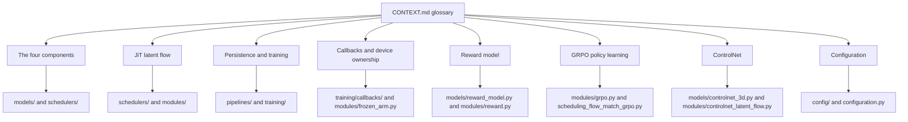

# Domain vocabulary and decision records

This page is the wiki's entry point into the project's *own* language. Manifold
keeps a single canonical glossary ([`CONTEXT.md`](../CONTEXT.md)) at the repo
root and a numbered decision trail ([`docs/adr/`](../docs/adr/)) beside it.
Everything else in the repo — source, tests, issue text — is expected to use the
glossary's terms and to respect the recorded decisions.

Three things live here:

- a **glossary map** — every canonical term, the synonyms the glossary says to
  avoid, and the source file or symbol that implements it;
- an **ADR index by subsystem** — what each decision established and which wiki
  page documents the behavior;
- the **work-recording conventions** — issues, triage labels, and how to flag a
  conflict with an existing decision instead of silently overriding it.

Start with [Quickstart](quickstart.md) for the wiki map, and
[Architecture and source map](architecture.md) for component boundaries and the
runtime flows behind these terms.



*Figure: Each glossary section of `CONTEXT.md` resolves to a small, identifiable slice of the source tree.*

## How work is recorded

### Issues and triage

Work is proposed and tracked as **GitHub Issues**, operated through the `gh`
CLI. Pull requests are explicitly *not* a request surface: `docs/agents/issue-tracker.md`
records "PRs as a request surface: no." The documented commands are:

```text
gh issue create --title "..." --body "..."
gh issue view <number> --comments
gh issue list --state open --json number,title,body,labels,comments --jq '...'
gh issue comment <number> --body "..."
gh issue edit <number> --add-label "..."   # or --remove-label
gh issue close <number> --comment "..."
```

The repo infers the repository from `git remote -v`, so `gh` needs no explicit
`--repo` flag inside a clone.

Five canonical triage labels are used, and only these five (their strings are
the default spellings, mapped one-to-one from the skills' role names):

| Label | Meaning |
|---|---|
| `needs-triage` | Maintainer needs to evaluate this issue |
| `needs-info` | Waiting on reporter for more information |
| `ready-for-agent` | Fully specified, ready for an AFK agent |
| `ready-for-human` | Requires human implementation |
| `wontfix` | Will not be actioned |

### Single-context domain docs and ADR conflicts

The repository is a **single-context repo**: `CONTEXT.md` plus `docs/adr/` at the
root, and nothing else. `docs/agents/domain.md` sets two obligations for
anything that names a domain concept (an issue title, a refactor proposal, a
hypothesis, a test name):

1. **Use the glossary's vocabulary.** Do not drift to a synonym the glossary
   explicitly avoids. If the concept you need is missing from the glossary, that
   is a signal: either you are inventing language the project does not use
   (reconsider) or there is a real gap (note it for the domain-modeling pass).
2. **Flag ADR conflicts explicitly** rather than silently overriding an existing
   decision — in the form *"Contradicts ADR-0007 (event-sourced orders) — but
   worth reopening because…"*.

`CLAUDE.md` is the human-readable entry point for the same three conventions
(issue tracker, triage labels, domain docs); `AGENTS.md` adds the OpenWiki
retrieval rules and states the tie-breaker used throughout this wiki: **source
code and tests are authoritative**.

## Glossary map

Each row gives the canonical term, the synonyms `CONTEXT.md` explicitly says to
avoid, and the source file or symbol that implements it. The glossary's own
section headings are preserved so the map can be read back against
`CONTEXT.md` line by line.

### The four components

| Canonical term | Avoid | Implemented by |
|---|---|---|
| **Model** | network, backbone | `src/manifold/models/` — `AutoencoderKL` (wraps MONAI MAISI `AutoencoderKlMaisi`), `UNet3DConditionModel` (wraps `DiffusionModelUNetMaisi`), `RewardModel`, `ControlNet3DConditionModel`. "Backbone" names the wrapped MONAI class, not the wrapper. |
| **Scheduler** | noise scheduler, sampler | `src/manifold/schedulers/scheduling_flow_match_heun.py` — `FlowMatchHeunDiscreteScheduler` (`add_noise`, `set_timesteps`, `scale_model_input`, `euler_step`, `heun_correct`, `heun_rollout`). Owns transport + reverse step and no training concern. |
| **Module** (training Module) | trainer, Lightning module | `src/manifold/modules/latent_flow.py` — `LatentFlowModule(spt.Module)`; siblings `ControlNetLatentFlowModule`, `RewardModule`, `GRPOModule`. Owns logit-normal `t` sampling, the `(1−t)⁻²` loss weight, the MSE, and optimizer wiring. |
| **Pipeline** | inferer, generator | `src/manifold/pipelines/latent_flow.py` — `LatentFlowPipeline` (`sample_latent`, `from_pretrained`, `save_pretrained`); `ControlNetLatentFlowPipeline`. Holds UNet, scheduler, VAE; returns a decoded volume. |

### The JiT latent flow

| Canonical term | Avoid | Implemented by |
|---|---|---|
| **JiT** (x0-denoiser) | recipe, denoiser mode, x0 mode | `prediction_type = "sample"` on the scheduler base (`src/manifold/schedulers/scheduling_utils.py`); the `(1−t)⁻²`-weighted clean-latent MSE in `LatentFlowModule.forward`. Not `torch.jit`. |
| **Transport** | forward process, noise schedule, corruption | `FlowMatchHeunDiscreteScheduler.add_noise` — `z = t·x + (1−t)·e`, `t∈[0,1]`, `t→1` is clean. The Module calls it rather than re-deriving the noising. |
| **scale_factor** | latent scale, norm factor | `AutoencoderKL.scaling_factor` (a buffer on the VAE wrapper, `src/manifold/models/autoencoder_kl.py`). `encode` returns scaled latents, `decode` undoes the scaling, `encode_raw` returns the unscaled latent the data stack estimates `1/std(z)` over (`estimate_scale_factor`, `src/manifold/data/latent_dataset.py`). The Module and Pipeline never reference it. |
| **conditioning** | context, encoder hidden states | `UNet3DConditionModel.forward(spacing=…, class_labels=…)` — the spacing tensor plus class-label vector the UNet consumes (medical geometry and modality, not text embeddings). |

### Persistence

| Canonical term | Avoid | Implemented by |
|---|---|---|
| **Checkpoint** (native) | weights file, model file | `LatentFlowPipeline.from_pretrained` / `save_pretrained` — a per-component directory plus `model_index.json`. Hope-style flat checkpoints are no longer ingested. |

### Training

| Canonical term | Avoid | Implemented by |
|---|---|---|
| **Training pipeline** | train script, run script | `manifold-train` → `src/manifold/training/cli.py` (`run_training`) composed over `TrainingSpine`; `build_trainer` in `src/manifold/training/trainer.py`. |
| **Training checkpoint** (`.ckpt`) | weights file (say training-ckpt or native) | The Lightning `ModelCheckpoint` artifact, mounted through `CheckpointSpec` (`src/manifold/training/callbacks/checkpoint.py`). Full training state (UNet + optimizer + LR schedule + epoch); the resume and best-by-FID medium. |
| **Export** | convert (say export) | `src/manifold/training/export.py` — `export_to_native`, the one-shot `.ckpt → native` bridge that bakes the raw optimizer weights as the inference UNet; the `manifold-export` CLI in `src/manifold/training/export_cli.py`. |
| **Fixed-sample validation** | rolling validation, random-sample eval | `FIDCallback` (`src/manifold/metrics/fid/callback.py`): the same fixed real subset, decoded once and cached, plus a re-seeded generation noise each epoch (`FixedSampleRollout`). |
| **Unbiased FID** | biased FID, plain FID | `src/manifold/metrics/fid/math.py` — `frechet_distance_unbiased` / `frechet_from_moments` (the small-sample `Tr(Σ)/n` correction), with `SufficientStatsReducer` doing the per-plane reduction. RadImageNet ResNet50 backbone, 2.5D over three orthogonal planes. |

### Training callbacks and device ownership

> `CONTEXT.md` heads this section "ADR-0029–0033, pending". That marker is
<!-- openwiki: broken internal link [#stale-markers-in-contextmd] heading anchor "stale-markers-in-contextmd" does not exist in /openwiki/domain-vocabulary-and-decisions.md. Fix the href or restore the target, then delete this comment. -->
> stale — see [Stale markers](#stale-markers-in-contextmd). The terms below
> describe shipped code.

| Canonical term | Avoid | Implemented by |
|---|---|---|
| **Callback registry** | callback factory, callback config | `src/manifold/training/callbacks/registry.py` — `CallbackRegistry` maps a callback **name** to a `CallbackSpec` dataclass. Construction is two-phase: `resolve` (config-time name/knob validation, fail-fast) then `build` (fit-prep injection of runtime objects via the typed `CallbackContext`). Registered specs: `train_loss`, `fid`, `checkpoint`, `paired_fidelity`. |
| **Frozen arm** | frozen module (say frozen arm) | `src/manifold/modules/frozen_arm.py` — `FrozenArmMixin._register_frozen_arm`. A registered `nn.Module` child (so Lightning's `.to(device)` moves it), held off the optimizer (`requires_grad=False`) and off the checkpoint (`state_dict`/`load_state_dict` overrides), and held in `eval()` across `module.train()`. Arms in the tree: the Reward Module's frozen JiT denoiser, the GRPO Module's frozen reward model / reference policy / frozen base UNet, the ControlNet Module's frozen base UNet. |
| **DevicePolicy** | device manager, device resolver | `src/manifold/training/device_policy.py` — `DevicePolicy.pin` (pre-process-group `set_device`, returns `cuda:{LOCAL_RANK}`), `.device` (side-effect-free read), `.warm_device(fallback)` (post-process-group VAE-warm resolution). Owns the pre-`Trainer.fit` staging decision only; Lightning owns in-Trainer placement. |
| **TrainingSpine** | training runner, base trainer | `src/manifold/training/core.py` — `TrainingSpine` is a composed dataclass (not a base class) owning callback-name merging → registry `resolve`/`build` → checkpoint injection → `build_trainer` → `fit`. It is the registry's single caller; seeding stays in each CLI shell because it must precede module construction. |
| **Collective-count invariance** (FID, DDP) | DDP guard, collective symmetry | `src/manifold/metrics/fid/callback.py` — `_all_reduce_flag` / `_make_error_flag`: every rank-local failure path sets an error flag that is `all_reduce`d with `ReduceOp.MAX` *before* any reduction-bearing phase, so all ranks abort or proceed together instead of entering collectives in different orders. |

### Reward model (GRPO)

| Canonical term | Avoid | Implemented by |
|---|---|---|
| **Reward Model** | discriminator, critic | `src/manifold/models/reward_model.py` — `RewardModel` wraps MONAI `PatchDiscriminator` behind a mean-pooling head. It emits a raw patch-logit mean (no sigmoid) and owns **no** rollout; it scores the terminal latent `z_K` unconditionally, for both GRPO policies. |
| **Reward Module** | reward trainer, reward Lightning module | `src/manifold/modules/reward.py` — `RewardModule(FrozenArmMixin, spt.Module)`: preference-pair construction, the Bradley–Terry pairwise loss (`bradley_terry_loss`), and optimizer wiring. It holds the frozen JiT x0-denoiser for the online rollout. |
| **Online rollout** (reward) | pair cache, online sampling | The per-fit-step pair rollout in `RewardModule.forward("fit")`, executed by `partial_denoise_rollout` (`src/manifold/modules/partial_denoise.py`) on `PartialFlowMatchHeunScheduler`. Distinct from the one-time val/probe precompute. |
| **Preference pair** (winner / loser) | positive/negative sample | `RewardModule` draws two flow-times `t_a, t_b ~ U[0,1)` per clean latent, labels the larger-`t` half the winner and the smaller-`t` the loser (label by *input* corruption level), and denoises both with the same Heun budget. The winner/loser corruption ranges overlap by construction. |

### GRPO policy learning

| Canonical term | Avoid | Implemented by |
|---|---|---|
| **Anchor trajectory** | baseline trajectory, reference rollout | `src/manifold/modules/grpo.py` — `singular_branch_rollout` runs one deterministic (noise-free) Heun anchor per group under `no_grad`; its interval slice is `FlowMatchGRPOScheduler.rollout_range`. |
| **Singular branching** | per-step GRPO, token-level GRPO | `singular_branch_rollout`: exactly **one** stochastic SDE step branched off the anchor at `z_k`, then a deterministic Heun suffix to the terminal `z_K` for the reward. One UNet evaluation stays inside the autograd graph. |
| **Transition policy** | policy network, actor | `src/manifold/schedulers/scheduling_flow_match_grpo.py` — `FlowMatchGRPOScheduler.sde_step_mean` owns the Gaussian `(mean, std)` of the one stochastic step; `gaussian_log_prob` in `modules/grpo.py` computes the mean-reduced log-density the clipped ratio uses. |
| **Group** | prompt, batch | `group_advantage` (`src/manifold/modules/grpo.py`): the `G` siblings sharing one (conditioning, initial-noise) pair, normalized as `A = (R − mean R)/(std R + ε)`. |
| **Policy Module** | GRPO trainer, actor | `src/manifold/modules/grpo.py` — `GRPOModule` overrides `training_step` (not `forward`), runs the multi-step PPO inner loop (`clipped_surrogate_loss`), and optimizes whichever policy the inputs supply: the JiT UNet, or the frozen base UNet plus the trainable ControlNet. It holds the frozen reward model, runs no EMA, and resumes/selects/exports the raw arm. |

### ControlNet (paired MRI)

| Canonical term | Avoid | Implemented by |
|---|---|---|
| **ControlNet** | control branch, condition net, control adapter (say ControlNet) | `src/manifold/models/controlnet_3d.py` — `ControlNet3DConditionModel`: a trainable clone of the base UNet's encoder plus zero-conv layers whose residuals enter the frozen base through MONAI's native `down_block_additional_residuals` / `mid_block_additional_residual` forward arguments. Zero-init zero-convs ⇒ the initial behavior is the pretrained JiT UNet unchanged. `x_src` is a **control signal**, not a transport endpoint. |
| **ControlNet two-stage** | paired pre-training (say ControlNet two-stage) | Stage 1 `ControlNetLatentFlowModule` (supervised, noise→data transport, `(1−t)⁻²`-weighted x0-MSE on `x_tgt`) → stage 2 `GRPOModule` on the ControlNet branch. Mirrors `LatentFlowModule → GRPOModule`. |
| **Direction head** | summed-label conditioning | `ControlNet3DConditionModel`: a direction MLP over `concat(embed(src), embed(tgt+offset))` on the ControlNet's class-embedding path, with `paired_direction_offset` breaking A↔B symmetry. Carries the any-to-any contrast pairing. |
| **Paired fidelity** (3D PSNR/SSIM) | image PSNR (specify 3D), fidelity reward | `src/manifold/metrics/paired.py` — `PairedFidelityMetrics` (MONAI 3D PSNR/SSIM, `data_range=1.0`) over per-sample min-max-normalized decoded volumes. Two protocols: the offline before/after comparison (`src/manifold/eval/before_after.py`) and the observe-only in-training monitor (`PairedFidelityCallback`, `src/manifold/metrics/paired_callback.py`; `PairedFidelitySpec`, `src/manifold/training/callbacks/paired_fidelity.py`). |

### Configuration

| Canonical term | Avoid | Implemented by |
|---|---|---|
| **Experiment config** | run config, hydra config, "the config" | `src/manifold/config/loader.py` (OmegaConf: env → recipe → network kwargs, `_base_` inheritance, `???` fail-fast, CLI/dotlist overrides) and `src/manifold/config/builder.py`. Builds components at launch; never persists them. |
| **Component config** | model config, "the config" (say which — Experiment or Component) | `src/manifold/configuration.py` — `register_to_config` / `ConfigMixin` write the per-component `config.json` that `from_pretrained` / `save_pretrained` round-trip. Independent of how the component was launched. |

## ADR index by subsystem

The trail in `docs/adr/` is 37 numbered decisions. They are indexed here by
subsystem rather than by number alone, because the numbers interleave
subsystems (for example 0011–0015 are GRPO, 0018–0023 are the paired reward that
ADR-0034 later deleted). Each row states what the decision established in one
line and points at the wiki page that documents the resulting behavior.

### Architecture and transport

| ADR | Purpose | Documented at |
|---|---|---|
| 0001 | Diffusers-style layout with manifold's own base classes (no `diffusers` subclassing); x0-only JiT; the Scheduler owns transport + reverse step, the Module owns training concerns. | [Architecture](architecture.md#component-model) |
| 0002 | Faithful two-evaluation true-Heun reverse step (predictor + corrector), not diffusers' single-call multistep idiom. | [Architecture](architecture.md#runtime-flows) |

### Persistence and configuration

| ADR | Purpose | Documented at |
|---|---|---|
| 0003 | `scale_factor` owned by the VAE wrapper; native per-component checkpoint format (the hope→native converter part is superseded by ADR-0007). | [Architecture](architecture.md#configuration-and-persistence) |
| 0004 | OmegaConf experiment-config layer above the JSON component config; the two config systems are separate by design. | [Architecture](architecture.md#configuration-and-persistence) |
| 0005 | The x0 Heun sampler primitive is owned by the Module; the Pipeline delegates to it (one rollout, no train/infer drift). | [Architecture](architecture.md#runtime-flows) |
| 0006 | Training writes Lightning `.ckpt`; the native inference directory comes from a separate export that bakes the raw UNet weights. | [Workflows](workflows.md#checkpoint-and-export-contract) |
| 0007 | Retire the hope→native converter; `export_to_native` becomes the sole checkpoint → inference path. | [Workflows](workflows.md#checkpoint-and-export-contract) |

### Reward and preference data

| ADR | Purpose | Documented at |
|---|---|---|
| 0008 | A second scheduler for partial per-sample denoise, by **inheritance** from the Heun scheduler — never a forked transport. | [Workflows](workflows.md#reward-and-grpo-stages) |
| 0009 | Reward via partial-reconstruction (corruption-level) labels, plus a generated-end probe that measures the train/inference gap (pair definition amended by ADR-0010). | [Workflows](workflows.md#reward-and-grpo-stages) |
| 0010 | Online rollout-in-the-loop preference pairs: full-range ordered winner/loser, de-saturating `val/pair_acc`. | [Workflows](workflows.md#reward-and-grpo-stages) |
| 0018 | Paired-JiT reward supervision: real target vs generated target (superseded by ADR-0034). | Decision history only |
| 0019 | Condition-aware paired reward scoring `concat([x_src, tgt])` (superseded by ADR-0034). | Decision history only |
| 0020 | Paired reward pairs precomputed offline into a disk fake cache (superseded by ADR-0034). | Decision history only |
| 0021 | Paired-reward generator loaded through a paired native export bridge, baking the raw arm (superseded by ADR-0034; the loader survives relocated to `training/controlnet_inputs.py`). | [Workflows](workflows.md#reward-and-grpo-stages) |
| 0022 | Paired reward subject split is 2-way, reusing the paired train/val partition (superseded by ADR-0034; the splitter survives relocated to `data/paired_manifests.py`). | [Architecture](architecture.md#supervised-paired-translator-controlnet) |
| 0023 | Paired reward generated-end probe; the checkpoint monitors `val/gen_pair_acc` (superseded by ADR-0034). | Decision history only |

### GRPO policy learning

ADR-0013 and ADR-0014 are the *paired-transport* decisions (the src→tgt flow
and its conditioning) that ADR-0026/0028 later replaced; they sit in this
number range but belong to the retired paired-JiT line.

| ADR | Purpose | Documented at |
|---|---|---|
| 0011 | GRPO singular-branching rollout on a deterministic Heun anchor; the SDE transition math lives in `FlowMatchGRPOScheduler`. | [Workflows](workflows.md#reward-and-grpo-stages) |
| 0012 | `GRPOModule` overrides `training_step` with a multi-step PPO inner loop; raw arm, no EMA (its "no KL" clause was reversed by ADR-0015). | [Workflows](workflows.md#reward-and-grpo-stages) |
| 0013 | Paired JiT: the same transport with a data latent at the `t = 0` endpoint (superseded by ADR-0026/0027). | Decision history only |
| 0014 | Paired JiT conditioning: channel concat of `x_src` plus summed contrast labels, trained from scratch (retired by ADR-0026/0028). | Decision history only |
| 0015 | GRPO v2: KL anchor to a frozen reference policy plus a bounded reward (reverses ADR-0012's `KL = 0`). | [Workflows](workflows.md#reward-and-grpo-stages) |

### DDP and validation

| ADR | Purpose | Documented at |
|---|---|---|
| 0016 | Multi-GPU validation stays rank-0-only, with honest guards (superseded by ADR-0025). | Decision history only |
| 0017 | Latent cache warm-up moves into `DataModule.setup()`, so process-group-initialized per-rank sharding is actually live. | [Workflows](workflows.md#jit-training) |
| 0025 | All validation metrics are fully DDP; the rank-0-only gate is removed (supersedes ADR-0016). | [Operations and testing](operations-and-testing.md#distributed-validation-contract) |
| 0030 | FID callback split at **metric** granularity into composable helpers, plus the collective-count invariance hardening. | [Callback registry](callback-registry.md) |

### ControlNet

| ADR | Purpose | Documented at |
|---|---|---|
| 0024 | Paired GRPO (G2RPO): Brownian-bridge singular-branch GRPO on the src→tgt flow (superseded by ADR-0028). | Decision history only |
| 0026 | ControlNet on the frozen JiT UNet via MONAI's native residual-injection forward arguments — replaces the src→tgt transport. | [Architecture](architecture.md#supervised-paired-translator-controlnet) |
| 0027 | ControlNet two-stage: supervised pre-training, then GRPO on the ControlNet. | [Workflows](workflows.md#paired-training) |
| 0028 | Two-mode GRPO unified into one Module; the Brownian bridge machinery is deleted (the "Mode-1 / Mode-2" wording is later dropped by ADR-0034). | [Architecture](architecture.md#reward-and-policy-post-training) |

### Callbacks and the CLI spine

| ADR | Purpose | Documented at |
|---|---|---|
| 0029 | Callback registry: name → spec, two-phase `resolve`/`build`, registry-driven callbacks. | [Callback registry](callback-registry.md) |
| 0032 | CLI spine collapse: one composed `TrainingSpine` over the registry; five thin shells; one checkpoint owner. | [Callback registry](callback-registry.md) |
| 0033 | `scripts/` elimination: `export_checkpoint.py` becomes `manifold-export`, `generate_reward_pairs.py` is retired, dead diagnostics are removed. | [Workflows](workflows.md#checkpoint-and-export-contract) |

### Device ownership

| ADR | Purpose | Documented at |
|---|---|---|
| 0031 | Device ownership split in two: Lightning owns in-`Trainer.fit` frozen arms (register + dual-exclude); a `DevicePolicy` owns pre-Trainer staging (§A2 landed by ADR-0035). | [Frozen arms and device policy](frozen-arm-and-device-policy.md) |
| 0035 | `DevicePolicy` — the single owner of the per-rank pre-process-group CUDA device; lands ADR-0031 §A2 and deletes the misplaced `resolve_warm_device` free function. | [Frozen arms and device policy](frozen-arm-and-device-policy.md) |

### Evaluation

| ADR | Purpose | Documented at |
|---|---|---|
| 0036 | ControlNet translation fidelity is offline 3D PSNR/SSIM against the real target, not FID. | [Evaluation](evaluation.md) |
| 0037 | ControlNet paired fidelity is **also** monitored in training — observe-only `val/psnr` / `val/ssim` on a fixed paired subset, never a checkpoint monitor or a loss term. | [Architecture](architecture.md#in-training-paired-fidelity-monitor) |

### Proposed plan (not an ADR)

`docs/prd/ddp-correctness.md` is a **proposed** PRD (status banner in the
file), not a decision record. Its locked "keep rank-0-only FID/PSNR" choice was
later reversed by ADR-0025, and it cites modules that no longer exist
(`paired_cli.py`, `psnr_ssim_callback.py`). Treat it as historical planning
input, not as current policy.

## Superseded and dead vocabulary

These terms still appear in `CONTEXT.md` and in ADR bodies because they were
once real. Do **not** resurrect the modules, flags, or CLI entries behind them.

| Dead term | What replaced it | Why it is dead |
|---|---|---|
| **Paired JiT** and its companions — src/tgt latents, summed-label conditioning, any-to-any pairing as a *transport*, the paired dataset contract | **ControlNet** on the noise→data transport | The src→tgt transport is gone. `x_src` survives only as a ControlNet **control signal**; the summed-label base-UNet mechanism was replaced by the ControlNet **direction head** (ADR-0026/0028). |
| **Paired reward model** — the condition-aware `2·C_latent` reward, real-vs-fake supervision, the offline fake cache, the paired probe, `PairedRewardModule`, `paired_reward_cli` | The single unconditional realism **Reward Model** | Deleted by ADR-0034. Both GRPO policies score `z_K` with the same `C_latent` reward; ControlNet fidelity comes from `x_src` conditioning + the supervised init + the KL anchor. |
| **Mode-1 / Mode-2 GRPO** (and any `--grpo-mode` flag) | One `GRPOModule` that infers its policy from the inputs | ADR-0028 unified the two modes; ADR-0034 dropped the numbering. There is no mode flag in the CLI today. |
| **Brownian bridge / paired GRPO** — `FlowMatchBridgeGRPOScheduler`, `singular_branch_rollout_paired` | The noise→data `FlowMatchGRPOScheduler`, reused verbatim | Deleted by ADR-0028. |
| **hope flat checkpoints**, the hope→native converter, `convert_hope_checkpoint` | `export_to_native` (ADR-0006) | Converter retired by ADR-0007; `from_pretrained` ingests native per-component directories only. |
| **EMA arms** (the "slowest-decay EMA shadow" selection) | Raw optimizer weights everywhere | EMA training was removed codebase-wide; the export always bakes the raw arm. |
| `manifold-train-paired`, `manifold-train-paired-reward` | `manifold-train-controlnet`; the reward CLI is `manifold-train-reward` | Removed with the paired-reward pipeline (ADR-0034). `pyproject.toml` is the single source of truth for console scripts. |
| `--pipeline paired` in `manifold-export` | `--pipeline jit` (default) or `--pipeline controlnet` | The choice string survives in `src/manifold/training/export_cli.py` but references a deleted module; it is a known backlog item, not a workflow. |

## Stale markers in the domain docs

`CONTEXT.md` is the vocabulary of record, but it carries markers that the code
has already overtaken. **Source and tests are authoritative** — the same rule
`AGENTS.md` states for the wiki itself.

1. **"Training callbacks & device ownership (ADR-0029–0033, pending)"** — the
   section note still says "ADRs written; implementation pending". All of it
   shipped: the registry (`CallbackRegistry`, two-phase `resolve`/`build`), the
   FID helper split and collective-count hardening, the frozen-arm
   registration, the `TrainingSpine` spine, and the `scripts/` removal. The two
   follow-ons that completed the refactor are live too — `DevicePolicy`
   (ADR-0035, landing ADR-0031 §A2) and the in-training paired-fidelity
   monitor (ADR-0037, `PairedFidelityCallback` + `PairedFidelitySpec`, mounted
   by `manifold-train-controlnet`).
2. **"unregistered" frozen arms** — the Reward Module entry ("holds the frozen
   JiT x0-denoiser (unregistered, so off the checkpoint/optimizer)") and the
   Policy Module entry ("frozen Reward Model (unregistered, …)") describe the
   retired `object.__setattr__` bypass. The arms are now **registered**
   `nn.Module` children held off the optimizer and off the checkpoint by
   `FrozenArmMixin` (ADR-0031 A1). A stale echo of the same wording survives
   in the `src/manifold/training/export.py` header comment. The `frozen arm`
   term itself is current; only its "unregistered" qualifier is not.
3. **ADR front-matter status banners** are not a reliable implementation
   signal either. `docs/adr/0017-latent-warmup-in-datamodule-setup.md` still
   carries `status: proposed` and says "the implementation is not yet landed",
   but the warm now runs inside `LatentWarmDataModule.setup()` after the
   process group exists. Read the ADR's *decision* text, then confirm against
   source.

## Where to go next

- [Quickstart](quickstart.md) — wiki map and task routing to entry points, symbols, and focused tests.
- [Architecture and source map](architecture.md) — component boundaries, runtime flows, and the native artifact contract.
- [Key workflows](workflows.md) — JiT training, the supervised ControlNet translator, the reward and GRPO stages, export, and evaluation.
- [Callback registry and training spine](callback-registry.md) — the spec contract, `resolve`/`build`, and the `TrainingSpine` merge order.
- [Frozen arms and per-rank device policy](frozen-arm-and-device-policy.md) — `FrozenArmMixin` and `DevicePolicy` in detail.
- [Before/after GRPO evaluation](evaluation.md) — `manifold-eval`, paired PSNR/SSIM, and the report artifacts.
- [Operations and testing](operations-and-testing.md) — the distributed-validation contract and the focused test commands.
