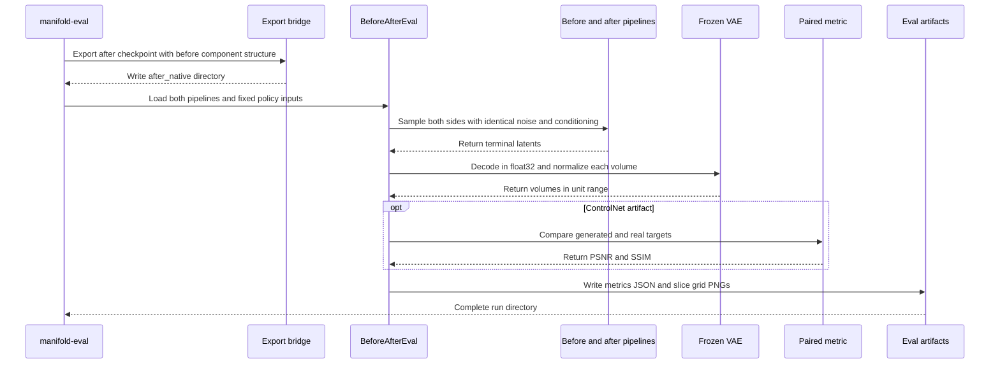

# Before/after GRPO evaluation

## When to use this page

Consult this page when adding or changing the shipped `manifold-eval` entry point, a paired-fidelity scalar, the before/after eval driver, evaluation artifacts, or the report builder. The evaluation workflow composes the [checkpoint-to-native export contract](workflows.md#checkpoint-and-export-contract) and is structurally dependent on the persisted `model_index.json` contract documented in [Architecture and source map](architecture.md#configuration-and-persistence).

The subsystem has four layers:

1. `src/manifold/eval/cli.py` owns the `manifold-eval` console entry and infers the policy from the before native artifact.
2. `src/manifold/eval/before_after.py` owns the policy-agnostic same-noise generation, decode, normalization, scoring, and grid-writing flow.
3. `src/manifold/metrics/paired.py` owns the MONAI-backed 3D PSNR/SSIM metric for ControlNet pairs.
4. `src/manifold/eval/comparison_page.py` turns the written metrics and PNGs into a self-contained HTML report. It is library-only, not a console command.

The public `manifold.eval` barrel exports `BeforeAfterEval`, `BeforeAfterResult`, `SliceGrid`, `ComparisonPageBuilder`, `JitComparison`, and `ControlNetComparison` from `src/manifold/eval/__init__.py`. The only shipped console surface is `manifold-eval`, registered in `pyproject.toml` as `manifold-eval = "manifold.eval.cli:main"`.

## Runtime flow



*Figure: `manifold-eval` exports the after policy, samples both sides under paired noise, decodes and scores them, and writes portable evaluation artifacts.*

The driver creates a same-noise contract in two ways:

- **JiT / unconditional:** each pipeline receives a fresh generator on the same device with the same `seed`; both produce the same Gaussian start noise.
- **ControlNet / paired:** one noise tensor is drawn for the batch and passed to both `sample_latent` calls. The source latent, real target latent, spacing, contrast labels, and Heun step count stay fixed.

This makes differences attributable to the policy weights rather than random sampling. `BeforeAfterEval` is intentionally injectable: callers can replace its `fidelity` scorer or `grid` renderer, and the CLI can replace real ControlNet data loading with `pairs_provider` in focused smoke tests.

## Policy dispatch and artifact contract

`_pipeline_class_of` reads `pipeline_class` from the before directory's `model_index.json`. There is no evaluation mode flag:

| `pipeline_class` | Resulting path | Evaluation input |
|---|---|---|
| `LatentFlowPipeline` | `run_unconditional` | `--latent-shape`, `--num-samples`, `--modality`, `--spacing`, and fixed seed |
| `ControlNetLatentFlowPipeline` | `run_paired` | held-out `src`/`tgt` latent pairs, spacing, contrast labels, and fixed seed |

A directory without `model_index.json` raises `FileNotFoundError`; an unrecognized `pipeline_class` raises a `ValueError` naming the supported classes.

The CLI loads a probe pipeline from the before export, uses its UNet/VAE/scheduler structure to run the existing `export_to_native` bridge, and writes the after policy to `<output>/after_native`. It then reloads both native exports into fresh pipelines. A ControlNet after export reuses the before export's frozen base; only the after checkpoint's trainable `controlnet.*` weights are baked.

The before export remains independent because the export bridge mutates the loaded probe components in place. The ControlNet real-data path also reuses `build_brats_pair_manifest`, `_train_val_manifests`, and the warmed paired latent cache; it applies the before VAE's `scaling_factor` rather than re-estimating it. A held-out validation split is mandatory, either through `--val-data-base-dir` or a positive `--val-fraction`.

## Running the shipped workflow

For JiT, generate unconditional before/after grids:

```bash
manifold-eval \
  --before-dir runs/jit_native \
  --after-ckpt runs/grpo_jit/last.ckpt \
  --output runs/eval_jit \
  --device cuda
```

For ControlNet, evaluate matched translations against held-out real targets:

```bash
manifold-eval \
  --before-dir runs/controlnet_native \
  --after-ckpt runs/grpo_controlnet/last.ckpt \
  --output runs/eval_controlnet \
  --data-base-dir data/brats \
  --val-data-base-dir data/brats_val \
  --latents-dir runs/paired_latents \
  --target-dim 256,256,128 \
  --num-pairs 8 \
  --device cuda
```

Shared controls are `--seed`, `--num-inference-steps`, and `--device` (which defaults to `cuda` when available, else `cpu`). ControlNet-only controls are `--data-base-dir`, `--val-data-base-dir`, `--val-fraction`, `--latents-dir`, `--cache-tag`, `--target-dim`, `--num-pairs`, `--src-label`, and `--tgt-label`. The ControlNet path needs `--data-base-dir` and `--latents-dir` unless a `pairs_provider` is injected; the eval never encodes, so a warmed cache miss fails fast rather than silently encoding.

## Outputs and metric semantics

`BeforeAfterEval` writes one 2.5D PNG per sample. Each grid has three orthogonal center slices (`xy`, `yz`, `zx`) and columns for the policy outputs:

- JiT: `before | after`.
- ControlNet: `before | after | real target`.

`metrics.json` records the policy, seed, inference-step count, sample count, grid basenames, and the before/after values that apply. For ControlNet the generated target and real target are each VAE-decoded and passed through the shared `min_max_to_unit` helper before MONAI scoring. Grid references in JSON are basenames, so the report remains portable after the eval directory is moved.

Write durability differs by artifact: the slice-grid PNGs and the HTML page are written atomically (`.tmp` plus `os.replace`, so an interrupted run cannot leave a truncated file), while `metrics.json` is written directly.

### Paired-fidelity metric

`PairedFidelityMetrics` takes generated and real tensors with equal `[B,C,D,H,W]` shape, already normalized to `[0,1]`. It composes MONAI `PSNRMetric(max_val=1.0)` and `SSIMMetric(spatial_dims=3, data_range=1.0)`, then batch-means both outputs. PSNR is reported in dB and is `+inf` for zero-error/identical volumes; SSIM is bounded by MONAI's metric and equals `1.0` for identical volumes. A shape mismatch between the generated and the real volume raises a `ValueError` before MONAI sees the pair.

`min_max_to_unit` normalizes each decoded volume independently. A constant/degenerate volume maps to zeros instead of dividing by zero. Do not compare unnormalized VAE output, or change the metric's default data range without updating both the ControlNet pipeline and eval paths; that would make in-training and offline measurements diverge. The MONAI 3D SSIM default window also requires spatial extents that fit its configured window, so production smoke fixtures should not shrink every axis below the supported window size.

Unlike unconditional JiT evaluation, paired fidelity is full-reference: it requires a real target. It complements rather than replaces the realism reward, which is deliberately fidelity-blind. As recorded in ADR-0036, offline PSNR/SSIM is the apples-to-apples GRPO comparison; the unconditional JiT continues to use shared `val/fid` plus reward trajectory.

## From metrics to a shareable comparison

`ComparisonPageBuilder.build` accepts `JitComparison(eval_dir, before_csv, after_csv)` and optionally `ControlNetComparison(eval_dir)`. It reads `metrics.json`, optionally reads JiT `val/fid` and `val/mean_reward` series from Lightning `metrics.csv` files, and embeds both generated curves and slice grids as base64 PNG data URIs. The result has no external image, stylesheet, or script dependencies and can be written atomically to an `out_path`.

The page deliberately explains the metric split: JiT is reference-free and uses FID, while ControlNet has a real target and uses PSNR/SSIM. If a ControlNet eval directory is not supplied, the builder emits a clearly marked pending slot rather than inventing a comparison. This API is imported from `manifold.eval`; unlike `manifold-eval`, it is not registered in `[project.scripts]`.

## Relationship to the in-training paired-fidelity monitor

ADR-0037's in-training paired-fidelity monitor is implemented in the current tree: `PairedFidelityCallback` (`src/manifold/metrics/paired_callback.py`) behind the registry spec `PairedFidelitySpec` (`src/manifold/training/callbacks/paired_fidelity.py`). Its knobs, cadence, DDP behavior, and test anchors are documented on the dedicated [Paired-fidelity monitor](paired-fidelity-monitor.md) page.

What matters for this page is the contract the two share: the monitor runs the **same metric**, the **same `min_max_to_unit` normalization**, and the **same full Heun rollout** as this offline comparison, so the in-training `val/psnr` / `val/ssim` curve is directly comparable to the offline number. The monitor stays **observe-only** — it never selects checkpoints (selection remains `val/x0_mae`) and never contributes loss or gradient. This offline pass remains the apples-to-apples before/after pairing of record; the monitor is a per-epoch drift screen, not a replacement (ADR-0036, ADR-0037).

## Change guidance

### Change sampling or add a new policy

Start in `BeforeAfterEval` and preserve the paired-input contract. Policy detection then belongs in `_pipeline_class_of`; add the concrete pipeline to the known mapping and pass real policy-specific inputs through the CLI. Validate both driver-level same-pipeline identity and CLI end-to-end artifact routing.

### Change PSNR, SSIM, or normalization

Change the metric contract in `src/manifold/metrics/paired.py`, re-export names from `src/manifold/metrics/__init__.py`, and update every consumer that must remain comparable. A normalization change crosses `src/manifold/pipelines/pipeline_utils.py`, `controlnet_latent_flow.py`, `before_after.py`, and the in-training monitor (`src/manifold/metrics/paired_callback.py`); it is not an eval-only change.

### Add or change report content

Treat `BeforeAfterResult.metrics` and the persisted JSON/PNG layout as the source contract. Update `ComparisonPageBuilder`, both comparison test fixtures, and the in-tree builder tests. Keep `ComparisonPageBuilder` library-only unless a separate decision introduces a new console command; artifact assembly is intentionally outside `manifold-eval` runtime.

### Add a console entry

Register the callable in `pyproject.toml` and ensure the executable is exercised from a real subprocess or equivalent installed-command smoke, not only an in-process import. For `manifold-eval`, retain `main(argv=None)` as the consumer seam and keep the before-artifact policy inference free of a mode flag.

### Extend the paired-fidelity monitor to the ControlNet-GRPO path

The supervised ControlNet stage already runs the monitor; the GRPO stage does not. `src/manifold/training/grpo_cli.py` registers only `train_loss`, `fid`, and `checkpoint`, and on the ControlNet-GRPO path it forbids the `fid` callback and the `val/fid` monitor because an unconditional FID rollout ignores the ControlNet. ADR-0037 treats the GRPO-stage extension as a **deliberate follow-up with its own ticket/ADR**, since that rationale does not cover paired fidelity — the paired rollout goes through the trainable ControlNet. Landing it means registering `PairedFidelitySpec` on the GRPO shell, supplying a paired validation subset source and the rollout step count (the GRPO `CallbackContext.inference_recipe` is `None` when FID is off), and deciding how the VAE is staged for the decode on that path. The offline eval and the supervised monitor are unaffected either way.

## Focused tests and minimal validation

| Behavior | Existing test anchor |
|---|---|
| Metric identity, known PSNR, perturbation monotonicity, 3D input, and shape rejection | `tests/test_paired_fidelity.py` |
| JiT and ControlNet same-seed/same-pipeline identity, normalization, paired columns, scores, and reproducible grids | `tests/test_before_after_eval.py` |
| Console policy routing, after-export weight bake, held-out data loading, and required inputs | `tests/test_eval_cli.py` |
| Self-contained HTML, metric explanation, curves, grids, pending slot, and output file | `tests/test_comparison_page.py` |

Run the full focused evaluation surface with:

```bash
pytest tests/test_paired_fidelity.py tests/test_before_after_eval.py tests/test_eval_cli.py tests/test_comparison_page.py -q
```

For a fast first pass, run `pytest tests/test_paired_fidelity.py tests/test_before_after_eval.py -q`; the CLI and report-builder tests are still required when crossing the installed console or artifact/presentation boundary. Also consult [Operations and testing](operations-and-testing.md#standard-checks) for the repository test matrix and the conditions that make broader DDP or packaging checks necessary.
