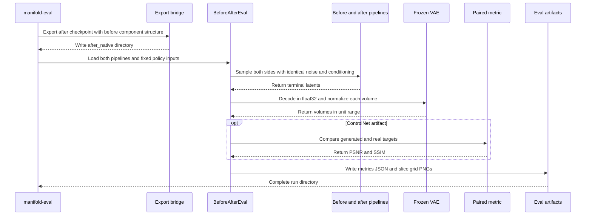
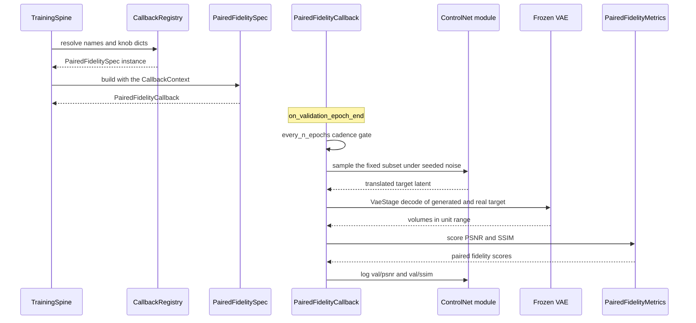

# Before/after GRPO evaluation

## When to use this page

Consult this page when adding or changing the shipped `manifold-eval` entry point, a paired-fidelity scalar, the before/after eval driver, evaluation artifacts, the report builder, or the in-training paired-fidelity monitor. The evaluation workflow composes the [checkpoint-to-native export contract](workflows.md#checkpoint-and-export-contract) and is structurally dependent on the persisted `model_index.json` contract documented in [Architecture and source map](architecture.md#configuration-and-persistence).

The offline subsystem has four layers:

1. `src/manifold/eval/cli.py` owns the `manifold-eval` console entry and infers the policy from the before native artifact.
2. `src/manifold/eval/before_after.py` owns the policy-agnostic same-noise generation, decode, normalization, scoring, and grid-writing flow.
3. `src/manifold/metrics/paired.py` owns the MONAI-backed 3D PSNR/SSIM metric for ControlNet pairs.
4. `src/manifold/eval/comparison_page.py` turns the written metrics and PNGs into a self-contained HTML report. It is library-only, not a console command.

A fifth layer sits beside them and **shares layer 3**: the in-training paired-fidelity monitor (`src/manifold/metrics/paired_callback.py` plus its registry spec `src/manifold/training/callbacks/paired_fidelity.py`), documented in [In-training paired-fidelity monitor](#in-training-paired-fidelity-monitor).

The public `manifold.eval` barrel exports `BeforeAfterEval`, `BeforeAfterResult`, `SliceGrid`, `ComparisonPageBuilder`, `JitComparison`, and `ControlNetComparison` from `src/manifold/eval/__init__.py`. The only shipped console surface is `manifold-eval`, registered in `pyproject.toml` as `manifold-eval = "manifold.eval.cli:main"`. The monitor is library-only as well: `manifold.metrics` exports `PairedFidelityCallback`, `PairedFidelityMetrics`, `PairedFidelityScores`, and `VaeStage`, and `manifold.training.callbacks` exports `PairedFidelitySpec`.

## Runtime flow



*Figure: `manifold-eval` exports the after policy, samples both sides under paired noise, decodes and scores them, and writes portable evaluation artifacts.*

The driver creates a same-noise contract in two ways:

- **JiT / unconditional:** each pipeline receives a fresh generator on the same device with the same `seed`; both produce the same Gaussian start noise.
- **ControlNet / paired:** one noise tensor is drawn for the batch and passed to both `sample_latent` calls. The source latent, real target latent, spacing, contrast labels, and Heun step count stay fixed.

This makes differences attributable to the policy weights rather than random sampling. `BeforeAfterEval` is intentionally injectable: callers can replace its `fidelity` scorer or `grid` renderer, and the CLI can replace real ControlNet data loading with `pairs_provider` in focused smoke tests.

## Policy dispatch and artifact contract

`_pipeline_class_of` reads `pipeline_class` from the before directory's `model_index.json`. There is no evaluation mode flag:

| `pipeline_class` | Resulting path | Evaluation input |
|---|---|---|
| `LatentFlowPipeline` | `run_unconditional` | `--latent-shape`, `--num-samples`, `--modality`, `--spacing`, and fixed seed |
| `ControlNetLatentFlowPipeline` | `run_paired` | held-out `src`/`tgt` latent pairs, spacing, contrast labels, and fixed seed |

The CLI loads a probe pipeline from the before export, uses its UNet/VAE/scheduler structure to run the existing `export_to_native` bridge, and writes the after policy to `<output>/after_native`. It then reloads both native exports into fresh pipelines. A ControlNet after export reuses the before export's frozen base; only the after checkpoint's trainable `controlnet.*` weights are baked.

The before export remains independent because the export bridge mutates the loaded probe components in place. The ControlNet real-data path also reuses `build_brats_pair_manifest`, `_train_val_manifests`, and the warmed paired latent cache; it applies the before VAE's `scaling_factor` rather than re-estimating it. A held-out validation split is mandatory, either through `--val-data-base-dir` or a positive `--val-fraction`.

## Running the shipped workflow

For JiT, generate unconditional before/after grids:

```bash
manifold-eval \
  --before-dir runs/jit_native \
  --after-ckpt runs/grpo_jit/last.ckpt \
  --output runs/eval_jit \
  --device cuda
```

For ControlNet, evaluate matched translations against held-out real targets:

```bash
manifold-eval \
  --before-dir runs/controlnet_native \
  --after-ckpt runs/grpo_controlnet/last.ckpt \
  --output runs/eval_controlnet \
  --data-base-dir data/brats \
  --val-data-base-dir data/brats_val \
  --latents-dir runs/paired_latents \
  --target-dim 256,256,128 \
  --num-pairs 8 \
  --device cuda
```

Shared controls are `--seed`, `--num-inference-steps`, and `--device`. ControlNet-only controls are `--data-base-dir`, `--val-data-base-dir`, `--val-fraction`, `--latents-dir`, `--cache-tag`, `--target-dim`, `--num-pairs`, `--src-label`, and `--tgt-label`.

## Outputs and metric semantics

`BeforeAfterEval` writes one 2.5D PNG per sample. Each grid has three orthogonal center slices (`xy`, `yz`, `zx`) and columns for the policy outputs:

- JiT: `before | after`.
- ControlNet: `before | after | real target`.

`metrics.json` records the policy, seed, inference-step count, sample count, grid basenames, and the before/after values that apply. For ControlNet the generated target and real target are each VAE-decoded and passed through the shared `min_max_to_unit` helper before MONAI scoring. The grid and HTML files use atomic replacement writes, and grid references in JSON are basenames so the report remains portable after the eval directory is moved.

### Paired-fidelity metric

`PairedFidelityMetrics` takes generated and real tensors with equal `[B,C,D,H,W]` shape, already normalized to `[0,1]`. It composes MONAI `PSNRMetric(max_val=1.0)` and `SSIMMetric(spatial_dims=3, data_range=1.0)`, then batch-means both outputs. PSNR is reported in dB and is `+inf` for zero-error/identical volumes; SSIM is bounded by MONAI's metric and equals `1.0` for identical volumes.

`min_max_to_unit` normalizes each decoded volume independently. A constant/degenerate volume maps to zeros instead of dividing by zero. Do not compare unnormalized VAE output, or change the metric's default data range without updating both the ControlNet pipeline and eval paths; that would make in-training and offline measurements diverge. The MONAI 3D SSIM default window also requires spatial extents that fit its configured window, so production smoke fixtures should not shrink every axis below the supported window size.

The same metric class and the same `min_max_to_unit` normalization are used by the [in-training paired-fidelity monitor](#in-training-paired-fidelity-monitor), and both paths generate with the full Heun rollout — so the monitor's per-epoch `val/psnr` / `val/ssim` and this offline number are directly comparable.

Unlike unconditional JiT evaluation, paired fidelity is full-reference: it requires a real target. It complements rather than replaces the realism reward, which is deliberately fidelity-blind. As recorded in ADR-0036, offline PSNR/SSIM is the apples-to-apples GRPO comparison; the unconditional JiT continues to use shared `val/fid` plus reward trajectory.

## From metrics to a shareable comparison

`ComparisonPageBuilder.build` accepts `JitComparison(eval_dir, before_csv, after_csv)` and optionally `ControlNetComparison(eval_dir)`. It reads `metrics.json`, optionally reads JiT `val/fid` and `val/mean_reward` series from Lightning `metrics.csv` files, and embeds both generated curves and slice grids as base64 PNG data URIs. The result has no external image, stylesheet, or script dependencies and can be written atomically to an `out_path`.

The page deliberately explains the metric split: JiT is reference-free and uses FID, while ControlNet has a real target and uses PSNR/SSIM. If a ControlNet eval directory is not supplied, the builder emits a clearly marked pending slot rather than inventing a comparison. This API is imported from `manifold.eval`; unlike `manifold-eval`, it is not registered in `[project.scripts]`.

## In-training paired-fidelity monitor

ADR-0037's observe-only monitor **ships** on the supervised ControlNet path. `manifold-train-controlnet` registers a `paired_fidelity` spec by default, so a supervised run logs `val/psnr` and `val/ssim` on every gated validation epoch while checkpoint selection stays on `val/x0_mae`. This section is the canonical reference for the monitor; the registry mechanics it plugs into are in [Callback registry and training spine](callback-registry.md#change-guidance).

Sibling pages link to this section as `#in-training-paired-fidelity-monitor`; the former `#accepted-in-training-monitor-planned-not-active` anchor is retired.



*Figure: the monitor is resolved and built through the registry, then scores one gated validation epoch — fixed subset, full rollout, staged decode, shared metric, two logged scalars.*

### The callback

`PairedFidelityCallback` (`src/manifold/metrics/paired_callback.py`) is a `pl.Callback` that acts on `on_validation_epoch_end`:

- **Cadence gate.** `_gated` mirrors `FIDCallback._gated`: the monitor runs when `every_n_epochs <= 1` or `current_epoch % every_n_epochs == 0`. All ranks gate identically (the epoch counter is rank-symmetric), so the metric-sync collective stays symmetric. A gated-off epoch performs no generation, no decode, and logs nothing.
- **Fixed paired subset.** `_fixed_subset` takes a seeded `randperm` prefix of `subset_size` items from the paired validation dataset and collates them once; the collated batch (`src_latent` / `tgt_latent` `[N, C, D, H, W]`, `src_label` / `tgt_label` `[N]`, `spacing` `[N, 3]`) is cached on the callback. The same subjects are scored every monitored epoch, so an epoch-over-epoch change reflects the model and not a moving data sample.
- **Lazy dataset resolution.** The source may be the dataset itself or a datamodule exposing `val_latent_ds`; the callback resolves `getattr(src, "val_latent_ds", src)` at first use, so the cold path's post-`setup()` replacement of the warmed validation dataset is honored (F5 / ADR-0017). `build` never resolves it.
- **Generation.** A fresh `torch.Generator(device).manual_seed(seed)` draws the start noise on every gated epoch — sampling stochasticity is isolated from quality drift — and the module's own `ControlNetLatentFlowModule.sample` (the shared `controlnet_rollout` Heun primitive, so validation cannot drift from inference) produces the translated target latent. The whole generation runs under `torch.inference_mode()`: no gradient is ever formed.
- **Decode.** `VaeStage` (`src/manifold/metrics/vae_stage.py`) moves the held frozen VAE to the module's device for the decode and restores it to CPU afterwards; `LatentDecoder` decodes the generated and the real target latents identically (float32, `norm_float16` disabled).
- **Normalize and score.** Both volumes pass through `min_max_to_unit` (per-sample to `[0, 1]`), then `PairedFidelityMetrics` scores 3D PSNR + 3D SSIM — the same class, the same normalization, and the same full-rollout generation as the offline pass.
- **Log.** The two `torchmetrics.MeanMetric` instances are attached to the **module** (`_manifold_val_psnr_mean` / `_manifold_val_ssim_mean`), because Lightning only registers metrics it finds on the module. They are reset before each update, so the logged number is the current epoch's value and not a running mean, and `module.log("val/psnr", …)` / `module.log("val/ssim", …)` hand the cross-rank reduction to Lightning's metric sync.

Because `MetricsPlotCallback` renders every finite CSV column as its own subplot, `val/psnr` and `val/ssim` appear in the standard metrics PNG with no extra wiring; the `+inf` PSNR sentinel of identical volumes is filtered out by that renderer rather than collapsing the axis scale.

### The registered spec and the wiring

`PairedFidelitySpec` (`src/manifold/training/callbacks/paired_fidelity.py`) is the frozen dataclass the registry resolves. Its knobs are `subset_size` (8), `every_n_epochs` (1), `num_inference_steps` (`None` ⇒ read from the recipe), and `seed` (0); `logged_metrics` is a `ClassVar`, so it is not a config knob. `CallbackRegistry.resolve` rejects an unknown knob for the name with a `ValueError` before any callback object exists.

`build(ctx)` injects the runtime objects: `ctx.module`, `ctx.vae`, and `ctx.datamodule` — forwarded as the paired-subset source and resolved lazily by the callback, never at build time.

**Recipe-primary rollout depth.** The spec's `num_inference_steps` defaults to `None`, meaning "read it from the recipe": `build` takes `ctx.inference_recipe["num_inference_steps"]`, falling back to the callback's own 15 when the context carries no recipe. The supervised shell fills that field from the existing `controlnet.num_inference_steps` knob (default 15 ⇒ 29 UNet evaluations), so the rollout depth is one shared knob rather than a second source of truth; an explicit per-callback `num_inference_steps` overrides the recipe.

**Two-phase construction.** The supervised shell (`src/manifold/training/controlnet_cli.py`) registers `("train_loss", TrainLossSpec)`, `("checkpoint", CheckpointSpec)`, and `("paired_fidelity", PairedFidelitySpec)` on the spine's registry, and passes `default_names=["train_loss", "checkpoint", "paired_fidelity"]` — the monitor is **on by default**. `TrainingSpine.run` then applies the standard merge order (defaults → knob dicts → the `--callbacks` / YAML `callbacks:` name-list replacement → `forbidden_callbacks` / `forbidden_monitors` → resolve → build → `validate_monitor` → `fit`). The name list is replaced wholesale by a YAML `callbacks:` block or `--callbacks`, so dropping `paired_fidelity` there silently removes the monitor.

**Monitor validation and the observe-only contract.** The spec declares `logged_metrics = frozenset({"val/psnr", "val/ssim"})`, so `CallbackRegistry.validate_monitor` accepts either scalar as a *validatable* checkpoint monitor — a future opt-in, not today's behavior. The supervised checkpoint monitor stays `val/x0_mae` (logged by the hand-appended `LatentX0MAE`), and the callback never enters the loss, the optimizer, or the EMA, and never drives checkpoint selection.

### DDP

Every rank runs the monitor redundantly on the same fixed subset under the same seeded noise on DDP-synchronized weights, so the per-rank result is identical and the only cross-rank interaction is Lightning's torchmetrics sync — there is no FID-style sharding and no error-rendezvous machinery, so collective-count invariance (ADR-0030) holds trivially. `tests/test_paired_fidelity_ddp.py` locks this down on the 2-rank harness: no deadlock, the same finite `val/psnr` / `val/ssim` on both ranks (including the rank-local, pre-sync scores), and the checkpoint monitor still `val/x0_mae`.

### Still unimplemented: the ControlNet-GRPO stage

The GRPO stage remains outside the monitor's scope. `grpo_cli` registers only `train_loss` / `fid` / `checkpoint`, and for a ControlNet policy it suppresses FID two ways — at default-derivation and post-merge through `forbidden_callbacks={"fid": …}` / `forbidden_monitors={"val/fid": …}`. Releasing that blanket ban **for this callback specifically** — paired fidelity rolls the trainable ControlNet, so the "constant frozen-base metric" rationale does not apply — is a deliberate follow-up with its own lifecycle and tests, and is **not implemented** in this tree. Do not register the monitor on the GRPO path, or describe it as active there, until that change lands.

## Change guidance

### Change sampling or add a new policy

Start in `BeforeAfterEval` and preserve the paired-input contract. Policy detection then belongs in `_pipeline_class_of`; add the concrete pipeline to the known mapping and pass real policy-specific inputs through the CLI. Validate both driver-level same-pipeline identity and CLI end-to-end artifact routing.

### Change PSNR, SSIM, or normalization

Change the metric contract in `src/manifold/metrics/paired.py`, re-export names from `src/manifold/metrics/__init__.py`, and update every consumer that must remain comparable. A normalization change crosses `src/manifold/pipelines/pipeline_utils.py`, `controlnet_latent_flow.py`, `before_after.py`, and the in-training monitor's decode path (`src/manifold/metrics/paired_callback.py`); it is not an eval-only change.

### Add or change report content

Treat `BeforeAfterResult.metrics` and the persisted JSON/PNG layout as the source contract. Update `ComparisonPageBuilder`, both comparison test fixtures, and the in-tree builder tests. Keep `ComparisonPageBuilder` library-only unless a separate decision introduces a new console command; artifact assembly is intentionally outside `manifold-eval` runtime.

### Add a console entry

Register the callable in `pyproject.toml` and ensure the executable is exercised from a real subprocess or equivalent installed-command smoke, not only an in-process import. For `manifold-eval`, retain `main(argv=None)` as the consumer seam and keep the before-artifact policy inference free of a mode flag.

### Extend or change the shipped monitor

The monitor ships, so the work is now *extension*, not first implementation. The seams that carry the contract:

- **Metric and normalization.** A change to `PairedFidelityMetrics` or `min_max_to_unit` changes the monitor and the offline comparison together — update the pipeline, the monitor, and `before_after.py` in one change so the in-training curve and the offline number cannot drift apart.
- **Rollout depth.** Change the shared `controlnet.num_inference_steps` knob (it feeds `CallbackContext.inference_recipe`), not a hard-coded step count inside the callback; the spec's own `num_inference_steps` knob is only a per-callback override on top of the recipe.
- **Subset source and cadence.** The paired source is resolved lazily (`getattr(datamodule, "val_latent_ds", datamodule)`) and the subset is cached after the first gated epoch. Anything that assumes the dataset is bound at build time breaks the cold path.
- **DDP.** Keep the redundant-evaluation design: every rank scores the same fixed subset under the same seeded noise, and Lightning's metric sync is the only cross-rank interaction. Do not add FID-style sharding or a custom `all_reduce` without revisiting collective-count invariance (ADR-0030) and the redundancy invariant the DDP gate locks down.
- **Observe-only.** Do not make `val/psnr` / `val/ssim` a checkpoint monitor, a loss term, or a GRPO-stage path until the separate follow-up is accepted.

## Focused tests and minimal validation

| Behavior | Existing test anchor |
|---|---|
| Metric identity, known PSNR, perturbation monotonicity, 3D input, and shape rejection | `tests/test_paired_fidelity.py` |
| JiT and ControlNet same-seed/same-pipeline identity, normalization, paired columns, scores, and reproducible grids | `tests/test_before_after_eval.py` |
| Console policy routing, after-export weight bake, held-out data loading, and required inputs | `tests/test_eval_cli.py` |
| Self-contained HTML, metric explanation, curves, grids, pending slot, and output file | `tests/test_comparison_page.py` |
| Monitor hook: logged `val/psnr` / `val/ssim`, cadence gate, fixed subset, determinism, metric reset, `[0,1]` wiring, shape-mismatch surfacing, observe-only | `tests/test_paired_fidelity_callback.py` |
| Monitor spec: knobs, unknown-knob rejection, `logged_metrics`, recipe-primary step count, checkpoint monitor stays `val/x0_mae` | `tests/test_callback_registry.py` |
| Supervised shell wiring: default registration, `inference_recipe` fill, end-to-end `val/psnr` / `val/ssim` with the monitor on | `tests/test_controlnet_cli.py` |
| DDP: no deadlock, identical per-rank values (logged and rank-local), monitor left on `val/x0_mae` | `tests/test_paired_fidelity_ddp.py` |

Run the full focused evaluation surface with:

```bash
pytest tests/test_paired_fidelity.py tests/test_before_after_eval.py tests/test_eval_cli.py tests/test_comparison_page.py tests/test_paired_fidelity_callback.py -q
```

The distributed gate is a separate, heavier spawn-based run; run it when the monitor's gating, subset selection, or DDP behavior changes:

```bash
pytest tests/test_paired_fidelity_ddp.py -q
```

For a fast first pass, run `pytest tests/test_paired_fidelity.py tests/test_before_after_eval.py tests/test_paired_fidelity_callback.py -q`; the CLI and report-builder tests are still required when crossing the installed console or artifact/presentation boundary. Also consult [Operations and testing](operations-and-testing.md#standard-checks) for the repository test matrix and the conditions that make broader DDP or packaging checks necessary.
