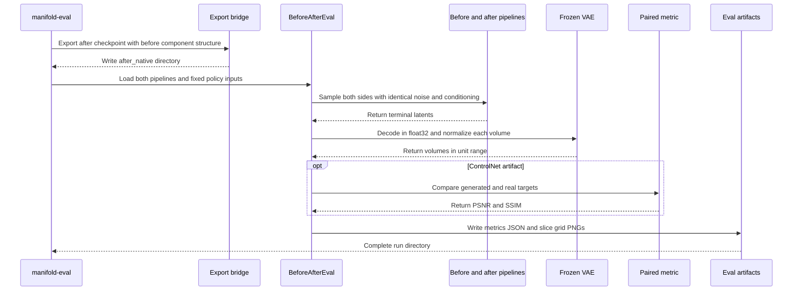
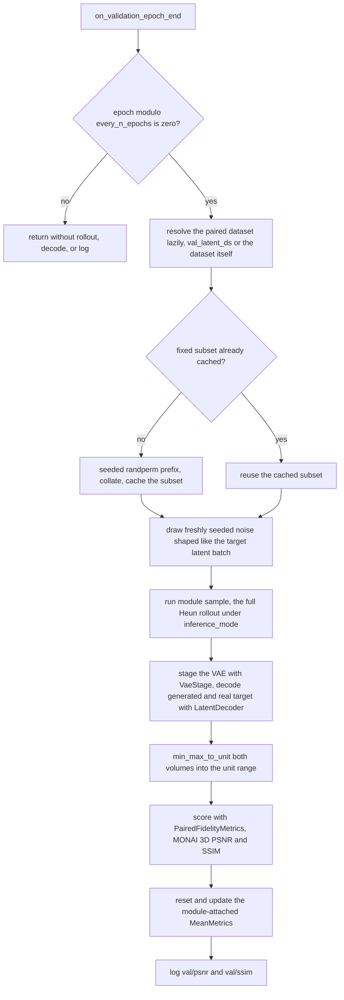

# Before/after GRPO evaluation

## When to use this page

Consult this page when adding or changing the shipped `manifold-eval` entry point, a paired-fidelity scalar, the before/after eval driver, evaluation artifacts, the report builder, or the observe-only in-training paired-fidelity monitor. The evaluation workflow composes the [checkpoint-to-native export contract](workflows.md#checkpoint-and-export-contract) and is structurally dependent on the persisted `model_index.json` contract documented in [Architecture and source map](architecture.md#configuration-and-persistence).

The subsystem has five layers:

1. `src/manifold/eval/cli.py` owns the `manifold-eval` console entry and infers the policy from the before native artifact.
2. `src/manifold/eval/before_after.py` owns the policy-agnostic same-noise generation, decode, normalization, scoring, and grid-writing flow.
3. `src/manifold/metrics/paired.py` owns the MONAI-backed 3D PSNR/SSIM metric for ControlNet pairs.
4. `src/manifold/eval/comparison_page.py` turns the written metrics and PNGs into a self-contained HTML report. It is library-only, not a console command.
5. `src/manifold/metrics/paired_callback.py` + `src/manifold/training/callbacks/paired_fidelity.py` own the observe-only **in-training** paired-fidelity monitor (ADR-0037). It reuses layer 3's metric plus the shared `min_max_to_unit` / `LatentDecoder` / `VaeStage` helpers, on a fixed paired validation subset.

The public `manifold.eval` barrel exports `BeforeAfterEval`, `BeforeAfterResult`, `SliceGrid`, `ComparisonPageBuilder`, `JitComparison`, and `ControlNetComparison` from `src/manifold/eval/__init__.py`. The only shipped console surface is `manifold-eval`, registered in `pyproject.toml` as `manifold-eval = "manifold.eval.cli:main"`. The monitor is **not** a console surface: it is a Lightning callback reached through `manifold-train-controlnet`.

## Runtime flow



*Figure: `manifold-eval` exports the after policy, samples both sides under paired noise, decodes and scores them, and writes portable evaluation artifacts.*

The driver creates a same-noise contract in two ways:

- **JiT / unconditional:** each pipeline receives a fresh generator on the same device with the same `seed`; both produce the same Gaussian start noise.
- **ControlNet / paired:** one noise tensor is drawn for the batch and passed to both `sample_latent` calls. The source latent, real target latent, spacing, contrast labels, and Heun step count stay fixed.

This makes differences attributable to the policy weights rather than random sampling. `BeforeAfterEval` is intentionally injectable: callers can replace its `fidelity` scorer or `grid` renderer, and the CLI can replace real ControlNet data loading with `pairs_provider` in focused smoke tests.

## Policy dispatch and artifact contract

`_pipeline_class_of` reads `pipeline_class` from the before directory's `model_index.json`. There is no evaluation mode flag:

| `pipeline_class` | Resulting path | Evaluation input |
|---|---|---|
| `LatentFlowPipeline` | `run_unconditional` | `--latent-shape`, `--num-samples`, `--modality`, `--spacing`, and fixed seed |
| `ControlNetLatentFlowPipeline` | `run_paired` | held-out `src`/`tgt` latent pairs, spacing, contrast labels, and fixed seed |

The CLI loads a probe pipeline from the before export, uses its UNet/VAE/scheduler structure to run the existing `export_to_native` bridge, and writes the after policy to `<output>/after_native`. It then reloads both native exports into fresh pipelines. A ControlNet after export reuses the before export's frozen base; only the after checkpoint's trainable `controlnet.*` weights are baked.

The before export remains independent because the export bridge mutates the loaded probe components in place. The ControlNet real-data path also reuses `build_brats_pair_manifest`, `_train_val_manifests`, and the warmed paired latent cache; it applies the before VAE's `scaling_factor` rather than re-estimating it. A held-out validation split is mandatory, either through `--val-data-base-dir` or a positive `--val-fraction`.

## Running the shipped workflow

For JiT, generate unconditional before/after grids:

```bash
manifold-eval \
  --before-dir runs/jit_native \
  --after-ckpt runs/grpo_jit/last.ckpt \
  --output runs/eval_jit \
  --device cuda
```

For ControlNet, evaluate matched translations against held-out real targets:

```bash
manifold-eval \
  --before-dir runs/controlnet_native \
  --after-ckpt runs/grpo_controlnet/last.ckpt \
  --output runs/eval_controlnet \
  --data-base-dir data/brats \
  --val-data-base-dir data/brats_val \
  --latents-dir runs/paired_latents \
  --target-dim 256,256,128 \
  --num-pairs 8 \
  --device cuda
```

Shared controls are `--seed`, `--num-inference-steps`, and `--device`. ControlNet-only controls are `--data-base-dir`, `--val-data-base-dir`, `--val-fraction`, `--latents-dir`, `--cache-tag`, `--target-dim`, `--num-pairs`, `--src-label`, and `--tgt-label`.

## Outputs and metric semantics

`BeforeAfterEval` writes one 2.5D PNG per sample. Each grid has three orthogonal center slices (`xy`, `yz`, `zx`) and columns for the policy outputs:

- JiT: `before | after`.
- ControlNet: `before | after | real target`.

`metrics.json` records the policy, seed, inference-step count, sample count, grid basenames, and the before/after values that apply. For ControlNet the generated target and real target are each VAE-decoded and passed through the shared `min_max_to_unit` helper before MONAI scoring. The grid and HTML files use atomic replacement writes, and grid references in JSON are basenames so the report remains portable after the eval directory is moved.

### Paired-fidelity metric

`PairedFidelityMetrics` takes generated and real tensors with equal `[B,C,D,H,W]` shape, already normalized to `[0,1]`. It composes MONAI `PSNRMetric(max_val=1.0)` and `SSIMMetric(spatial_dims=3, data_range=1.0)`, then batch-means both outputs. PSNR is reported in dB and is `+inf` for zero-error/identical volumes; SSIM is bounded by MONAI's metric and equals `1.0` for identical volumes.

`min_max_to_unit` normalizes each decoded volume independently. A constant/degenerate volume maps to zeros instead of dividing by zero. Do not compare unnormalized VAE output, or change the metric's default data range without updating both the ControlNet pipeline and eval paths; that would make in-training and offline measurements diverge. The MONAI 3D SSIM default window also requires spatial extents that fit its configured window, so production smoke fixtures should not shrink every axis below the supported window size.

Unlike unconditional JiT evaluation, paired fidelity is full-reference: it requires a real target. It complements rather than replaces the realism reward, which is deliberately fidelity-blind. As recorded in ADR-0036, offline PSNR/SSIM is the apples-to-apples GRPO comparison; the unconditional JiT continues to use shared `val/fid` plus reward trajectory.

## From metrics to a shareable comparison

`ComparisonPageBuilder.build` accepts `JitComparison(eval_dir, before_csv, after_csv)` and optionally `ControlNetComparison(eval_dir)`. It reads `metrics.json`, optionally reads JiT `val/fid` and `val/mean_reward` series from Lightning `metrics.csv` files, and embeds both generated curves and slice grids as base64 PNG data URIs. The result has no external image, stylesheet, or script dependencies and can be written atomically to an `out_path`.

The page deliberately explains the metric split: JiT is reference-free and uses FID, while ControlNet has a real target and uses PSNR/SSIM. If a ControlNet eval directory is not supplied, the builder emits a clearly marked pending slot rather than inventing a comparison. This API is imported from `manifold.eval`; unlike `manifold-eval`, it is not registered in `[project.scripts]`.

## In-training paired-fidelity monitor (observe-only)

ADR-0037 corrects ADR-0036's training-era silence: paired fidelity is *also* observed **in-training**, through a generative validation callback on the supervised ControlNet path. It is shipped and on by default (ADR-0037, issue #238) — it is not a planned extension.

The monitor is two files plus the shell wiring:

- `src/manifold/metrics/paired_callback.py` — `PairedFidelityCallback`, the `pl.Callback` that does the work.
- `src/manifold/training/callbacks/paired_fidelity.py` — `PairedFidelitySpec`, the registry spec (the knobs) that builds the callback.
- `src/manifold/training/controlnet_cli.py` — registers `paired_fidelity` → `PairedFidelitySpec` and passes it in the supervised shell's default callback list `["train_loss", "checkpoint", "paired_fidelity"]`.

`PairedFidelitySpec` declares `logged_metrics = frozenset({"val/psnr", "val/ssim"})`, so `CallbackRegistry.validate_monitor` accepts those two names as *validatable* monitors — but declaring them is not a switch: the shell's checkpoint monitor stays `val/x0_mae` and the callback never claims the checkpoint.

### Knob surface

| Knob | Default | Meaning |
|---|---|---|
| `subset_size` | `8` | fixed paired subjects scored per monitored epoch |
| `every_n_epochs` | `1` | cadence gate (`1` = every validation epoch) |
| `num_inference_steps` | `None` | rollout step count; `None` ⇒ **recipe-primary** |
| `seed` | `0` | generation-noise seed and subset-selection seed |

The step count is recipe-primary: when the per-callback knob is unset, `PairedFidelitySpec.build` reads `ctx.inference_recipe["num_inference_steps"]`, and the supervised shell now fills `CallbackContext.inference_recipe` with `{"num_inference_steps": int(num_inference_steps)}` — the existing `controlnet.num_inference_steps` config knob (default `15` in `configs/train/config_controlnet_supervised.yaml`). An explicit per-callback value overrides the recipe; with neither, the callback's own default (`15`) applies. The precedence chain is therefore *per-callback knob → recipe → callback default*.

### Runtime sequence

On `on_validation_epoch_end` the callback does, in order:

1. **Cadence gate** — `epoch % every_n_epochs == 0` (or `every_n_epochs <= 1`). The gate reads only rank-symmetric values, so every DDP rank gates identically.
2. **Lazy dataset resolution** — `getattr(paired_data, "val_latent_ds", paired_data)`. The spec forwards `ctx.datamodule` as the subset source, and the dataset is read at first use, not at build time, so the cold path's post-`setup()` replacement of `val_latent_ds` is honored.
3. **Fixed subset selection** — a seeded `randperm` prefix of `subset_size` subjects, collated with `default_collate` into `src_latent`/`tgt_latent` `[N,C,D,H,W]`, `src_label`/`tgt_label` `[N]`, `spacing` `[N,3]`. The collated subset is **cached**, so epoch-over-epoch change reflects the model, not a moving data sample.
4. **Seeded generation** — a fresh `torch.Generator` seeded with `seed` draws the start noise (shaped like the target-latent batch) on the module's device and dtype, so sampling stochasticity is isolated from quality drift.
5. **Full rollout** — the module's own `ControlNetLatentFlowModule.sample()` runs the shared `controlnet_rollout` Heun integration under `torch.inference_mode`; no gradient is ever formed.
6. **VAE staging + decode** — `VaeStage` moves the held frozen VAE CPU → device and restores it afterwards (VAE-only staging; `VramStage` composes the same helper), and `LatentDecoder` decodes the generated latent and the real target latent identically.
7. **Normalization** — `min_max_to_unit` on both decoded volumes (per-sample, to `[0,1]`).
8. **Scoring** — `PairedFidelityMetrics` returns the batch-mean PSNR/SSIM.
9. **Logging** — two `torchmetrics.MeanMetric`s attached to the *module* (Lightning scans `named_modules()` for `Metric` subclasses, so a logged metric must live on the module — mirroring `LatentX0MAE`) are reset, updated with the epoch's scalars, and logged as `val/psnr` / `val/ssim`. Resetting per epoch means the logged value is the current epoch's, not an accumulation.



*Figure: the gated monitor epoch — cadence gate, lazy paired-dataset resolution, cached fixed subset, seeded full rollout, staged VAE decode, min-max normalization, MONAI scoring, and the two logged metrics.*

### Why the numbers are comparable to the offline number

The monitor is not a parallel implementation: it reuses `VaeStage`, `LatentDecoder`, `min_max_to_unit`, and `PairedFidelityMetrics` — the same helpers the offline before/after comparison uses — and it generates with the module's **full** Heun rollout, not a one-step x0-decode proxy (ADR-0037 rejected the proxy: it measures one-step denoising, not the deployed translation). Three invariants make the in-training curve and the offline number directly comparable:

- **Identical metric** — the same `PairedFidelityMetrics` (MONAI 3D PSNR/SSIM, `data_range = 1.0`).
- **Identical normalization** — the same per-sample `min_max_to_unit` on the VAE-decoded volumes.
- **Identical full-rollout generation** — the same Heun rollout the deployed pipeline runs, with the step count taken from the shared recipe knob (default `15`, the same default as `manifold-eval --num-inference-steps`).

Plus the honesty bounds: PSNR is `+inf` on identical volumes (the ceiling is surfaced, not clamped), and SSIM is `1.0` there.

### Observe-only contract

- The monitor **never** drives checkpoint selection — the supervised shell's checkpoint monitor stays `val/x0_mae` (the fast latent surrogate logged by the hand-appended `LatentX0MAE`).
- It **never** enters the loss, the optimizer, or EMA; generation runs under `inference_mode`.
- It **never** writes samples or artifacts — training persists no volume, no slice grid, no image. The metric plot callback renders every logged metric from the CSVLogger's `metrics.csv` as its own subplot, so `val/psnr` and `val/ssim` appear in the training line chart without any extra wiring.

### DDP: redundant evaluation, not sharded

Every rank runs the monitor on the **same** fixed subset: DDP-synchronized weights, identical fixed input, and the same re-seeded noise make each rank's rollout identical by construction. The only cross-rank interaction is Lightning's torchmetrics sync on the two logged `MeanMetric`s — there is no FID-style subset sharding and no error-rendezvous machinery, and collective-count invariance holds trivially.

The cost implication is deliberate: a **full Heun rollout plus a VAE decode per gated epoch on every rank**. At the default 15 steps the Heun loop costs 29 UNet evaluations per monitored epoch (a final Euler-only step avoids the vanishing corrector denominator), on `subset_size` subjects. That is why the cadence gate (`every_n_epochs`) and the subset size exist, and why the design would have to be revisited if the subset grew enough to make redundancy wasteful.

### Open follow-up: the GRPO stage

`manifold-train-grpo` does **not** register the monitor — its registry holds only `train_loss`, `fid`, and `checkpoint`. On the ControlNet-GRPO policy path the shell force-removes `fid` through `TrainingSpine`'s `forbidden_callbacks` / `forbidden_monitors` (the unconditional FID rollout ignores the ControlNet and is a constant frozen-base metric). ADR-0037 treats the GRPO-stage extension as a **deliberate follow-up, not in this change**: it means releasing the blanket FID ban for *this* callback only (its rationale does not cover paired fidelity, which rolls the trainable ControlNet) and keeping the VAE on GPU for the decode — a separate decision with its own lifecycle and tests.

## Change guidance

### Change sampling or add a new policy

Start in `BeforeAfterEval` and preserve the paired-input contract. Policy detection then belongs in `_pipeline_class_of`; add the concrete pipeline to the known mapping and pass real policy-specific inputs through the CLI. Validate both driver-level same-pipeline identity and CLI end-to-end artifact routing.

### Change PSNR, SSIM, or normalization

Change the metric contract in `src/manifold/metrics/paired.py`, re-export names from `src/manifold/metrics/__init__.py`, and update every consumer that must remain comparable. A normalization change crosses `src/manifold/pipelines/pipeline_utils.py`, `controlnet_latent_flow.py`, `before_after.py`, **and** `src/manifold/metrics/paired_callback.py`; it is not an eval-only change — the in-training monitor would silently stop agreeing with the offline number.

### Add or change report content

Treat `BeforeAfterResult.metrics` and the persisted JSON/PNG layout as the source contract. Update `ComparisonPageBuilder`, both comparison test fixtures, and the in-tree builder tests. Keep `ComparisonPageBuilder` library-only unless a separate decision introduces a new console command; artifact assembly is intentionally outside `manifold-eval` runtime.

### Add a console entry

Register the callable in `pyproject.toml` and ensure the executable is exercised from a real subprocess or equivalent installed-command smoke, not only an in-process import. For `manifold-eval`, retain `main(argv=None)` as the consumer seam and keep the before-artifact policy inference free of a mode flag.

### Change or tune the in-training paired-fidelity monitor

- **Knob renames fail loudly.** The knobs are dataclass fields on `PairedFidelitySpec`, so `CallbackRegistry.resolve` rejects the old name with `ValueError: Unknown knob(s) for callback 'paired_fidelity'`. Every recipe or CLI site using the old name must be updated in the same change.
- **Keep the step count recipe-primary.** The precedence is *per-callback `num_inference_steps` → `ctx.inference_recipe["num_inference_steps"]` → the callback's default (15)*. `controlnet.num_inference_steps` stays the single source of truth and the spec knob is an override; if you change one, change both sides or the in-training number stops being comparable with the offline eval's `--num-inference-steps`.
- **Keep it observe-only.** Do not move `checkpoint.monitor_metric` onto `val/psnr` / `val/ssim`, do not add either scalar to the loss, and do not let the callback touch the optimizer or EMA. `logged_metrics` only makes the two names *validatable*; it is not the switch that turns them on as a monitor.
- **Keep the offline and in-training normalization identical.** Any change to `min_max_to_unit` or the metric's data range must land in the pipeline, the eval driver, and the monitor together.
- **Extend to the GRPO stage only under a separate decision.** Registering `paired_fidelity` in `manifold-train-grpo` means releasing the blanket FID ban for this callback only, per ADR-0037 — it needs its own rationale, lifecycle, and tests, not a one-line registry addition.

The registry-specific extension recipe is in [Callback registry and training spine](callback-registry.md#change-guidance).

## Focused tests and minimal validation

| Behavior | Existing test anchor |
|---|---|
| Metric identity, known PSNR, perturbation monotonicity, 3D input, and shape rejection | `tests/test_paired_fidelity.py` |
| JiT and ControlNet same-seed/same-pipeline identity, normalization, paired columns, scores, and reproducible grids | `tests/test_before_after_eval.py` |
| Console policy routing, after-export weight bake, held-out data loading, and required inputs | `tests/test_eval_cli.py` |
| Self-contained HTML, metric explanation, curves, grids, pending slot, and output file | `tests/test_comparison_page.py` |
| Monitor wiring: logged `val/psnr` / `val/ssim`, cadence gate, fixed-subset stability, metric reset, `[0,1]` volumes, shape-mismatch error, observe-only contract | `tests/test_paired_fidelity_callback.py` |
| 2-rank DDP: no deadlock, identical per-rank scores (logged and rank-local), unchanged checkpoint monitor | `tests/test_paired_fidelity_ddp.py` |
| Supervised shell: monitor on by default, `inference_recipe` filled from `controlnet.num_inference_steps`, checkpoint still on `val/x0_mae` | `tests/test_controlnet_cli.py`, `tests/test_callback_registry.py` |

Run the full focused evaluation surface with:

```bash
pytest tests/test_paired_fidelity.py tests/test_before_after_eval.py tests/test_eval_cli.py tests/test_comparison_page.py -q
```

and the in-training monitor surface with:

```bash
pytest tests/test_paired_fidelity_callback.py tests/test_paired_fidelity_ddp.py -q
```

For a fast first pass, run `pytest tests/test_paired_fidelity.py tests/test_before_after_eval.py -q`; the CLI and report-builder tests are still required when crossing the installed console or artifact/presentation boundary, and the DDP test is required when the monitor's cross-rank behavior is touched. Also consult [Operations and testing](operations-and-testing.md#standard-checks) for the repository test matrix and the conditions that make broader DDP or packaging checks necessary.
