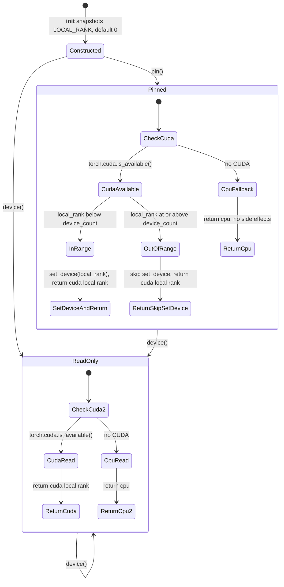

# Frozen arms and per-rank device policy

Two mechanisms own the cross-cutting "what is frozen / which GPU does it land on"
concern that every training CLI has to get right:

- **`FrozenArmMixin`** (`src/manifold/modules/frozen_arm.py`, ADR-0031 A1) — the
  shared "register + dual-exclude" implementation that keeps a frozen arm off
  the optimizer and off the checkpoint while letting Lightning own its device
  placement through the standard submodule machinery. Used by `GRPOModule`,
  `ControlNetLatentFlowModule`, and `RewardModule`.
- **`DevicePolicy`** (`src/manifold/training/device_policy.py`, ADR-0035) — the
  single owner of the per-rank CUDA device decision. It replaced the duplicated
  pre-PG `set_device` twin that lived in two training `main()`s, the controlnet
  shell's bare `cuda:0` literal, and the
  `manifold.data.latent_pipeline.resolve_warm_device` free function used by the
  post-PG VAE warm. Three methods: `pin` (one `set_device` side effect pre-PG),
  `device` (side-effect-free read), `warm_device` (post-PG per-rank CUDA
  resolution, byte-identical to the former free function).

They are deliberately decoupled: the policy answers **which** device a rank
uses, the frozen-arm chain answers **how** a model is staged onto it
(`.to(device).eval()` + `requires_grad_(False)`). ADR-0035 keeps them as two
independent refactor candidates so either can be changed or deleted alone.

## Why the split is by timing (ADR-0031)

Device ownership splits in two because the two halves live on opposite sides of
`Trainer.fit`:

- **A1 — frozen arms inside `Trainer.fit`** become normal registered
  `nn.Module` children, so Lightning's automatic `.to(device)` moves them
  per-rank. The `object.__setattr__` registration bypass and the `on_fit_start`
  manual `.to(self.device)` moves are gone.
- **A2 — models staged outside `Trainer.fit`** (the `_real_inputs` rollouts, the
  fake-cache builders, the VAE cache-warm) cannot be Lightning-managed: they run
  before the process group exists, when `self.device` is still `cuda:0`. They are
  routed through the `DevicePolicy`, which resolves `cuda:{LOCAL_RANK}` from the
  launcher environment.

A single mechanism cannot cover both: a post-PG policy is impossible for A2
(nothing knows the rank before the PG exists), and Lightning cannot reach A2 at
all (its `.to(device)` only visits registered children of a module the Trainer
owns).

## FrozenArmMixin: register + dual-exclude

### Why this exists (ADR-0031 A1)

The previous scheme kept a frozen base UNet *unregistered* on the host via
`object.__setattr__`, hiding it from the module tree entirely. That worked for
the off-optimizer and off-checkpoint invariants but broke Lightning's automatic
`.to(device)`, forcing a manual staging step in `on_fit_start` and leaving
Mode-1 (supervised) and Mode-2 (GRPO ControlNet) forks out of sync. ADR-0031
chose the opposite direction: **register** the frozen arm as a normal
`nn.Module` submodule so Lightning owns its device placement, and **dual-exclude**
it from the optimizer and the checkpoint through targeted overrides.

### The mixin contract

```python
class XModule(FrozenArmMixin, spt.Module):
    def __init__(self):
        super().__init__()
        self._register_frozen_arm("frozen_name", arm)
        self.trainable = ...
```

Declare the host as `class XModule(FrozenArmMixin, spt.Module)` so the mixin
precedes `spt.Module`. The three dunder overrides chain to `nn.Module` via
cooperative `super()` because neither `spt.Module` nor `pl.LightningModule`
overrides `state_dict` / `load_state_dict` / `train` (asserted in
`tests/test_frozen_arm_mixin.py`'s module docstring). The production MRO is
exercised by the three host modules' existing tests; the mixin's own tests use a
minimal `nn.Module`-based `_Host` to exercise the cooperative-`super()` contract
without dragging in Lightning's forward/optim machinery.

`_register_frozen_arm(name, arm)` does the uniform prep **once at construction**:

- `arm.eval()`
- `arm.parameters()` → `requires_grad_(False)`
- `setattr(self, name, arm)` (registers as a normal submodule)
- `self._frozen_arm_names |= {name}` (the arm set is fixed at init; the set is a
  `frozenset`, so it is stored as a plain attribute, not a submodule)

That single call is the only place the "register + dual-exclude" prep is
applied — adding a frozen arm cannot forget the freeze. `_frozen_arm_names` has
a class-level default of `frozenset()`, so a host with no frozen arms degrades
to a no-op rather than an `AttributeError`.

### The three dunder overrides

- **`state_dict(destination, prefix='', keep_vars=False, ...)`** — strips the
  registered frozen arms **in place on the shared `destination`** (matching the
  arms under the caller-supplied `prefix`). The filter must mutate, not build a
  fresh dict, because a parent/wrapper that drives the recursion reads the
  `destination` it passed in (PyTorch recurses via
  `module.state_dict(destination=..., prefix='module.')` and discards the child's
  return value). Prefix-awareness is what stops a `module.frozen.*` key from
  leaking under the DDP wrapper prefix.
- **`load_state_dict(state_dict, strict=True, ...)`** — strict on the
  **trainable** keys, lenient only on the frozen arms. The implementation drops
  any stray frozen keys from the incoming mapping, calls `super()` with
  `strict=False`, then re-raises a `RuntimeError` listing the non-frozen
  mismatches. The checkpoint never carries frozen-arm weights (state_dict strips
  them); the arms are rebuilt fresh each launch (the reward from its own
  `.ckpt`, the reference policy via `deepcopy`, the ControlNet-policy base from
  the native export). The frozen arms being absent from the checkpoint is the
  one tolerated mismatch. A missing or unexpected **trainable** key still raises
  with a `RuntimeError` mentioning "missing" / "unexpected" (no blanket
  `strict=False`, which would also hide a missing trainable key and resume on
  stale or random weights).
- **`train(mode=True)`** — re-applies `eval()` on every registered frozen arm
  after `super().train(mode)`. Registration makes Lightning's recursive
  `train(True)` flip the arms to training mode; the override re-freezes them so
  BatchNorm running stats cannot drift during rollout / reward evaluation.

The mixin **does not own optimizer arm-selection**: "which arm is optimized"
stays in each host's `configure_optimizers` (GRPO → `unet` or `controlnet`,
reward → `reward_model`, ControlNet → `controlnet`). The mixin guarantees only
the `requires_grad=False` layer; the host's optimizer simply never selects the
frozen arms. `configure_optimizers` excludes frozen arms by construction (see
the host tests: `tests/test_grpo.py`, `tests/test_controlnet_module_training.py`,
`tests/test_reward.py`).

### Which arms each host freezes

The mixin declares the *mechanism*; each host declares only *which* arms are
frozen, via `_register_frozen_arm` calls in its `__init__`:

| Host | Frozen arms (`_frozen_arm_names`) | Optimized arm |
|---|---|---|
| `ControlNetLatentFlowModule` (`src/manifold/modules/controlnet_latent_flow.py`) | `unet` — the frozen JiT base | `controlnet` |
| `GRPOModule`, UNet policy (`src/manifold/modules/grpo.py`) | `reward_model`; plus `reference_unet` when a KL reference is supplied | `unet` (the trainable policy) |
| `GRPOModule`, ControlNet policy | `unet` — the frozen base; `reward_model`; plus `reference_unet` **and** `reference_controlnet` when a KL reference is supplied | `controlnet` |
| `RewardModule` (`src/manifold/modules/reward.py`) | `denoiser` — the frozen JiT x0-denoiser (only when one is supplied) | `reward_model` (the discriminator) |

Notes that matter when reading the code:

- The GRPO base freeze is a **derived invariant**, not a constructor argument:
  `controlnet is not None` ⇒ the policy UNet becomes the frozen base. On the
  UNet-policy path the same `self.unet` is the *trainable* policy and is
  deliberately never registered as a frozen arm.
- When no KL reference is supplied, `reference_unet` / `reference_controlnet`
  are plain `None` attributes (not submodules), so they contribute no keys to
  `state_dict()` and no parameters.
- The reward module's `scheduler` is not an `nn.Module`, so it is plain-assigned
  and never registered.

### MRO detail

Because the production host is `FrozenArmMixin, spt.Module` and the dunders
chain through `nn.Module`, the `_Host` test fixture uses the same ordering with
`nn.Module` as the base. This keeps the mixin's behavioral contract tests
independent of Lightning's forward / configure_optimizers machinery while
remaining a faithful exercise of the cooperative-`super()` chain.

### Acceptance matrix (FrozenArmMixin)

The mixin's behavior contract is locked down by `tests/test_frozen_arm_mixin.py`:

| Behavior | Test |
|---|---|
| Registration applies the uniform frozen-arm prep (eval + requires_grad=False) and adds to `_frozen_arm_names` | `test_register_frozen_arm_freezes_and_evals` |
| `state_dict()` strips the frozen arm in place on the shared `destination` | `test_state_dict_strips_frozen_arm_in_place` |
| `state_dict()` strips the frozen arm through the DDP wrapper prefix | `test_state_dict_strips_frozen_arm_through_wrapper_prefix` |
| `load_state_dict` strict on trainable, lenient on the frozen arm | `test_load_state_dict_strict_except_frozen_allowlist` |
| `module.train()` keeps the frozen arm in eval | `test_train_keeps_frozen_arm_in_eval` |
| Backward reaches the trainable arm; the frozen arm carries no grad | `test_backward_only_touches_trainable_arm` |
| The host's `configure_optimizers` wires the trainable arm only | `test_configure_optimizers_excludes_frozen_arm` |

The host-level proof that "the base is registered but dual-excluded" lives at
`tests/test_controlnet_module_training.py::test_base_is_registered_but_dual_excluded`
(ADR-0031 A1 acceptance): the base is present in `parameters()` (so Lightning
owns device placement) but `requires_grad=False`, absent from the optimizer
groups, and absent from `state_dict()`. `tests/test_grpo.py` proves the same
contract on the production `spt.Module` MRO with a two-arm host
(`test_frozen_arms_registered_but_dual_excluded`,
`test_state_dict_strips_frozen_arms_through_wrapper_prefix`,
`test_load_state_dict_strict_except_frozen_allowlist`,
`test_train_keeps_frozen_arms_in_eval`), and `tests/test_reward.py` proves the
denoiser arm on the reward host
(`test_module_backward_updates_discriminator_only`).

### Operational consequence: the DDP-init broadcast

Registration has a cost ADR-0031 documents explicitly: at
`DistributedDataParallel` **construction**, every registered parameter —
including the `requires_grad=False` frozen arms — is synchronized from rank 0.
The `params_to_ignore` / `static_graph` knobs address gradient sync, not this
init-time broadcast. It is a one-time startup cost (not per-step) and is
semantically harmless because the arms are rank-identical by construction, but
GRPO pays it several times (base + reward + reference unet + reference
controlnet), adding multi-gigabyte startup communication that compounds DDP-init
timeout pressure. The mitigation ADR-0031 names is to construct the frozen arms
on each rank from the same source, not to add a DDP exclusion hack.

A second downstream consequence: the off-checkpoint invariant reaches the
export bridge. `src/manifold/training/export.py` bakes only the `controlnet.*`
keys out of a supervised-ControlNet checkpoint and expects the frozen base to
contribute no `unet.unet.*` keys. That expectation still holds — the base is
now *registered* but stripped by the mixin's `state_dict()` override — although
the comment in `export.py` still describes the retired `object.__setattr__`
mechanism rather than the mixin.

## DevicePolicy — the per-rank CUDA decision

### Why this exists (ADR-0035)

Three pre-existing call sites all duplicated the same answer to "which GPU does
this rank use":

1. The pre-PG `set_device` twin, character-identical across `grpo_cli.main`
   and `reward_cli.main` (issue #205, ADR-0035 T2).
2. The controlnet CLI's pre-PG `torch.device("cuda" if torch.cuda.is_available() else "cpu")`
   that resolved to `cuda:0` for every DDP rank — the source of the PR #156
   `cuda:0` race / DDP-init-timeout category ADR-0031 §A2 promised to close
   (issue #206, ADR-0035 T3).
3. The `manifold.data.latent_pipeline.resolve_warm_device` free function used
   by the JiT `_warm_data` and the controlnet `_real_inputs` VAE warm closures
   (issues #207 / #208, ADR-0035 T4 / T5). That free function is now deleted;
   `src/manifold/data/latent_pipeline.py` no longer defines it.

ADR-0035 collapses all three into a single `DevicePolicy` class with three
methods. The behavior is byte-identical to the prior code paths; the change is
de-duplication. The class is constructed (not a module-level free function) and
is imported as `from .device_policy import DevicePolicy` — it is not re-exported
from `manifold.training.__init__`.

### Construction

```python
policy = DevicePolicy()  # side-effect free: snapshots LOCAL_RANK (missing -> 0)
```

`__init__` only reads `os.environ.get("LOCAL_RANK")` and stores the result
(`0` when unset). It touches neither CUDA nor the process group. The snapshot is
taken **once at construction** — post-PG callers do **not** re-resolve via
`dist.get_rank()`. A `torchrun` launch always sets `LOCAL_RANK`; a
single-process launch does not, and the default 0 is correct in that case.

### `pin` — the one-time pre-PG side effect

```python
device = policy.pin()
```

This is the call every training CLI `main()` makes **before** Lightning
initializes the process group:

- If `torch.cuda.is_available()`:
  - if `local_rank < torch.cuda.device_count()` → `torch.cuda.set_device(local_rank)` (the one side effect), then return `torch.device(f"cuda:{local_rank}")`.
  - else (out-of-range, the "twin guard") → **skip** `set_device`, return `cuda:{local_rank}`.
- Else → return `torch.device("cpu")`, no side effects.

The out-of-range guard mirrors the prior twin: if `LOCAL_RANK` exceeds the
device count (e.g. a misconfigured `CUDA_VISIBLE_DEVICES`), the rank still
gets the per-rank device value but does not call `set_device` (which would
raise). This is the "twice-bitten" guard: never silently fall back, never
raise on a misconfigured but recoverable launch.


*Figure: `DevicePolicy` state transitions — `pin()` performs the one-time pre-PG `set_device` (with the twin's out-of-range guard), `device()` is the side-effect-free read.*

### `device` — side-effect-free read

```python
device = policy.device()
```

Returns the same `cuda:{local_rank}` (or `cpu`) without calling `set_device`.
Use this for read-only / debug paths where the caller does not want the side
effect (most code does want `pin`).

### `warm_device` — post-PG VAE warm resolution

```python
device = policy.warm_device(launch_time_fallback)
```

This replaces `manifold.data.latent_pipeline.resolve_warm_device` (now
deleted). The semantics are byte-identical:

- `import torch.distributed as dist` happens **inside the method body**, so
  importing the module never touches the process group
  (`test_warm_device_dist_import_is_lazy` guards the contract).
- If `fallback.type == "cuda"` and `dist.is_initialized()` → return
  `cuda:{local_rank}` (the per-rank device from the construction-time
  snapshot, not a `dist.get_rank()` re-resolution).
- Otherwise → return the `fallback` unchanged (CPU fallback stays CPU;
  single-process fallback stays whatever the launch-time capture was).

There is **no `is_available()` check**: the gate is "CUDA fallback under a
live PG", so a CUDA fallback under a live PG resolves to `cuda:{local_rank}`
even when CUDA is unavailable on the box. This matches the former
`resolve_warm_device` semantics — verified by
`test_warm_device_pg_up_without_cuda_still_resolves_cuda_fallback`.

The launch-time `fallback` is captured in the shell's `main()` **before** the
PG is initialized, so under DDP it is the default `cuda:0` (the rank's
`CUDA_VISIBLE_DEVICES`-exposed index 0). After the PG is up (inside
`DataModule.setup()`), `LOCAL_RANK` names the rank's actual GPU and
`warm_device` returns it.

### Where the policy is called

| Shell | Pre-PG `pin()` | Post-PG `warm_device()` |
|---|---|---|
| `src/manifold/training/grpo_cli.py` | `DevicePolicy().pin()` on the real path | — |
| `src/manifold/training/reward_cli.py` | `DevicePolicy().pin()` on the real path | — |
| `src/manifold/training/controlnet_cli.py` | `DevicePolicy().pin()` on the real path | `DevicePolicy().warm_device(device)` inside the `_real_inputs` warm closure |
| `src/manifold/training/cli.py` (JiT) | **none** — the shell captures the launch-time fallback `torch.device("cuda" if torch.cuda.is_available() else "cpu")` | `DevicePolicy().warm_device(device)` inside the `_warm_data` warm closure |

Two invariants hold across the shells:

- In the **GRPO, reward, and controlnet shells the `data_provider` CPU-smoke
  seam stays `torch.device("cpu")`** and never constructs a `DevicePolicy` —
  those smokes need no GPU and no launcher env.
- The **JiT shell does not pin at all**. It stages nothing on a GPU pre-PG (the
  VAE is built on CPU) and resolves the per-rank device only inside the post-PG
  warm closure, which re-stages the VAE onto `warm_device` and rebuilds the
  `encode_fn` bound to that device. (Its `data_provider` smoke receives the
  launch-time `device` rather than a forced-CPU device, because the JiT path
  has no GPU-side pre-PG work to protect.)

### Acceptance matrix (DevicePolicy)

The behavior contract is locked down by `tests/test_device_policy.py` (all CUDA
calls are monkeypatched — no real GPU required):

| Behavior | Test |
|---|---|
| `pin()` under LOCAL_RANK=k + CUDA available returns `cuda:k` and calls `set_device(k)` exactly once | `test_pin_returns_cuda_local_rank_and_sets_device_exactly_once` |
| Out-of-range LOCAL_RANK → no `set_device`, still returns `cuda:k` | `test_pin_out_of_range_local_rank_skips_set_device` |
| No CUDA → `cpu`, zero side effects | `test_pin_cpu_unavailable_returns_cpu_no_side_effects` |
| LOCAL_RANK unset → defaults to 0 | `test_pin_local_rank_unset_defaults_to_zero` |
| `device()` returns the same value as `pin()` but never calls `set_device` | `test_device_returns_cuda_local_rank_side_effect_free` |
| `device()` with no CUDA → `cpu` | `test_device_cpu_unavailable_returns_cpu` |
| `warm_device` under live PG + CUDA fallback → `cuda:3` | `test_warm_device_local_rank_under_ddp` |
| `warm_device` non-CUDA fallback returned unchanged under DDP | `test_warm_device_non_cuda_fallback_returned_unchanged` |
| `warm_device` single-process fallback returned unchanged | `test_warm_device_single_process_fallback_returned_unchanged` |
| `warm_device` PG-up + CUDA-fallback + no CUDA still resolves (no `is_available` gate) | `test_warm_device_pg_up_without_cuda_still_resolves_cuda_fallback` |
| `import torch.distributed` is lazy (inside the method body, not at module level) | `test_warm_device_dist_import_is_lazy` |

The same file ends with three source-level guards (`inspect.getsource`) that keep
the retired call patterns from sneaking back in:

- `test_grpo_cli_main_pins_via_device_policy_not_inline_set_device`
- `test_reward_cli_main_pins_via_device_policy_not_inline_set_device`
- `test_controlnet_cli_main_pins_via_device_policy_not_bare_cuda`

The two warm-closure guards live in `tests/test_ddp_warm.py` (not in
`tests/test_device_policy.py`):

- `test_p1_warm_fn_uses_local_rank_device_not_launch_device` — the JiT
  `_warm_data` closure uses `DevicePolicy.warm_device`, not the deleted
  `resolve_warm_device`, and builds the VAE on CPU pre-PG.
- `test_p1_controlnet_warm_uses_device_policy_not_resolve_warm_device` — the
  controlnet `_real_inputs` closure does the same.

The end-to-end per-rank proof is a 2-rank spawn smoke,
`tests/test_controlnet_cli.py::test_main_real_path_pins_each_rank_to_local_gpu`:
it drives the controlnet `main` on the real branch with `_real_inputs` stubbed
to surface the device it receives, and asserts the two ranks **disagree**
(`cuda:0` vs `cuda:1`) — a bare `cuda:0` resolution would collapse both onto
GPU 0 (the PR #156 regression class).

## Cross-link: the paired-fidelity monitor's device read

The in-training paired-fidelity monitor (ADR-0037) reads its device from the
**frozen base UNet** — `next(self._module.unet.parameters()).device` in
`PairedFidelityCallback._device` — and stages the VAE onto that device through
`VaeStage`, which moves the VAE in for the decode and restores it to CPU on
exit.

That read is only correct because the base is a **registered** submodule: the
mixin registers the frozen base as a normal `nn.Module` child, so Lightning's
automatic `.to(device)` has already placed it on this rank's GPU, and the
monitor's device read inherits that placement instead of guessing. See the
[Paired-fidelity monitor](paired-fidelity-monitor.md) page for the monitor's
own contract, and the [Callback registry and training spine](callback-registry.md)
page for how the spec is mounted.

## Source map

- Mixin implementation: `src/manifold/modules/frozen_arm.py`
- Mixin barrel export: `src/manifold/modules/__init__.py` (re-exports
  `FrozenArmMixin`)
- Hosts that consume the mixin: `src/manifold/modules/grpo.py`,
  `src/manifold/modules/controlnet_latent_flow.py`, `src/manifold/modules/reward.py`
- Device policy implementation: `src/manifold/training/device_policy.py`
- CLI shells that call `pin()`: `src/manifold/training/grpo_cli.py`,
  `src/manifold/training/reward_cli.py`, `src/manifold/training/controlnet_cli.py`
- Shell that only calls `warm_device()`: `src/manifold/training/cli.py` (JiT)
- VAE-warm closures that call `warm_device()`:
  `src/manifold/training/cli.py::_warm_data`,
  `src/manifold/training/controlnet_cli.py::_real_inputs`
- Downstream consumer of the off-checkpoint invariant:
  `src/manifold/training/export.py`
- Monitor that reads the frozen base's device:
  `src/manifold/metrics/paired_callback.py` (+ `src/manifold/metrics/vae_stage.py`)
- Decision records: `docs/adr/0031-device-ownership.md`,
  `docs/adr/0035-devicepolicy-per-rank-device.md`

## Focused tests

```bash
pytest tests/test_frozen_arm_mixin.py tests/test_device_policy.py -q
```

For a host wiring change (adding a frozen arm to a new module, switching a
host to `FrozenArmMixin`), also run the host's own tests:

- GRPO hosts: `pytest tests/test_grpo.py -q`
- ControlNet hosts: `pytest tests/test_controlnet_module_training.py -q`
- Reward hosts: `pytest tests/test_reward.py -q`

For a CLI shell change to the `pin()` / `warm_device()` wiring, also run:

- `pytest tests/test_ddp_warm.py tests/test_controlnet_cli.py -q`

The `inspect.getsource`-style guards in `tests/test_device_policy.py` and
`tests/test_ddp_warm.py` are the load-bearing acceptance: any regression that
re-introduces the inline `set_device` twin, the bare `torch.device("cuda")` in
the controlnet CLI, or the `resolve_warm_device` free function will fail those
tests loudly.

For the wider picture on how these mechanisms sit inside a run, see
[Architecture](architecture.md), the shell recipes in
[Workflows](workflows.md), and the runbook notes in
[Operations and testing](operations-and-testing.md).
