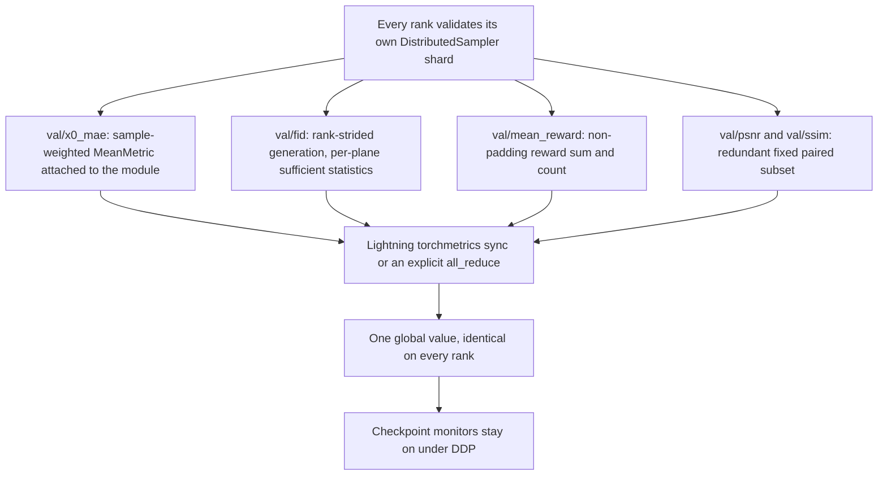

# Operations and testing

## Standard checks

```bash
pytest
ruff check .
```

For focused changes, start with the nearest tests:

| Area | Tests |
|---|---|
| Config and training orchestration | `tests/test_config.py`, `test_training_cli.py`, `test_controlnet_cli.py`, `test_training.py` |
| Data, warming, and split isolation | `tests/test_data.py`, `test_paired_latent_cache.py`, `test_paired_manifests.py`, `test_ddp_warm.py`, `test_controlnet_warm_defer.py` |
| Scheduler/module/pipeline behavior | `tests/test_scheduler.py`, `test_cfg.py`, `test_module_training.py`, `test_pipeline_inference.py`, `test_controlnet_model.py`, `test_controlnet_module_training.py`, `test_controlnet_pipeline_inference.py` |
| FID and image metrics | `tests/test_fid.py`, `test_fid_helpers.py`, `test_paired_fidelity.py`, `test_metric_plot.py` |
| Paired-fidelity monitor (in-training) | `tests/test_paired_fidelity_callback.py` |
| Distributed validation | `tests/test_ddp.py`, `test_ddp_detection.py`, `test_ddp_metrics.py`, `test_ddp_val_honesty.py`, `test_controlnet_ddp_monitor.py`, `test_paired_fidelity_ddp.py` |
| Reward and policy learning | `tests/test_reward.py`, `test_reward_pairs.py`, `test_grpo.py`, `test_controlnet_module_training.py` |
| Callback registry and training spine | `tests/test_callback_registry.py`, plus the registry / monitor / `forbidden_callbacks` assertions in `test_training_cli.py` |
| Frozen-arm contract (register + dual-exclude) | `tests/test_frozen_arm_mixin.py`, `tests/test_controlnet_module_training.py::test_base_is_registered_but_dual_excluded` |
| Per-rank device policy (`DevicePolicy`, post-PG warm) | `tests/test_device_policy.py`, plus `test_ddp_warm.py::test_p1_*` |
| Persistence/export and VAE scaling ownership | `tests/test_persistence.py`, `test_vae.py`, export assertions in training/reward/GRPO tests |
| Before/after eval and reporting | `tests/test_paired_fidelity.py`, `test_before_after_eval.py`, `test_eval_cli.py`, `test_comparison_page.py` |
| Deletion guards (retired subsystems stay gone) | `tests/test_paired_reward_deleted.py` |

The two monitor test files are the ones to reach for when touching the in-training paired-fidelity observer:

- `tests/test_paired_fidelity_callback.py` drives the Lightning hook directly with a stub module (stubbed `sample()`), a toy VAE, and a tiny paired dataset, and asserts only external behavior: the logged `val/psnr` / `val/ssim`, the `every_n_epochs` gate (no generation, no decode, no log on an off-epoch), the fixed subset stability across epochs, the same-seed determinism, the per-epoch metric reset (the logged value is the current epoch, not a running mean), the `[0, 1]` normalization and the `+inf` PSNR / `1.0` SSIM ceiling on identical volumes, the shape-mismatch error, and the observe-only contract (generation under `inference_mode`, only the two monitor keys logged).
- `tests/test_paired_fidelity_ddp.py` runs the 2-rank CPU harness with the monitor default-on and asserts no deadlock, that both ranks log the same finite `val/psnr` / `val/ssim`, that the **rank-local** pre-sync scores match across ranks (the redundant-evaluation design claim), and that the validation contract is untouched (the checkpoint still monitors `val/x0_mae`, `val/x0_mae` is finite, the monitored checkpoint is still written, and the `is_global_zero` split is intact).

`tests/ddp.py` is the multi-process helper/harness used by DDP tests: it spawns CPU gloo workers through `run_ddp_two_rank`, and each worker writes a per-rank result JSON the calling test asserts on. Run the focused distributed tests after changing rank gates, sampler assumptions, reduction code, validation callbacks, trainer device selection, checkpoint monitors, or the paired-fidelity monitor's fixed subset / seed / rollout step count.

## Distributed validation contract

ADR-0025 supersedes ADR-0016. Every validation metric runs on all ranks over each rank's `DistributedSampler` shard and is reduced to a global value; the rank-0-only gates are gone. Current behavior is:

- **Latent-space x0-MAE (`val/x0_mae`):** every rank computes the cheap reconstruction-MAE on its shard through `LatentX0MAE` (`src/manifold/training/metrics.py`), which attaches a `torchmetrics.MeanMetric` to the module and updates it with the per-batch sample count as the weight. Lightning's DDP reduction therefore produces the true sample-weighted global mean `(Σ mae·B)/(Σ B)`, not a mean of per-rank means.
- **FID:** synthetic and real examples are rank-strided. Each plane reduces sufficient statistics `(sum_x, sum_xxT, n)`, reconstructs global moments, and computes unbiased FID without gathering feature matrices. Empty local shards contribute zero statistics; only the global count must be at least two.
- **GRPO reward (`val/mean_reward`):** every rank validates its own shard and accumulates a non-padding `(sum, count)` pair; at epoch end the pair is `all_reduce`d (SUM) into the global mean, and the result is logged with `sync_dist=False` — the manual reduction already produced the global value, so a manually `all_reduce`d value must never also carry `sync_dist=True`.
- **Paired fidelity (`val/psnr` / `val/ssim`):** the ADR-0037 observer **is shipped and default-on** for `manifold-train-controlnet` — `run_controlnet_training` registers `PairedFidelitySpec` and passes `default_names=["train_loss", "checkpoint", "paired_fidelity"]` (`src/manifold/training/controlnet_cli.py`). On each gated validation epoch it rolls a fixed paired subset under fixed seeded noise through the module's own Heun rollout, decodes both volumes, and scores them with the same `min_max_to_unit` + `PairedFidelityMetrics` path the offline comparison uses. It stays **observe-only**: never a `monitor_metric` (checkpoint selection stays `val/x0_mae`), never in the loss, never touching the optimizer. Its DDP design is **redundant evaluation**, not sharding: every rank scores the *same* fixed subset under identical seeded noise on DDP-synchronized weights, so the per-rank values are identical and Lightning's torchmetrics sync is the only cross-rank interaction — there is no FID-style sharding and no error-rendezvous machinery. See [Paired-fidelity monitor](paired-fidelity-monitor.md).
- **Checkpoint monitors:** configured `val/fid`, `val/x0_mae`, and `val/mean_reward` monitors remain global under DDP, so best-by-metric selection still works under multi-GPU. The paired `val/psnr` / `val/ssim` observer is declared as *validatable* (`logged_metrics`) but is never wired to `monitor_metric`. The shipped offline comparison instead uses `BeforeAfterEval` + `PairedFidelityMetrics` for a deterministic seed — see [Before/after GRPO evaluation](evaluation.md#relationship-to-the-in-training-paired-fidelity-monitor).



*Figure: each validation metric reduces its per-rank shard to the same global value; the paired-fidelity observer reaches that value by redundant evaluation rather than by sharding.*

Key implementations are `src/manifold/metrics/fid/`, `src/manifold/metrics/paired_callback.py`, `src/manifold/training/metrics.py`, `src/manifold/modules/grpo.py`, and the training callback/CLI paths in `src/manifold/training/`.

Do not follow the stale checkpoint comments in `configs/train/config_rflow_jit.yaml` that still describe rank-0-only DDP metrics and unmonitored fallback. The `config_paired_jit.yaml` referenced in older docs no longer exists; the supervised paired translator is `configs/train/config_controlnet_supervised.yaml`. ADR-0025 and current callback/CLI code are authoritative.

## Before/after evaluation runbook

`manifold-eval` is the only eval console entry. It owns a fresh export of the after `.ckpt`, two clean native reloads, deterministic generation, and the eval artifacts. The implementation and artifact schema are the canonical reference in [Before/after GRPO evaluation](evaluation.md#outputs-and-metric-semantics).

For a quick shipped-surface check, confirm that the installed entry point exposes the contract before starting a full run:

```bash
manifold-eval --help
```

Then use the [workflow examples](workflows.md#beforeafter-evaluation). The key runbook constraints are:

- `--before-dir` must be a native directory with a self-describing `model_index.json`; a model-dir or a missing `pipeline_class` fails before export. Never pass an arbitrary directory merely because it contains weights.
- `--after-ckpt` is processed through the standard full-state export bridge. The command writes the derived native tree to `<output>/after_native`; it does not overwrite the before export or return a NIfTI file.
- `--seed`, `--num-inference-steps`, shape/conditioning, and the VAE/scheduler are the pairing contract. Hold them fixed when comparing checkpoints; changing them makes before/after noise or trajectory differences ambiguous. The shipped offline comparison is the deterministic same-seed reference.
- ControlNet requires a nonempty held-out split and a warmed cache under the geometry-suffixed cache tag. Match the cache's target geometry and `vae.scaling_factor`; eval reads the scaling factor from the before export and never re-estimates it.
- The report and slice-grid renderer imports Matplotlib lazily on the headless `Agg` backend, but a missing or broken rendering dependency fails the run instead of silently dropping visuals.
- A JiT run records provenance in `metrics.json` but intentionally has no `before.psnr` or `before.ssim`. Those full-reference fields are valid only for ControlNet; the unconditional comparison uses same-noise grids and training FID/reward history.

Focused validation for any metric, driver, CLI, or report change:

```bash
pytest tests/test_paired_fidelity.py tests/test_before_after_eval.py tests/test_eval_cli.py tests/test_comparison_page.py -q
```

Conditional integration check: if a `pyproject.toml` console entry, package barrel, hatch artifact, or installed `manifold-eval` import path changes, build/install the wheel and run the CLI `main(argv)` smoke rather than relying only on the internal tests. This repository has no generated publish mirror or second eval entry point; the hatch package mirror is derived from `pyproject.toml`.

## Distributed validation runbook

The all-rank policy reverses a rank-0 workaround for a reproducible 8-DCU/DTK stall during concurrent full-volume MAISI VAE decode. NVIDIA 8-GPU and single-DCU runs were reported healthy, but ADR-0025 explicitly marks the sugon verification as pending.

Before relying on multi-DCU best-by-metric selection, run one validation epoch on all eight ranks with a small subset, following the ADR's probe parameters:

```text
--max-epochs 1 check_val_every_n_epoch=1 val_subset_size=4
```

Profile all ranks through the validation epoch and confirm that every rank exits decode and logs the same global metric. The VAE network config currently uses `num_splits: 4`, `dim_split: 1`, and `save_mem: true` (the `autoencoder` block of `configs/network/config_network.yaml`), but this configuration was already present during the original stall; do not claim it is a proven fix.

If the probe hangs, ADR-0025's fallback order is:

1. Serialize GPU decode across ranks while retaining global reduction.
2. Move decode to CPU (`sw_device='cpu'`).

The metric contract stays global; only the decode strategy should change. A return to rank-0-only metrics would again make checkpoint selection shard-biased.

## Diagnosing deadlock vs. slow validation

ADR-0025 includes diagnostic guidance for distinguishing the DCU deadlock from slow validation. The symptom triad "processes `Sl` (sleeping) + log mtime stalled + no tqdm output" is a false positive — it also describes healthy, fully-loaded validation under 8-DDP.

Before diagnosing a deadlock, use load-bearing signals:

- `hy-smi` (after `source /opt/dtk/env.sh`): DCU% near 0 with no progress = stalled; DCU% ~100% = computing (slow, not deadlocked).
- `SIGTERM` response: the 2026-07-14 stall ignored `SIGTERM` (required `SIGKILL`); a merely-slow validation terminates on `SIGTERM`.
- `py-spy` on all ranks: identical frozen frame in `sliding_window_inference -> _conv_forward` = deadlock.

The "Sl + log stalled" triad alone is insufficient; do not act on it without confirming one of the above signals.

## DDP failure modes to guard

- Every rank must enter collectives in the same order. FID synchronizes feature-network disablement before entering moment reductions so a rank-local load failure cannot strand other ranks.
- Empty FID shards must not be sent through MAISI decode; they contribute correctly sized zero sufficient statistics.
- A one-sample local shard is valid and must contribute its first/second-order sums; covariance validity is checked only after global reduction.
- Do not combine manual `all_reduce` with `sync_dist=True` for the same value.
- Preserve rank-strided FID seeds (`seed + global_index`) so the distributed sample union matches the requested global sample count rather than multiplying it by world size.
- Keep the paired-fidelity monitor redundant, not sharded: every rank must score the same fixed subset under the same seeded noise on DDP-synchronized weights. If the subset ever grows enough to shard, the FID-style error-rendezvous machinery becomes necessary — that is a redesign, not a knob.

These cases are covered principally by `tests/test_fid.py`, `test_ddp_metrics.py`, `test_ddp_val_honesty.py`, and `test_paired_fidelity_ddp.py`.

## Validation and checkpoint cautions

- Noise-to-data production validation is disabled unless a held-out source is wired; the code refuses train-as-validation leakage. In that case checkpointing falls back to periodic/last rather than monitored FID.
- ControlNet-supervised validation (`manifold-train-controlnet`) should use a nonzero subject-level `val_fraction` (the recipe default is `0.2`); `0` permits a train-as-validation fallback and is not an honest generalization estimate. The shared splitter lives in `src/manifold/data/paired_manifests.py` and supports a native-split directory when `env.val_data_base_dir` is a real BraTS directory.
- `--callbacks` **replaces** the callback name list, so passing it on the supervised path drops the default-on `paired_fidelity` observer. If the replacement list also drops `checkpoint`, `TrainingSpine.run` fails fast ("the resolved callback list has no ModelCheckpoint"). Check the resolved list before assuming the monitor ran.
- FID callbacks and `BeforeAfterEval` decode in float32 with MAISI `norm_float16` disabled. Before/after evaluation then applies the same per-volume `min_max_to_unit` convention as the ControlNet pipeline and scores PSNR/SSIM with `data_range=1.0`.
- Current metrics and native exports use raw optimizer weights. Remove references to EMA arms from automation and dashboards.
- Export uses full-state deserialization; only process checkpoints produced by a trusted run.

## Diagnostics

The `scripts/` directory was eliminated in ADR-0033; the helper scripts that used to live there (`scripts/eval_paired_step_sweep.py`, `scripts/diag_brain_mask_psnr.py`, etc.) are not part of this tree. The retained investigation tool is `tests/parity/validate_against_hope.py`, a sampler-parity probe kept as a `<1e-3` proof (ADR-0005) that the modules-side sampler and the inference pipeline roll out the same trajectory. It is a one-off gauss script, not a CI seam: it needs the `hope` package plus the JiT checkpoint on the `PYTHONPATH`, so read its arguments and assumptions before using it against a new dataset or checkpoint.
