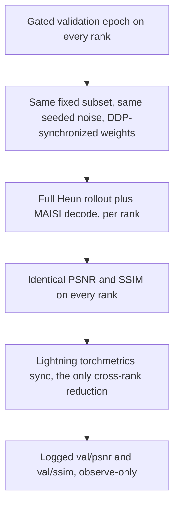

# Operations and testing

## Standard checks

```bash
pytest
ruff check .
```

For focused changes, start with the nearest tests:

| Area | Tests |
|---|---|
| Config and training orchestration | `tests/test_config.py`, `test_training_cli.py`, `test_controlnet_cli.py`, `test_training.py` |
| Data, warming, and split isolation | `tests/test_data.py`, `test_paired_latent_cache.py`, `test_paired_manifests.py`, `test_ddp_warm.py`, `test_controlnet_warm_defer.py` |
| Scheduler/module/pipeline behavior | `tests/test_scheduler.py`, `test_module_training.py`, `test_pipeline_inference.py`, `test_controlnet_module_training.py`, `test_controlnet_pipeline_inference.py` |
| FID and image metrics | `tests/test_fid.py`, `test_fid_helpers.py`, `test_paired_fidelity.py`, `test_metric_plot.py` |
| In-training paired-fidelity monitor | `tests/test_paired_fidelity_callback.py`, `tests/test_paired_fidelity_ddp.py`, plus the registry-side monitor tests in `tests/test_callback_registry.py` |
| Distributed validation | `tests/test_ddp.py`, `test_ddp_detection.py`, `test_ddp_metrics.py`, `test_ddp_val_honesty.py`, `test_controlnet_ddp_monitor.py` |
| Reward and policy learning | `tests/test_reward.py`, `test_reward_pairs.py`, `test_grpo.py`, `test_controlnet_module_training.py` |
| Callback registry and training spine | `tests/test_callback_registry.py` (resolve/build, monitor validation, the post-merge `forbidden_callbacks` / `forbidden_monitors` guards), `tests/test_controlnet_cli.py` (the supervised shell's default callback set) |
| Frozen-arm contract (register + dual-exclude) | `tests/test_frozen_arm_mixin.py`, `tests/test_controlnet_module_training.py::test_base_is_registered_but_dual_excluded` |
| Per-rank device policy (`DevicePolicy`, post-PG warm) | `tests/test_device_policy.py`, plus `test_ddp_warm.py::test_p1_*` |
| Persistence/export | `tests/test_persistence.py`, export assertions in training/reward/GRPO tests |
| Before/after eval and reporting | `tests/test_paired_fidelity.py`, `test_before_after_eval.py`, `test_eval_cli.py`, `test_comparison_page.py` |

`tests/ddp.py` is the multi-process helper/harness used by DDP tests. Run the focused distributed tests after changing rank gates, sampler assumptions, reduction code, validation callbacks, trainer device selection, checkpoint monitors, or the paired-fidelity monitor's cross-rank behavior.

The in-training monitor has its own focused surface:

```bash
pytest tests/test_paired_fidelity_callback.py tests/test_paired_fidelity_ddp.py -q
```

- `tests/test_paired_fidelity_callback.py` drives the callback's validation hook directly with a stub module, a toy VAE, and a tiny paired dataset, asserting only external behavior: the logged `val/psnr` / `val/ssim`, the cadence gate (no rollout, no decode, no log on an off-epoch), the reproducibility of a same-seed value, the stability of the fixed subset across epochs, the per-epoch metric reset, the `[0,1]` normalization and the PSNR/SSIM ceiling, the shape-mismatch error, and the observe-only contract (generation under `inference_mode`, only the two monitor keys logged).
- `tests/test_paired_fidelity_ddp.py` runs the two-rank harness in `tests/ddp.py` (`controlnet_paired_fidelity_ddp_worker`) and asserts the fit completes without a deadlock, that both ranks log the same finite `val/psnr` / `val/ssim`, that the **rank-local pre-sync** scores are identical too, and that the validation contract is unchanged (checkpoint monitor still `val/x0_mae`, `val/x0_mae` still finite, the `is_global_zero` split intact, a monitored checkpoint still written).
- `tests/test_callback_registry.py` carries the registry-side monitor tests: the spec builds the callback with its knobs, an unknown knob fails fast at resolve, `val/psnr` / `val/ssim` are accepted as *validatable* monitors, resolving the spec does **not** displace the checkpoint monitor from `val/x0_mae`, and the rollout step count is recipe-primary.

## Distributed validation contract

ADR-0025 supersedes ADR-0016. Current behavior is:

- **Latent-space x0-MAE (`val/x0_mae`):** every rank computes the cheap reconstruction-MAE on its `DistributedSampler` shard through `LatentX0MAE` (`src/manifold/training/metrics.py`), which attaches a `torchmetrics.MeanMetric` to the module (sample-weighted) so Lightning's DDP reduction produces the true global mean.
- **FID:** synthetic and real examples are rank-strided. Each plane reduces sufficient statistics `(sum_x, sum_xxT, n)`, reconstructs global moments, and computes unbiased FID without gathering feature matrices. Empty local shards contribute zero statistics; only the global count must be at least two.
- **GRPO reward:** every rank validates and scores its own shard, accumulating the reward sums and counts of the non-padding samples. At epoch end the module **all-reduces `(sum, count)` itself** and logs the exact global mean as `val/mean_reward` with `sync_dist=False` (`src/manifold/modules/grpo.py`). A second `sync_dist=True` log of the same value would double-reduce it. (ADR-0025 still words this reduction as `sync_dist=True`; the shipped module is the authority.)
- **Checkpoint monitors:** configured `val/fid`, `val/x0_mae`, and `val/mean_reward` monitors remain global under DDP.
- **In-training paired fidelity (`val/psnr` / `val/ssim`):** the observe-only monitor is **shipped and mounted by default** on the supervised ControlNet path (`manifold-train-controlnet`). It logs under Lightning's torchmetrics sync, never enters `monitor_metric` or the loss, and never touches the optimizer — checkpoint selection stays on `val/x0_mae`. See [In-training paired-fidelity monitor](#in-training-paired-fidelity-monitor-operational-contract).
- **Monitoring gap:** `manifold-train-grpo` does **not** register the monitor — its registry holds only `train_loss`, `fid`, and `checkpoint` — so the ControlNet-GRPO stage still reports only `val/mean_reward`, a fidelity-blind realism signal (ADR-0034). ADR-0037 treats the GRPO-stage extension as an open follow-up, not as shipped behavior.

Key implementations are `src/manifold/metrics/fid/`, `src/manifold/metrics/paired_callback.py`, `src/manifold/training/callbacks/paired_fidelity.py`, `src/manifold/modules/grpo.py`, and the training callback/CLI paths in `src/manifold/training/`.

Do not follow the stale checkpoint comments in `configs/train/config_rflow_jit.yaml` that still describe rank-0-only DDP metrics and unmonitored fallback, nor the equally stale comment in `configs/train/config_controlnet_supervised.yaml` that claims a DDP fallback to `save_last` with no monitor — the supervised shell always sets `monitor_metric: val/x0_mae` (mode `min`) and the metric is global under DDP. The `config_paired_jit.yaml` referenced in older docs no longer exists; the supervised paired translator is `configs/train/config_controlnet_supervised.yaml`. ADR-0025 and current callback/CLI code are authoritative.

## In-training paired-fidelity monitor (operational contract)

`manifold-train-controlnet` mounts the observe-only paired-fidelity monitor **by default**. It is the second generative validation callback next to `FIDCallback`, and it is the shipped answer to "is the ControlNet actually learning to translate?".

**Where it lives.** `PairedFidelityCallback` (`src/manifold/metrics/paired_callback.py`) does the work; `PairedFidelitySpec` (`src/manifold/training/callbacks/paired_fidelity.py`) is the registry spec; the supervised shell registers it under the registry name `paired_fidelity` and puts it in its default callback list `["train_loss", "checkpoint", "paired_fidelity"]` (`src/manifold/training/controlnet_cli.py`).

**What a gated epoch does.** The callback selects a fixed, seeded subset of paired subjects, runs the module's own full Heun ControlNet rollout under fixed noise, VAE-decodes the generated volume and the real target, min-max normalizes both to `[0,1]`, scores 3D PSNR/SSIM with the same `PairedFidelityMetrics` the offline before/after comparison uses, and logs `val/psnr` / `val/ssim` through module-attached `torchmetrics.MeanMetric`s. The subset is cached and the noise is re-seeded every gated epoch, so epoch-over-epoch movement reflects the model, not a moving sample.

**Knobs and precedence.** `subset_size` (8), `every_n_epochs` (1), `num_inference_steps` (`None` ⇒ recipe-primary), `seed` (0). The step count resolves *per-callback knob → `ctx.inference_recipe["num_inference_steps"]` → the callback default 15*; the supervised shell fills the recipe from the existing `controlnet.num_inference_steps` knob, so the in-training rollout step count stays the same knob the offline eval's `--num-inference-steps` mirrors. Note that the monitor's `every_n_epochs` is its own cadence gate — it is a `paired_fidelity` knob, not the `checkpoint.every_n_epochs` knob.

**How the knobs are set today.** The registry validates the knob set (an unknown knob raises `ValueError` at resolve), and `run_controlnet_training(callback_cfg=...)` merges a per-name knob map over the shell defaults. The shipped CLI, however, populates `callback_cfg` with the `checkpoint` block only, so from `manifold-train-controlnet` the only config-reachable monitor knob today is the rollout step count (`controlnet.num_inference_steps`); `subset_size`, `every_n_epochs`, and `seed` keep their spec defaults (8 / 1 / 0) unless a caller passes a `paired_fidelity` entry in `callback_cfg` or the shell is extended to read a `paired_fidelity` config block. Check the wiring before assuming a knob in a recipe is honored.

**Observe-only.** It never drives checkpoint selection, never enters the loss, never touches the optimizer or EMA, and writes no artifacts — training persists no volume, no slice grid, no image. `PairedFidelitySpec.logged_metrics` declares `val/psnr` / `val/ssim` only so `CallbackRegistry.validate_monitor` accepts them as *validatable* monitors; it is not a switch. The two scalars still show up in the training line chart because `build_trainer` always attaches the `MetricsPlotCallback`, which renders every logged metric into `metrics.png` under the model dir.

**DDP property: redundant, not sharded.** Every rank evaluates the **same** fixed subset under the **same** seeded noise on DDP-synchronized weights, so every rank produces the same number by construction. There is no subset sharding, no error-rendezvous machinery, and **no custom `all_reduce`** — the callback contains no `torch.distributed` call at all, and the only cross-rank interaction is Lightning's torchmetrics sync on the two module-attached `MeanMetric`s. That is why collective-count invariance holds trivially, and why the 2-rank gate asserts the rank-local pre-sync scores as well as the synced ones (a silent per-rank divergence would be masked by the sync).



*Figure: the monitor's redundant DDP evaluation — identical inputs on every rank make the per-rank score identical, so the metric sync is the only cross-rank interaction.*

**Operational cost — budget for it.** Every gated epoch pays, **per rank**: a full Heun rollout over the subset (at the default 15 steps that is 29 UNet evaluations — the final step is Euler-only because the corrector denominator vanishes at `t = 1`), a MAISI VAE decode of both the generated and the real target volume, and a `VaeStage` cycle that snapshots the frozen VAE on the host and moves it CPU→device for the decode and back afterwards (the supervised path deliberately parks the VAE on CPU after the paired warm to keep training VRAM free). The redundancy is multiplied by world size, not divided by it. On long runs, raise the monitor's `every_n_epochs` or lower its `subset_size` rather than paying that cost at every validation epoch — and remember that the cheapest lever reachable from the CLI today is the rollout step count.

**Monitoring gap.** `manifold-train-grpo` does not register the monitor, so the ControlNet-GRPO stage still reports only `val/mean_reward`. Extending the monitor there is ADR-0037's deliberate follow-up (it would require releasing the blanket `forbidden_callbacks={"fid"}` for this callback only, because FID's rationale — an unconditional rollout that ignores the ControlNet — does not cover paired fidelity), not a shipped capability.

**Turning it off.** `--callbacks` replaces the shell's default callback-name list wholesale (`--callbacks train_loss,checkpoint`), which drops the monitor and its `val/psnr` / `val/ssim` logs for the run.

## Before/after evaluation runbook

`manifold-eval` is the only eval console entry. It owns a fresh export of the after `.ckpt`, two clean native reloads, deterministic generation, and the eval artifacts. The implementation and artifact schema are the canonical reference in [Before/after GRPO evaluation](evaluation.md#outputs-and-metric-semantics).

For a quick shipped-surface check, confirm that the installed entry point exposes the contract before starting a full run:

```bash
manifold-eval --help
```

Then use the [workflow examples](workflows.md#beforeafter-evaluation). The key runbook constraints are:

- `--before-dir` must be a native directory with a self-describing `model_index.json`; a model-dir or a missing `pipeline_class` fails before export. Never pass an arbitrary directory merely because it contains weights.
- `--after-ckpt` is processed through the standard full-state export bridge. The command writes the derived native tree to `<output>/after_native`; it does not overwrite the before export or return a NIfTI file.
- `--seed`, `--num-inference-steps`, shape/conditioning, and the VAE/scheduler are the pairing contract. Hold them fixed when comparing checkpoints; changing them makes before/after noise or trajectory differences ambiguous.
- ControlNet requires a nonempty held-out split and a warmed cache under the geometry-suffixed cache tag. Match the cache's target geometry and `vae.scaling_factor`; eval reads the scaling factor from the before export and never re-estimates it.
- The report and slice-grid renderer imports Matplotlib lazily on the headless `Agg` backend, but a missing or broken rendering dependency fails the run instead of silently dropping visuals.
- A JiT run records provenance in `metrics.json` but intentionally has no `before.psnr` or `before.ssim`. Those full-reference fields are valid only for ControlNet; the unconditional comparison uses same-noise grids and training FID/reward history.

Focused validation for any metric, driver, CLI, or report change:

```bash
pytest tests/test_paired_fidelity.py tests/test_before_after_eval.py tests/test_eval_cli.py tests/test_comparison_page.py -q
```

and, when the in-training monitor or its cross-rank behavior is touched:

```bash
pytest tests/test_paired_fidelity_callback.py tests/test_paired_fidelity_ddp.py -q
```

The in-training curve and the offline number are only comparable because both use the same metric, the same per-volume `min_max_to_unit` normalization, and the same full-rollout generation. A change to the normalization, the metric's data range, or the rollout step count must land in the eval driver, the pipeline, and the monitor together — otherwise the two numbers silently stop agreeing.

Conditional integration check: if a `pyproject.toml` console entry, package barrel, hatch artifact, or installed `manifold-eval` import path changes, build/install the wheel and run the CLI `main(argv)` smoke rather than relying only on the internal tests. This repository has no generated publish mirror or second eval entry point; the hatch package mirror is derived from `pyproject.toml`.

## Distributed validation runbook

The all-rank policy reverses a rank-0 workaround for a reproducible 8-DCU/DTK stall during concurrent full-volume MAISI VAE decode. NVIDIA 8-GPU and single-DCU runs were reported healthy, but ADR-0025 explicitly marks the sugon verification as pending.

Before relying on multi-DCU best-by-metric selection, run one validation epoch on all eight ranks with a small subset, following the ADR's probe parameters:

```text
--max-epochs 1 check_val_every_n_epoch=1 val_subset_size=4
```

Profile all ranks through the validation epoch and confirm that every rank exits decode and logs the same global metric. The VAE network config currently uses `num_splits: 4`, `dim_split: 1`, and `save_mem: true`, but this configuration was already present during the original stall; do not claim it is a proven fix.

Budget the probe for the decode work it triggers: on the supervised ControlNet recipe the paired-fidelity monitor adds a full-volume MAISI decode per rank per gated epoch through the same `LatentDecoder` the FID callback uses, and that work is redundant across ranks, so the concurrent decode pressure scales with world size. Either raise the monitor's `every_n_epochs` for the probe or account for the extra decode when reading the result — and do not treat a monitor-induced slowdown as the ADR-0025 deadlock without the load-bearing signals below.

If the probe hangs, ADR-0025's fallback order is:

1. Serialize GPU decode across ranks while retaining global reduction.
2. Move decode to CPU (`sw_device='cpu'`).

The metric contract stays global; only the decode strategy should change. A return to rank-0-only metrics would again make checkpoint selection shard-biased.

## Diagnosing deadlock vs. slow validation

ADR-0025 includes diagnostic guidance for distinguishing the DCU deadlock from slow validation. The symptom triad "processes `Sl` (sleeping) + log mtime stalled + no tqdm output" is a false positive — it also describes healthy, fully-loaded validation under 8-DDP.

Before diagnosing a deadlock, use load-bearing signals:

- `hy-smi` (after `source /opt/dtk/env.sh`): DCU% near 0 with no progress = stalled; DCU% ~100% = computing (slow, not deadlocked).
- `SIGTERM` response: the 2026-07-14 stall ignored `SIGTERM` (required `SIGKILL`); a merely-slow validation terminates on `SIGTERM`.
- `py-spy` on all ranks: identical frozen frame in `sliding_window_inference -> _conv_forward` = deadlock.

The "Sl + log stalled" triad alone is insufficient; do not act on it without confirming one of the above signals.

## DDP failure modes to guard

- Every rank must enter collectives in the same order. FID synchronizes feature-network disablement before entering moment reductions so a rank-local load failure cannot strand other ranks.
- Empty FID shards must not be sent through MAISI decode; they contribute correctly sized zero sufficient statistics.
- A one-sample local shard is valid and must contribute its first/second-order sums; covariance validity is checked only after global reduction.
- Do not combine manual `all_reduce` with `sync_dist=True` for the same value.
- Preserve rank-strided FID seeds (`seed + global_index`) so the distributed sample union matches the requested global sample count rather than multiplying it by world size.
- Keep the paired-fidelity monitor redundant, not sharded. Do not shard the fixed subset across ranks, do not add a custom `all_reduce` to it, and do not make its work rank-asymmetric: every rank evaluates the same subset under the same seeded noise, so the per-rank scores are expected to be identical (the 2-rank gate asserts the rank-local, pre-sync scores for exactly this reason).

These cases are covered principally by `tests/test_fid.py`, `test_ddp_metrics.py`, `test_ddp_val_honesty.py`, and `tests/test_paired_fidelity_ddp.py`.

## Validation and checkpoint cautions

- Noise-to-data production validation (`manifold-train`) is disabled unless a held-out source is wired; the code refuses train-as-validation leakage, and validation is then disabled at the Trainer (`limit_val_batches=0`). In that case checkpointing falls back to periodic/last rather than monitored FID.
- ControlNet-supervised validation (`manifold-train-controlnet`) needs a real held-out split: either `env.val_data_base_dir` pointing at a BraTS **directory** (a manifest JSON is ignored with a warning and the subject split is used instead) or a positive subject-level `val_fraction` (the recipe default is `0.2`). `val_fraction = 0` yields an empty val manifest and the CLI then refuses to start (`train data is never reused as val`) — it does **not** silently fall back to train-as-validation. The shared splitter lives in `src/manifold/data/paired_manifests.py`.
- FID callbacks, the paired-fidelity monitor, and `BeforeAfterEval` decode in float32 with MAISI `norm_float16` disabled. Before/after evaluation then applies the same per-volume `min_max_to_unit` convention as the ControlNet pipeline and scores PSNR/SSIM with `data_range=1.0`.
- The in-training paired-fidelity monitor adds a per-rank generative validation cost (full Heun rollout + MAISI decode per gated epoch) and re-stages the VAE on the device for that decode. On long supervised runs, raise its `every_n_epochs` or lower its `subset_size`; and keep in mind that the supervised path deliberately parks the VAE on CPU after the paired warm, so the monitor's staging is the only thing that puts it back on the GPU during training.
- Current metrics and native exports use raw optimizer weights. Remove references to EMA arms from automation and dashboards.
- Export uses full-state deserialization; only process checkpoints produced by a trusted run.

## Diagnostics

The `scripts/` directory was eliminated in ADR-0033; the helper scripts that used to live there (`scripts/eval_paired_step_sweep.py`, `scripts/diag_brain_mask_psnr.py`, etc.) are not part of this tree. The retained investigation tool is `tests/parity/validate_against_hope.py`, a sampler-parity probe kept as a `<1e-3` proof (ADR-0005) that the modules-side sampler and the inference pipeline roll out the same trajectory. Read its arguments and assumptions before using it against a new dataset or checkpoint.
