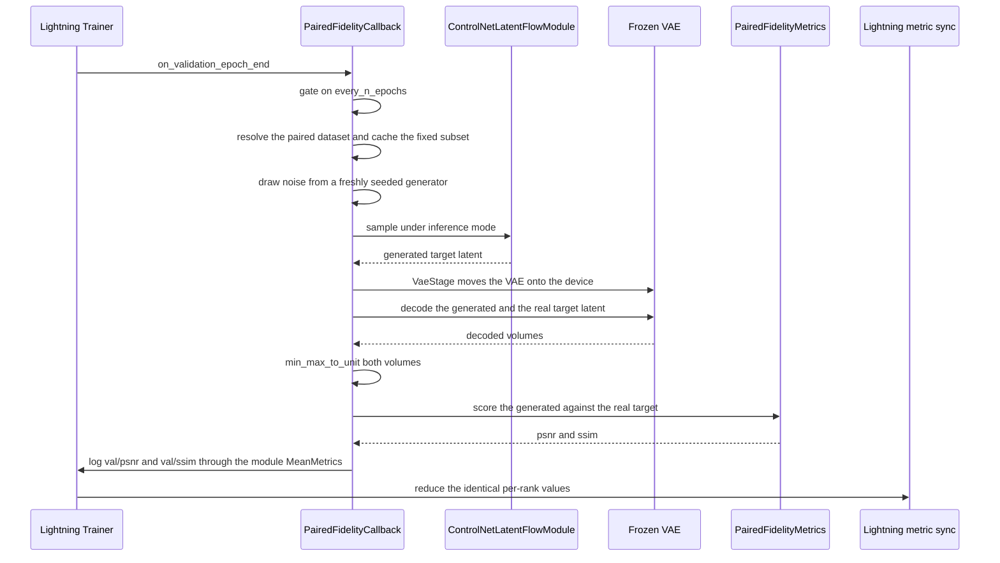
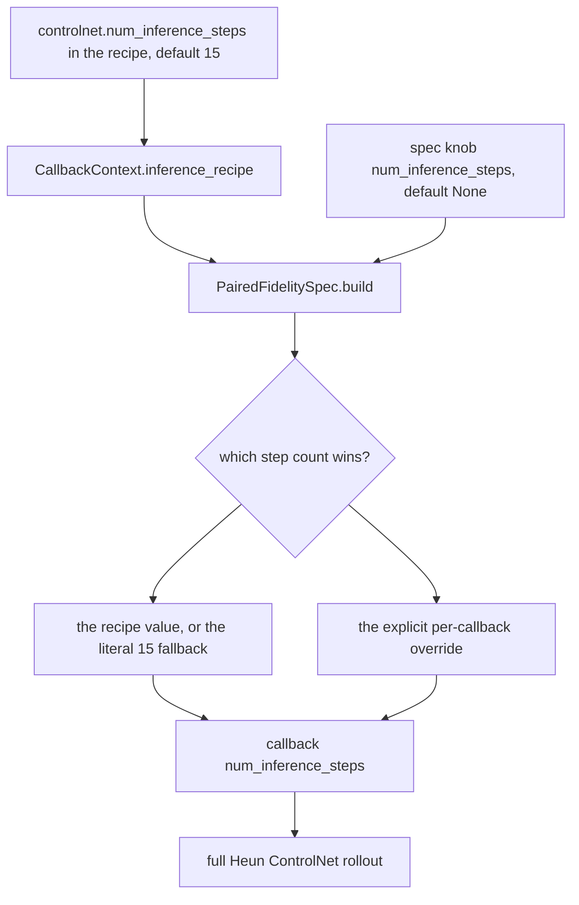
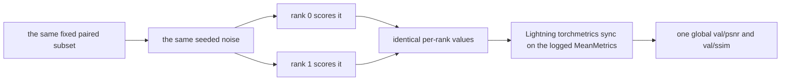

# In-training paired-fidelity monitor

The in-training paired-fidelity monitor is **implemented and shipped** on the
supervised ControlNet path (ADR-0037, issues #238/#239). It is two objects:

| Object | Path | Role |
|---|---|---|
| `PairedFidelityCallback` | `src/manifold/metrics/paired_callback.py` | The Lightning callback: on each gated validation epoch it rolls a fixed paired subset under fixed seeded noise through the module's own Heun rollout, VAE-decodes the generated and the real target, scores them, and logs `val/psnr` / `val/ssim`. |
| `PairedFidelitySpec` | `src/manifold/training/callbacks/paired_fidelity.py` | The registry spec: the four config knobs plus `build(ctx)`, which injects the runtime objects (`module` / `vae` / `datamodule`) from the `CallbackContext`. |

It is mounted exactly like `FIDSpec` on the `CallbackRegistry`, it is **on by
default** for `manifold-train-controlnet`, and it is **observe-only**: it never
selects a checkpoint, never enters the loss, and never touches the optimizer or
an EMA arm. It is the per-epoch drift screen that complements - and does not
replace - the offline before/after comparison of record (ADR-0036).

Related pages: the registry-side wiring is on
[Callback registry and training spine](callback-registry.md); the offline
comparison and its shared metric contract are on
[Before/after GRPO evaluation](evaluation.md); the device story is on
[Frozen arms and per-rank device policy](frozen-arm-and-device-policy.md); the
distributed-validation contract is on
[Operations and testing](operations-and-testing.md).

## Where it is mounted

`run_controlnet_training` registers the spec under the name `paired_fidelity`
and passes `default_names=["train_loss", "checkpoint", "paired_fidelity"]`, so
every supervised ControlNet run carries the monitor unless the name list is
explicitly replaced (`src/manifold/training/controlnet_cli.py`). The same shell
pins the checkpoint spec's `monitor_metric` to `val/x0_mae` - the monitor is
**not** that metric.

Only the supervised shell registers the spec. `src/manifold/training/grpo_cli.py`
registers `train_loss`, `fid`, and `checkpoint` only, so the GRPO stage does not
run the monitor; see [Scope boundary](#scope-boundary-and-extension-points).

## Runtime flow



*Figure: the monitor reuses the module's own rollout and the shared decode → min-max → MONAI metric path, then logs two scalars that never drive checkpoint selection.*

Step by step, in `PairedFidelityCallback.on_validation_epoch_end`:

1. **Gate.** `_gated(trainer)` is the only gate: it returns true when
   `every_n_epochs <= 1` or `current_epoch % every_n_epochs == 0`. `current_epoch`
   is 0-based, so with `every_n_epochs=2` the monitor runs on epochs 0, 2, 4, …
   On an off-epoch the hook returns immediately: no generation, no decode, no log.
2. **Fixed subset.** `_fixed_subset()` resolves the paired dataset and selects a
   seeded `randperm` prefix of `subset_size` (capped at the dataset length),
   collates it with `default_collate`, and **caches** the result. The cached
   batch carries `src_latent` / `tgt_latent` `[N, C, D, H, W]`, `src_label` /
   `tgt_label` `[N]`, and `spacing` `[N, 3]`.
3. **Seeded noise.** A fresh `torch.Generator` seeded with the callback's `seed`
   draws the start noise on the module's device, with the base UNet's dtype and
   the shape of the real target latent. The generator is re-created on every
   gated epoch, so the noise is identical across epochs and across ranks.
4. **Generation.** `ControlNetLatentFlowModule.sample(...)` runs the shared
   `controlnet_rollout` primitive - the same Heun noise→data rollout the
   inference Pipeline delegates to (ADR-0005) - under `torch.inference_mode()`.
5. **Decode.** Inside `VaeStage(self._vae, device_fn=self._device)`, the VAE is
   moved onto the device, put in `eval()`, and used through `LatentDecoder` to
   decode the generated latent and the real target latent; the stage restores
   the VAE to CPU on exit.
6. **Normalize.** Both decoded volumes go through `min_max_to_unit`, the
   Pipeline's per-volume `[0, 1]` convention.
7. **Score.** `PairedFidelityMetrics` returns the batch-mean 3D PSNR and 3D
   SSIM.
8. **Log.** The two module-attached `torchmetrics.MeanMetric` instances are
   reset, updated with the two scalars, and logged as `val/psnr` / `val/ssim`.

## The fixed subset and the fixed noise

**The paired dataset is resolved lazily.** `PairedFidelitySpec.build` forwards
`ctx.datamodule` as the paired-subset source, and the callback resolves the
actual dataset at the **first gated epoch** with
`getattr(datamodule, "val_latent_ds", datamodule)`. That laziness is load-bearing
on the cold path: `PairedWarmDataModule.setup()` runs the paired latent-cache
warm *after* the process group exists and replaces `val_latent_ds` there, so a
dataset captured at build time would be the un-warmed placeholder. The
warm/parity-path datamodule exposes the same `val_latent_ds` accessor, so both
paths resolve identically (ADR-0017 / F5).

The monitor implements the fixed-sample-validation ethos: the **same** paired
subjects are scored every monitored epoch, and the **same** initial noise is
redrawn every monitored epoch, so an epoch-over-epoch change reflects the model,
not sampling stochasticity or a moving data sample.

Two independent seeds are involved, both from the callback's single `seed` knob:

- The subset comes from `torch.randperm(len(ds), generator=torch.Generator().manual_seed(seed))`
  - a CPU generator, so every rank picks the same indices.
- The noise comes from `torch.Generator(device=device).manual_seed(seed)` - the
  same seed value on the same device type, so every rank draws the same noise.

The subset is materialized once and cached (`self._subset`), so the collated
batch is not re-selected (and re-shuffled) per epoch.

## Knob contract

The knobs are dataclass fields on `PairedFidelitySpec`; `CallbackRegistry.resolve`
validates names and knobs fail-fast (unknown name → `KeyError`, unknown knob →
`ValueError`) before any callback is constructed.

| Knob | Default | Meaning |
|---|---|---|
| `subset_size` | `8` | Number of fixed paired subjects scored per monitored epoch. Capped at the dataset length. |
| `every_n_epochs` | `1` | Cadence gate; `1` means every validation epoch. |
| `num_inference_steps` | `None` | Heun integration steps for the rollout. `None` ⇒ take the value from the inference recipe (see below). |
| `seed` | `0` | The subset-selection and generation-noise seed. |

`logged_metrics` is declared as a `ClassVar`, so it is **not** a config knob and
does not enter `resolve`'s knob allow-list.

The rollout step count is **recipe-primary**:



*Figure: the supervised spine fills the inference recipe from the existing `controlnet.num_inference_steps` knob; an explicit per-callback value overrides it.*

`run_controlnet_training` fills `CallbackContext.inference_recipe` with
`{"num_inference_steps": int(num_inference_steps)}`, sourced from the recipe's
`controlnet.num_inference_steps` (default `15` in
`configs/train/config_controlnet_supervised.yaml`). `PairedFidelitySpec.build`
reads that key and falls back to the literal `15` when a recipe-less context is
handed in - the same default the callback itself carries. The recipe therefore
reaches the callback without the knob being duplicated in two places.

At 15 Heun steps the rollout performs **29 x0 evaluations** (15 Euler predictors
plus 14 Heun correctors; the last step is Euler because the corrector
denominator `1 - t_next` vanishes at `t = 1`). Each evaluation runs the
ControlNet residual injection and then the frozen base UNet.

## Device read and VAE staging

`PairedFidelityCallback._device()` reads the device from the **frozen base
UNet**: `next(self._module.unet.parameters()).device`. That read is correct
only because the frozen arm is a *registered* submodule: `FrozenArmMixin`
registers the base UNet as a normal `nn.Module` child, so Lightning's automatic
`.to(device)` has already placed it on this rank's GPU and the monitor inherits
the placement instead of guessing (ADR-0031). See
[Frozen arms and per-rank device policy](frozen-arm-and-device-policy.md#cross-link-the-paired-fidelity-monitors-device-read).

The VAE itself lives on CPU between epochs (the cold warm path parks it there to
keep VRAM for the UNet). `VaeStage` is the single VAE-only stage/restore
implementation - it snapshots the CPU state, moves the VAE onto the device for
the decode, and restores it to CPU on exit, including when the move itself
fails. `LatentDecoder` decodes in float32 (it disables MONAI MAISI's
`norm_float16` on first use), because a half-precision decode raises a
bias-type mismatch in a validation hook.

## Scoring and logging

`PairedFidelityMetrics` composes MONAI's `PSNRMetric(max_val=1.0)` and
`SSIMMetric(spatial_dims=3, data_range=1.0)` and batch-means their per-sample
outputs. PSNR is `+inf` on identical volumes and SSIM is `1.0`; that ceiling is
surfaced honestly rather than clamped. A generated/real shape mismatch raises a
`ValueError` before MONAI sees the pair.

The two scalars are logged through `torchmetrics.MeanMetric` instances that are
**attached to the module** under the private names `_manifold_val_psnr_mean` /
`_manifold_val_ssim_mean` (the same mechanism `LatentX0MAE` uses): Lightning
scans `named_modules()` for `Metric` subclasses, so a callback-held metric
would not be registered or restored. The metrics are moved to the module's
device and are `reset()` before each update, so the logged value is the current
epoch's value and not a running mean across epochs.

The callback also accepts an injectable `fidelity` scorer, which is the seam the
unit tests use to substitute a tiny or recording scorer.

## Observe-only guarantees

- The spec and the callback both declare
  `logged_metrics = {"val/psnr", "val/ssim"}`, so
  `CallbackRegistry.validate_monitor` accepts them as *validatable* monitors -
  a future opt-in is possible without changing the registry.
- The shipped checkpoint spec's `monitor_metric` is `val/x0_mae`, and the
  callback itself never drives checkpoint selection: it logs two scalars and
  nothing else. The `logged_metrics` declaration is what makes the metrics
  *eligible* - a recipe that explicitly opted in
  (`checkpoint.monitor_metric: val/psnr`) would validate - but the shipped
  supervised recipe does not do that.
- The monitor never enters the loss, never touches the optimizer, and never
  touches an EMA arm. (The supervised ControlNet Module runs no EMA at all -
  the raw optimizer arm is what is validated, selected, and exported.)
- Generation runs under `torch.inference_mode()`, and the rollout primitive
  itself integrates with `grad="inference"`, so no gradient is ever formed. The
  callback logs exactly two keys.

## DDP design: redundant evaluation

ADR-0025 removed the rank-0-only gates from validation, and this monitor keeps
the "no rank-0 gate" rule - but it does **not** shard the work the way FID
does:

- **Every rank scores the same fixed subset.** DDP-synchronized weights plus
  the identical fixed input plus the identical seeded noise imply an identical
  result on every rank, so the per-rank values are the same number.
- **The only cross-rank interaction is Lightning's torchmetrics sync** on the
  two logged `MeanMetric`s. There is no FID-style sufficient-statistics
  reduction, no feature gather, and no error-rendezvous machinery.
- **The cadence gate is rank-symmetric.** `current_epoch` and `every_n_epochs`
  are the same on every rank, so all ranks enter the monitor's work - and
  therefore the metric-sync collective - in the same epochs and the same order.
  Collective-count invariance (ADR-0030) therefore holds trivially.
- **No error rendezvous.** ADR-0037 rejected the FID-style sharding and
  error-rendezvous machinery outright: because every rank runs the identical
  work on identical inputs, there is nothing to agree on before a reduction. The
  callback contains no `all_reduce` and no error flag - the only collective it
  reaches is the one Lightning's metric sync performs on the logged values.

The cost is redundant compute: `world_size` times the same rollout and decode.
ADR-0037 accepted that at the small fixed subset size and recorded "revisit only
if the subset grows".



*Figure: redundant evaluation - every rank computes the same number, so the metric sync is a formality rather than a sharded reduction.*

The 2-rank DDP test asserts this empirically: the fit completes without a hang,
both ranks log the same finite `val/psnr` / `val/ssim`, the **rank-local
pre-sync** scores match across ranks (the metric sync's averaging would
otherwise mask a silent per-rank divergence), and the validation contract is
untouched (the checkpoint still monitors `val/x0_mae`, `val/x0_mae` is finite,
the monitored checkpoint is still written, and the `is_global_zero` split is
intact).

## Comparability contract with the offline eval

The monitor and the offline `manifold-eval` before/after comparison share
exactly three things, and all three must hold for the numbers to be comparable:

1. **The same metric** - `PairedFidelityMetrics` (MONAI 3D PSNR + 3D SSIM over
   `[0, 1]` volumes, batch-mean).
2. **The same normalization** - `min_max_to_unit` per volume, so
   `data_range = 1.0`.
3. **The same full rollout** - the full Heun `controlnet_rollout`, not a
   single-step x0-decode proxy. The Module's `sample()` and the inference
   Pipeline's `sample_latent()` both delegate to that one primitive, and the
   offline eval drives the Pipeline, so all three paths integrate the same
   trajectory. ADR-0037 explicitly rejected the cheap single-step proxy: it
   measures one-step denoising reconstruction rather than the deployed
   translation, and exposure bias can look healthy while the rollout does not.

Because of that, the in-training `val/psnr` / `val/ssim` curve is directly
comparable to the offline number. Changing any one of the three is a
**cross-component change**: it touches the Pipeline's decode path, the offline
eval driver, and this callback together. A normalization or data-range change
alone is enough to make the in-training curve and the offline number diverge
silently.

The offline pass remains the apples-to-apples before/after pairing of record;
the monitor is a complementary per-epoch drift screen.

## Scope boundary and extension points

- **The GRPO stage is a deliberate separate follow-up.** ADR-0037 scoped the
  monitor to the supervised ControlNet stage and deferred the ControlNet-GRPO
  extension to its own ticket/ADR. The FID ban on the GRPO ControlNet path does
  not cover paired fidelity (an unconditional FID rollout ignores the
  ControlNet, while the paired rollout uses it), so extending the monitor there
  means registering `PairedFidelitySpec` on the GRPO shell, supplying a paired
  validation subset source and a rollout step count (the GRPO
  `CallbackContext.inference_recipe` is `None` when FID is off), and deciding
  how the VAE is staged for the decode on that path.
- **The metric seam is injectable.** `PairedFidelityCallback(fidelity=...)`
  accepts a substitute scorer; the default is `PairedFidelityMetrics()`.
- **The rollout primitive is shared, not forked.** The monitor calls the
  Module's `sample()`, which delegates to `controlnet_rollout` - the same
  primitive the inference Pipeline and the GRPO suffix use. A change to the
  rollout changes the monitor's numbers too, by design.
- **Changing the step count changes the metric's meaning.** The offline
  comparison holds `--num-inference-steps` fixed as part of its pairing
  contract; the in-training monitor reads the same recipe knob, so the two stay
  comparable as long as the knob is not changed on one side only.

## Invariants and failure modes

- **The subset is fixed and the noise is re-seeded.** A drifting subset or a
  persisted/advanced generator would make epoch-over-epoch changes
  uninterpretable; the callback creates a fresh generator each gated epoch.
- **The metric is reset per epoch.** Without the reset the logged value would be
  an accumulation, and a steadily improving model would look flat.
- **The VAE returns to CPU.** `VaeStage` restores the VAE even when the move
  fails mid-way; the monitor never leaves the VAE resident on the training GPU
  between epochs.
- **A shape mismatch fails loudly.** `PairedFidelityMetrics` raises
  `ValueError` ("matching shapes") instead of letting MONAI score mismatched
  tensors - a pairing bug must not pass silently.
- **PSNR can be `+inf`.** Identical volumes give infinite PSNR; that ceiling is
  surfaced honestly. Note that the metrics line-chart callback plots only finite
  values, so an `+inf` epoch is skipped by the plot rather than collapsing its
  axis.
- **The rollout puts both arms in `eval()`** for the generation
  (`controlnet_rollout` calls `unet.eval()` and `controlnet.eval()`). No
  parameter is mutated by the monitor; the frozen base stays in `eval()` by the
  frozen-arm contract regardless.

## Focused tests and minimal validation

| Behavior | Test anchor |
|---|---|
| Wiring: the two metrics are logged on the fixed subset through the real metric; the `every_n_epochs` gate skips generation, decode, and logging on an off-epoch; the same seed reproduces the value across epochs; the fixed subset is stable across epochs; the metric resets per epoch; identical volumes give the `+inf` / `1.0` ceiling on `[0, 1]` volumes; a shape mismatch surfaces the metric's error; generation runs under `inference_mode` and only the two monitor keys are logged | `tests/test_paired_fidelity_callback.py` |
| DDP: no deadlock, identical finite `val/psnr` / `val/ssim` on both ranks, identical rank-local pre-sync scores, and an untouched validation contract (checkpoint still monitors `val/x0_mae`, monitored checkpoint written, `is_global_zero` split intact) | `tests/test_paired_fidelity_ddp.py`, worker `controlnet_paired_fidelity_ddp_worker` in `tests/ddp.py` |
| The metric itself: identity ceiling, the `10·log10(max_val²/MSE)` PSNR definition, perturbation monotonicity, 3D input, and shape rejection | `tests/test_paired_fidelity.py` |
| The spec: knob threading, fail-fast on an unknown knob, the `logged_metrics` declaration, `validate_monitor` accepting `val/psnr` / `val/ssim`, the checkpoint monitor staying on `val/x0_mae`, and the recipe-primary step count (recipe value, explicit override, and the `15` fallback) | `tests/test_callback_registry.py` |
| The shell: the monitor is registered and on by default, an end-to-end fit records finite `val/psnr` / `val/ssim` while the checkpoint monitor stays `val/x0_mae`, and `main` threads `controlnet.num_inference_steps` into the recipe | `tests/test_controlnet_cli.py` |

```bash
pytest tests/test_paired_fidelity_callback.py tests/test_paired_fidelity_ddp.py -q
```

Add `tests/test_paired_fidelity.py` when the metric contract itself changes, and
`tests/test_callback_registry.py` / `tests/test_controlnet_cli.py` when the spec or
the shell wiring changes:

```bash
pytest tests/test_paired_fidelity.py tests/test_paired_fidelity_callback.py tests/test_paired_fidelity_ddp.py -q
```

For the registry-side extension recipe (adding a callback, renaming a knob,
changing the monitor contract), see
[Callback registry and training spine](callback-registry.md#change-guidance).

## Source map

- Callback: `src/manifold/metrics/paired_callback.py`
- Registry spec: `src/manifold/training/callbacks/paired_fidelity.py`
- Barrel exports: `src/manifold/metrics/__init__.py`, `src/manifold/training/callbacks/__init__.py`
- Metric: `src/manifold/metrics/paired.py`
- Shared decode helpers: `src/manifold/metrics/vae_stage.py`, `src/manifold/metrics/fid/decoder.py`, `src/manifold/pipelines/pipeline_utils.py`
- Metrics line chart (finite-values-only plotting): `src/manifold/metrics/metric_plot_callback.py`
- Rollout: `src/manifold/modules/controlnet_latent_flow.py`, `src/manifold/modules/controlnet_sampler.py`, `src/manifold/schedulers/scheduling_flow_match_heun.py`
- Shell wiring: `src/manifold/training/controlnet_cli.py`, `src/manifold/training/core.py`, `src/manifold/training/callbacks/{registry,context}.py`
- Frozen arm / device: `src/manifold/modules/frozen_arm.py`
- Paired validation dataset (lazy `val_latent_ds`): `src/manifold/data/warm_datamodule.py`, `src/manifold/data/datamodule.py`
- Offline counterpart: `src/manifold/eval/before_after.py`, `src/manifold/eval/cli.py`
- Tests: `tests/test_paired_fidelity_callback.py`, `tests/test_paired_fidelity_ddp.py`, `tests/test_paired_fidelity.py`, `tests/test_callback_registry.py`, `tests/test_controlnet_cli.py`, `tests/ddp.py`
- Decision records: `docs/adr/0037-controlnet-fidelity-in-training-monitor.md`,
  `docs/adr/0036-controlnet-fidelity-offline-3d-psnr-ssim.md`,
  `docs/adr/0025-all-ddp-validation-no-rank0-gate.md`,
  `docs/adr/0030-fid-callback-split.md`,
  `docs/adr/0017-latent-warmup-in-datamodule-setup.md`
